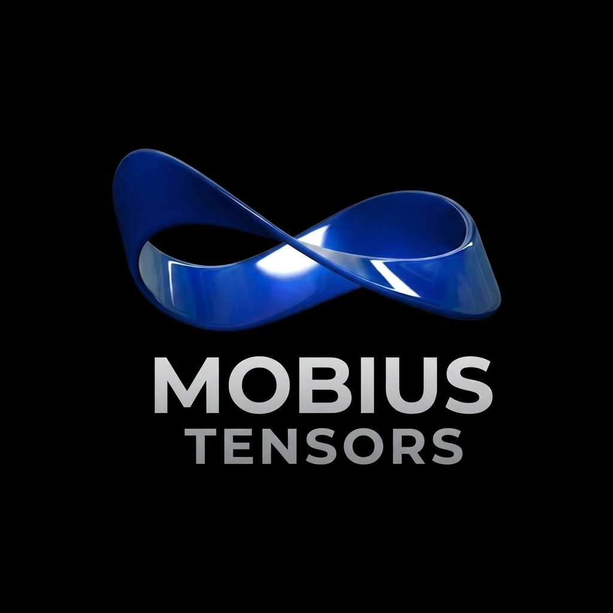

<div align="center">



# Mobius Tensors

One reusable AI solution platform, configured per use case.

</div>

## Projects

| Project | Description |
| --- | --- |
| [object-detection](projects/object-detection/) | CPU-only object detection (YOLOX → ONNX Runtime) |
| [argus](projects/argus/) | Record everything cameras see as embeddings, then ask about it (reuses object-detection) |
| [agents](projects/agents/) | Not started |
| [agent-deployment](projects/agent-deployment/) | Installing and managing AI agents (Claude Code, Cowork, Codex, …) on the customer side |

The website lives in its own repo, next to this one: `../mobius-website`.

## Docs

Company-wide, in [docs/mobius-tensors](docs/mobius-tensors/):

- [Mobius Tensors — AI Solution Platform](docs/mobius-tensors/Mobius%20Tensors%20—%20AI%20Solution%20Platform.md): company, use cases and ideas, architecture, roadmap and build plan, risks, glossary
- [Site Installation Guide — IP Cameras, PoE Switch and Server](docs/mobius-tensors/Site%20Installation%20Guide%20—%20IP%20Cameras,%20PoE%20Switch%20and%20Server.md): hands-on install steps for a client site

Per project, in `docs/<project>/`:

- [argus](docs/argus/): documentation (product, technical, model research; .md + .pdf), partner programme and presentation (.pptx)

## Layout

```
mobius-tensors/
├── docs/
│   ├── mobius-tensors/   company, architecture, roadmap and installation docs
│   └── <project>/        one folder per project (descriptions, presentations)
├── Images/      logo, banner and brand kit (Mobius Tensors in brand-kit/, Argus in argus/)
└── projects/    one folder per product, each with its own uv environment
```

## Development

Open `mobius-tensors.code-workspace` in VS Code so each project uses its own `.venv`.
To add a project, create it under `projects/`, run `uv sync` in it, and add it to the workspace file.
