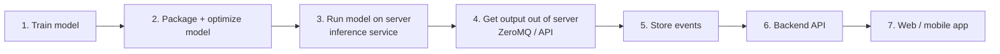
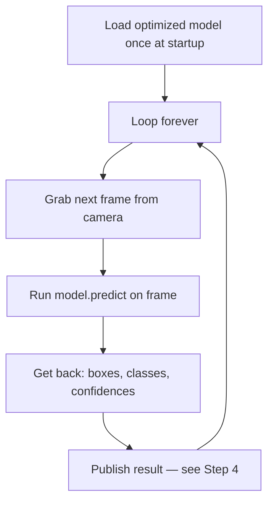
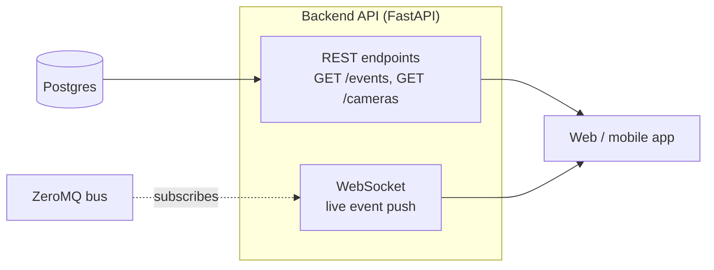
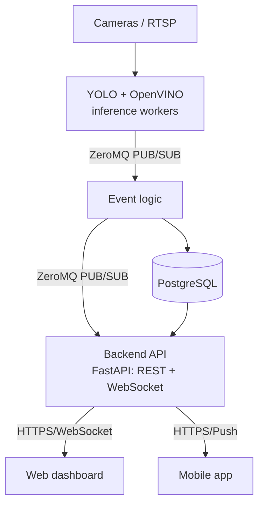

# Implementation Plan — From Trained Model to App

2026-09-21 · @Someone

This is the practical, step-by-step answer to: *"I train a model — then what? How does it get onto a server? How do I get output from the server? How does that reach a web/mobile app?"*

It's written assuming no prior background in serving ML models. Every unfamiliar term (ZeroMQ, OpenVINO, etc.) is explained where it first appears.

## 1. Train the model

You train a YOLO model (e.g. with Ultralytics' `yolo train` command) on your dataset (fire, guns, plates, etc.). The output is a **weights file** — a single file (e.g. `best.pt`) containing everything the model learned. This is the artifact everything downstream depends on.

**Where this happens:** your own machine or a cloud GPU (e.g. Google Colab, a rented GPU box) — not the production server. Training is a one-time (or periodic, when you improve the model) offline step. It is completely separate from "running" the model live on camera feeds.

## 2. Package / optimize the model for serving

A freshly trained `.pt` file works, but it's not optimized for real-time, always-on inference on a server (especially a CPU-only one). This is where **OpenVINO** comes in.

- **What OpenVINO is:** a free toolkit from Intel that takes a trained model and converts + optimizes it to run fast on CPUs (and Intel GPUs/VPUs). You export your YOLO model once (`yolo export format=openvino`), and get an optimized version that runs noticeably faster than the raw PyTorch model on a normal server CPU.
- **Why it matters for you:** your platform's design goal is "commodity servers, no GPU required to start." OpenVINO is what makes that realistic — without it, CPU inference is often too slow for real-time video.
- **Alternative/complementary options** (for later, not needed now): ONNX Runtime (similar idea, more hardware-agnostic), TensorRT (if you later add NVIDIA GPUs — much faster but GPU-only).

**Output of this step:** an optimized model file sitting in a folder on the server, ready to be loaded by a running program.

## 3. Run the model on the server (the "inference service")

This is the part that's easy to skip over mentally: *someone has to write a small, always-running program that loads the model once and keeps feeding it frames.*

Concretely, one Python process per camera-or-model does, in a loop:

This program is a normal long-running process (like a web server), started with something like `systemd`, `pm2`, or inside a Docker container, and restarted automatically if it crashes. There is one of these per use case/model (fire worker, gun worker, plate worker, etc.), potentially several if you have many cameras.

**This is "the server" in practice:** a Linux box (cloud VM or on-prem) running several of these small Python processes side by side, plus the pieces below.

## 4. Get output out of the server (ZeroMQ)

Each inference process above produces detections many times per second. **ZeroMQ (ZMQ)** is the piece that moves that data from "inside the inference loop" to "everywhere else that needs it" — without you having to write networking code by hand.

- **What ZeroMQ actually is, concretely:** a small library (`pip install pyzmq`) that gives you a `socket.send(data)` / `socket.recv()` API — but the "socket" can fan out to many listeners, load-balance across workers, etc., depending on the pattern you pick. There is no separate server process to install (unlike Kafka/RabbitMQ) — it's just a library each of your Python scripts imports.
- **The pattern you'll use most:** PUB/SUB. The inference worker `PUB`lishes every detection event (as a small JSON message: `{"camera": "cam1", "class": "fire", "confidence": 0.87, "ts": ...}`). Any other process — the event-logic service, a logging service, a debug tool — can `SUB`scribe and receive a copy, without the publisher knowing or caring who's listening.
- **What happens after ZMQ:** a small "event logic" process subscribes to raw detections, applies your business rules (e.g. "only alert if confidence > 0.6 and it's the same camera 3 frames in a row"), and if it decides something is a real event, it does two things: (a) writes a row to a database, (b) publishes the event again on a different ZMQ channel for anything downstream (like the alerting/API service) to pick up.

**In short: ZeroMQ is the "nervous system" connecting your small processes.** It's not the thing your web/mobile app talks to directly — that's the next step.

## 5. Store events

The event-logic process writes confirmed events to a database — start with **PostgreSQL** or even **SQLite** for a draft. A row is roughly: `id, camera_id, use_case, confidence, timestamp, snapshot_path, status`. Snapshot images/clips get saved to disk (or S3-style object storage later) and the row just stores the file path.

This database is the thing both the alerting logic and your future app will actually query — it's the source of truth, decoupled from the real-time ZMQ stream.

## 6. Backend API (this is the missing piece between "server" and "app")

Your web/mobile app **cannot** talk ZeroMQ directly (browsers and phones don't speak it, and you don't want to expose internal service sockets to the internet anyway). You need one more small service: a normal **HTTP API** (e.g. built with FastAPI in Python — pairs naturally with the rest of your Python stack).

This API service does two things:

- **REST endpoints** for anything historical/on-demand: "give me the last 50 events," "list cameras," "get this snapshot image." The app calls these like any normal API.
- **A WebSocket (or Server-Sent Events) endpoint** for live updates: this one small service subscribes to the ZeroMQ alert channel internally, and every time an event comes in, it pushes it out over the WebSocket to any connected app/browser. This is what makes the dashboard feel "live" without the app having to poll constantly.

**This API is the actual boundary of your system** — everything before it (cameras, YOLO, ZeroMQ, event logic) is internal infrastructure; everything from here on is a normal web/mobile engineering problem.

## 7. Web / mobile app

With the API in place, this is now standard app development, decoupled from all the CV/ML complexity:

- **Web dashboard:** a normal frontend (React, Vue, whatever) that calls the REST API for history and opens a WebSocket for live alerts. Shows camera feeds, event log, snapshots.
- **Mobile app:** same REST API, plus push notifications — the backend API calls a push service (e.g. Firebase Cloud Messaging) when a high-priority event fires, instead of (or in addition to) the WebSocket.

## Putting it together — who talks to whom

**The rule of thumb:** ZeroMQ is only used *between your own backend processes on the server*. The moment data needs to leave the server and reach a browser or phone, it goes through the one HTTP/WebSocket API — that's the only thing the app ever talks to.

## Minimal first version (what to actually build first)

You don't need all of this at once. A realistic Phase-0 slice:

1. One Python script: reads one camera (OpenCV), runs one YOLO model (OpenVINO-exported), prints detections to the console.
2. Add ZeroMQ: split that script into a publisher (camera+model) and a subscriber (prints/logs events) — proves the messaging pattern works.
3. Add a database: subscriber writes events to SQLite instead of printing.
4. Add FastAPI: one `GET /events` endpoint reading from SQLite. Test it with a browser or `curl` — no frontend yet.
5. Add a WebSocket endpoint that subscribes to ZeroMQ and pushes live events.
6. Only then build a minimal web page that calls the API and opens the WebSocket.

Each step is independently testable before moving to the next — you don't need to understand or build the whole diagram at once.

## Glossary (plain-language)

| Term | What it is, in one line |
| --- | --- |
| YOLO | The object-detection model itself — the thing that looks at a frame and says "gun, 87% confident, here's the box." |
| OpenVINO | A free tool that converts your trained model into a version that runs faster on normal CPUs. |
| ZeroMQ (ZMQ) | A lightweight messaging library your own backend processes use to send data to each other, without a separate broker server. |
| PUB/SUB | A ZeroMQ pattern: one process broadcasts, any number of other processes can listen in. |
| Inference worker | The always-running program that loops: grab frame → run model → output detection. |
| Event logic | The program that decides which raw detections are actually worth alerting on (thresholds, rules). |
| Backend API | The one HTTP(S)/WebSocket service your web/mobile app is allowed to talk to — hides all the internal ZeroMQ/inference plumbing. |
| REST endpoint | A normal URL your app calls to fetch data on demand (e.g. `GET /events`). |
| WebSocket | A persistent connection the server uses to push live updates to the app without it having to keep asking. |
