

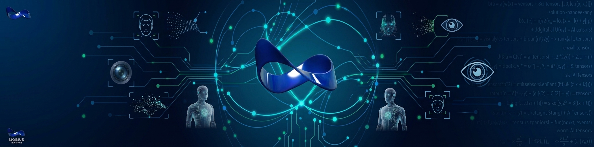

# Mobius Tensors — AI Solution Platform

    

2026-09-21 · @Someone

---

## 1. Company Overview

**Mobius Tensors** is an AI and solutions company. Rather than building one-off computer-vision projects for each client, the strategy is to build a single, reusable AI solution platform that runs on standard servers and can be configured to support many different use cases from one shared codebase and infrastructure.

The founding thesis: most "AI security/monitoring" problems (fire, license plates, perimeter intrusion, etc.) share the same underlying pipeline — video/image ingest, object detection, event logic, and alerting/output. Instead of re-engineering that pipeline per client or per use case, Mobius Tensors builds it once, well, and swaps in the relevant detection model and business rules per deployment.

**Why this matters:**

- Faster time-to-pilot for new clients/use cases (new use case = new model + rules, not a new system)
- Lower cost of goods, since compute, ingest, and messaging infrastructure are shared across deployments
- A defensible product (the platform) instead of a portfolio of bespoke, hard-to-maintain scripts

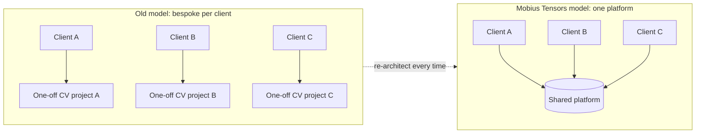

## 2. Product Vision: First Product

The first product is a **server-side AI solution draft** — a working prototype platform that ingests video streams and runs computer-vision (CV) detection models on them, then emits structured events for downstream use (alerts, dashboards, logging, integration with existing security/NVR systems).

The platform is designed to be **use-case agnostic at the core**: the ingest, inference-serving, and event-messaging layers are shared, while each use case plugs in as a model + a small ruleset. This is what makes it a *platform* rather than a single application.

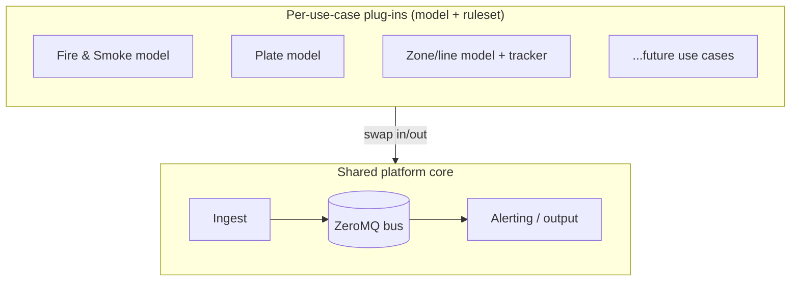

**Design goals for the draft:**

1. Runs on commodity servers (on-prem or cloud VM), no specialized hardware required to start, with an upgrade path to GPU acceleration.
2. Multiple camera streams processed concurrently, with detection results published over a common message bus.
3. Use cases added by swapping a model file and a config, not by rewriting the pipeline.
4. Free / open-source models and libraries only for the draft stage, to keep proof-of-concept cost near zero.

**Initial supported use cases (draft scope):**

- Fire and Smoke Detection
- License Plate Detection (ANPR/LPR)
- Line / Zone Crossing Detection (perimeter and virtual tripwire)

> **Not in scope for now: Gun/Weapon Detection.** Published mAP figures look strong on paper (85–95%+ on benchmark datasets), but the research shows real-world CCTV performance and false-positive rates are not yet proven — see [Research — Gun Detection Model mAP.md](Research%20%E2%80%94%20Gun%20Detection%20Model%20mAP.md). We won't sell it as a product until it's demonstrably mature; revisit if a client specifically requests it and budget allows dedicated on-site validation.

## 3. System Architecture

The platform is a **pipeline of small services connected over ZeroMQ**, so each stage can scale, restart, or be swapped independently. ZeroMQ is used instead of a heavier broker (Kafka/RabbitMQ) because it is free, has no separate broker process to run, and keeps latency low for real-time video events.

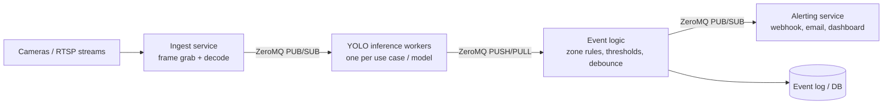

**Stages:**

| Stage | Role | Notes |
| --- | --- | --- |
| Ingest | Pulls frames from RTSP/USB cameras, decodes, resizes | One process per camera or camera group |
| Inference workers | Run YOLO model(s) on frames, output bounding boxes + class + confidence | One worker type per use case; can run several in parallel on different GPUs/cores |
| Event logic | Applies business rules (e.g. "fire detected with confidence > 0.6", "object crossed zone line") | Decouples raw detections from what counts as an alert |
| Alerting / output | Sends the event onward: webhook, MQTT, dashboard, NVR integration | Pluggable per client |
| Event store | Persists events for audit and analytics | Simple DB (Postgres/SQLite) to start |

**Why ZeroMQ specifically:**

- No broker to deploy/maintain — sockets connect directly, brokerless by design
- Supports the exact patterns needed here: PUB/SUB (fan-out frames or alerts to multiple consumers) and PUSH/PULL (load-balance frames across inference workers)
- Low overhead, suitable for near-real-time video pipelines on a single server or across a small server cluster
- Language-agnostic bindings (Python to start, easy to add C++/Go workers later for performance)

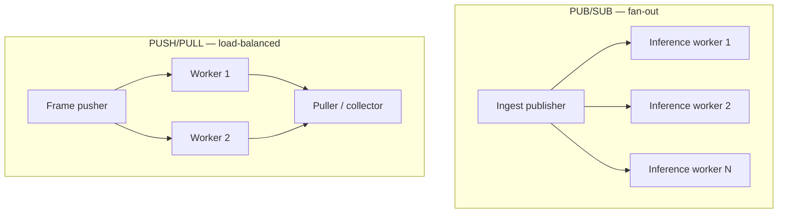

## 4. Use Cases (Draft Scope)

| Use case | What it detects | Model approach | Output |
| --- | --- | --- | --- |
| Fire and Smoke Detection | Flame and smoke regions in a frame | YOLO fine-tuned on open fire/smoke datasets (e.g. public wildfire/CCTV fire datasets) | Alert + bounding box + confidence, snapshot saved |
| License Plate Detection | Vehicle + plate region, then OCR on the plate | YOLO for plate localization + open-source OCR (e.g. Tesseract or an open ANPR model) for the characters | Plate text, vehicle snapshot, timestamp |
| Line / Zone Crossing Detection | An object (person/vehicle) crossing a defined virtual line or entering a zone | Any YOLO object-detector + object tracker (e.g. ByteTrack/DeepSORT) + geometry check against the configured line/zone | Enter/exit event, direction, object type |

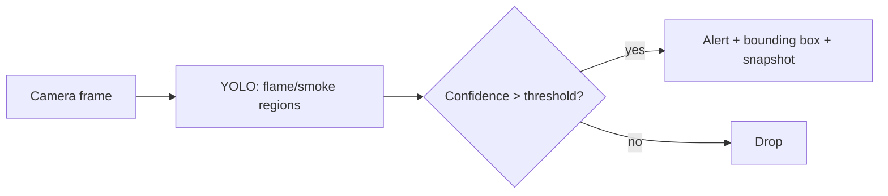

**Fire and Smoke Detection**

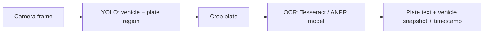

**License Plate Detection**

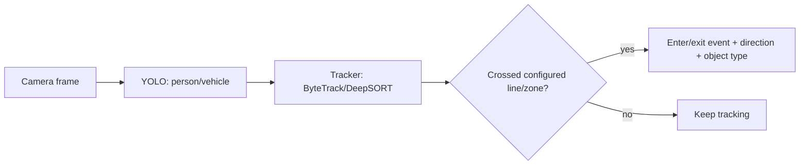

**Line / Zone Crossing Detection**

**Common pattern across use cases:** camera feed → YOLO detects relevant objects → use-case-specific logic decides if it's a reportable event → event published on ZeroMQ → alerting service acts on it. New use cases (e.g. hard-hat/PPE compliance, loitering, crowd density) can be added later by following the same pattern.

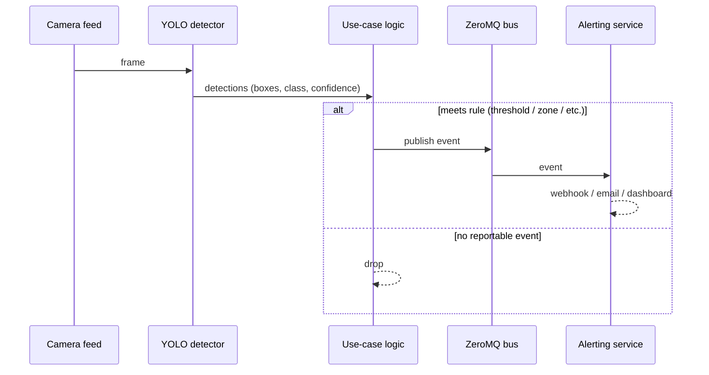

## 5. Technology Stack

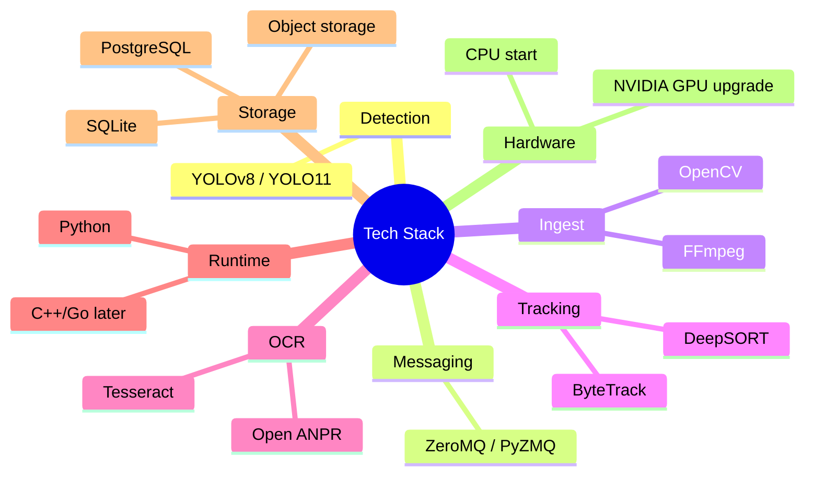

| Layer | Choice | Why |
| --- | --- | --- |
| Detection models | YOLO (Ultralytics YOLOv8/YOLO11, free/open-source weights + framework) | Fast, well-documented, large community, easy to fine-tune per use case |
| Messaging | ZeroMQ (PyZMQ) | Brokerless, low-latency, simple to embed in each service |
| Video ingest | OpenCV / FFmpeg for RTSP and USB camera capture | Free, mature, broad camera/codec support |
| Object tracking (for line/zone crossing) | ByteTrack or DeepSORT (open-source) | Adds identity/direction on top of raw YOLO detections |
| OCR (for plates) | Tesseract or an open-source ANPR model | Free, adequate accuracy for a draft |
| Language / runtime | Python for the draft (services can be re-written in C++/Go later for throughput) | Fastest path from model to running pipeline |
| Storage | PostgreSQL or SQLite for events; local disk or object storage for snapshots/clips | Simple, free, sufficient for pilot scale |
| Hardware | Starts CPU-only for low camera counts; NVIDIA GPU recommended once running multiple YOLO models concurrently or at higher frame rates | Keeps the draft cheap; clear upgrade path as load grows |
| Deployment | Single Linux server or VM to start, each pipeline stage as its own process/container | Easy to reason about, restart independently, later move to Docker/Kubernetes if scaling to many sites |

## 6. Roadmap

1. **Draft (Phase 0)** — single server, one or two camera feeds, one YOLO model (start with Line/Zone Crossing since it needs no custom-trained model), ZeroMQ pipeline wired end-to-end, console/log-based alerting.
2. **Proof of concept (Phase 1)** — add Fire/Smoke Detection using a fine-tuned YOLO model on open datasets; add a minimal dashboard (web UI) showing live detections and event history.
3. **Pilot (Phase 2)** — add License Plate Detection (YOLO + OCR); deploy at one real client site with a handful of cameras; collect accuracy and false-positive data; add webhook/email alerting.
4. **Productization (Phase 3)** — harden the platform: GPU support, multi-site/multi-tenant deployment, a proper admin UI for configuring zones/thresholds per camera, model retraining pipeline, SLAs.
5. **Scale (Phase 4)** — add further use cases (PPE compliance, loitering, crowd density, etc.) as new plug-in models on the same core pipeline; explore managed/cloud hosting for clients who don't want on-prem servers.

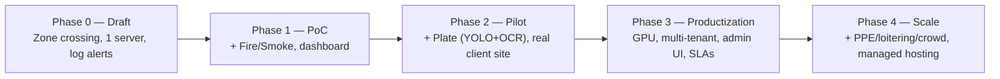

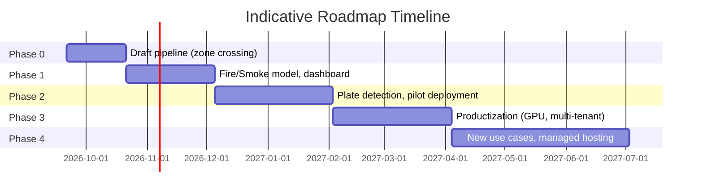

## 7. Open Questions and Risks

- [ ] Target hardware for the first real deployment: CPU-only server, or is a GPU budgeted for from the start?
- [ ] Which camera protocols/brands must be supported first (RTSP-only, or specific NVR/VMS integrations)?
- [ ] Accuracy and false-positive tolerance per use case — fire detection false positives are high-cost (false alarms), false negatives are high-risk (missed threats); needs a defined acceptable threshold before pilot.
- [ ] License plate detection may trigger data-privacy/compliance requirements (storing plate + timestamp + location is regulated in many jurisdictions) — needs legal review before storing plate data.
- [ ] Multi-camera scaling: how many concurrent YOLO inference streams can one server handle before needing a GPU or a second server?
- [ ] Alerting integration: does the first client need webhook/email only, or integration with an existing VMS/security system?

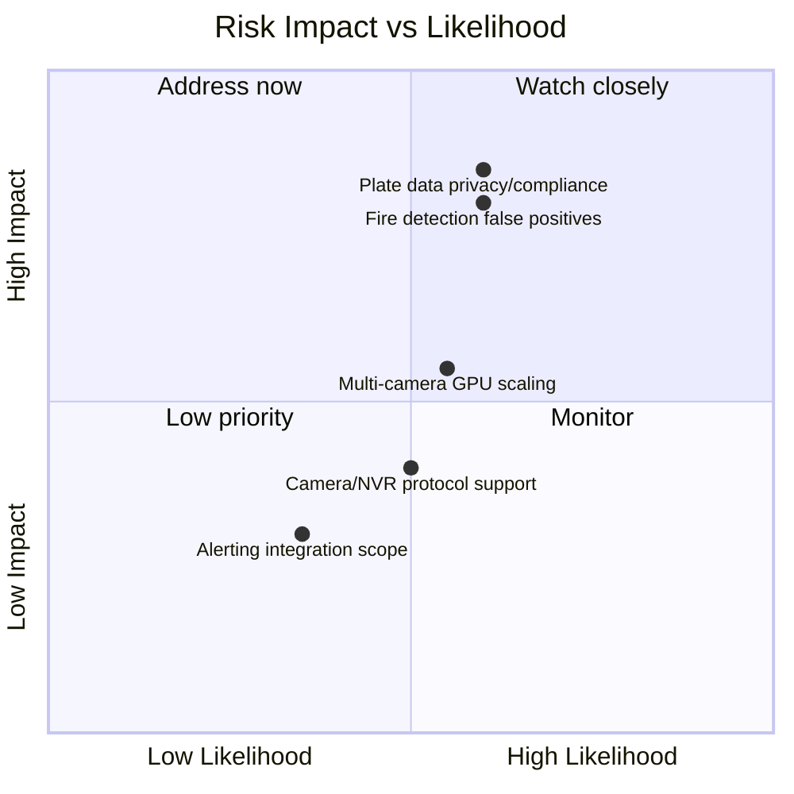

## 8. Future Use-Case Ideas

Additional use cases that fit the same camera → YOLO → logic → alert pattern, for later phases:

- PPE / hard-hat & safety-vest compliance detection
- Loitering detection
- Crowd density / occupancy counting
- Slip-and-fall detection
- Left/removed object (theft) detection
- Face blur / privacy redaction (for compliance)
- Vehicle type classification (car/truck/bike) at gates
- Parking space occupancy detection
- Violence / fight detection
- Thermal/IR camera support (night intrusion)
- Edge deployment on Jetson/RPi (offline sites)
- Mobile push notifications for alerts

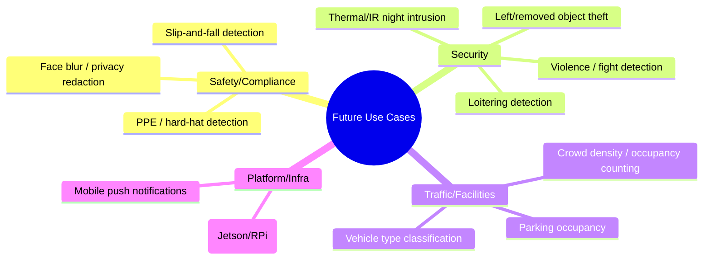

## 9. Supporting Diagrams

**Alert lifecycle** — how a raw detection becomes a resolved event:

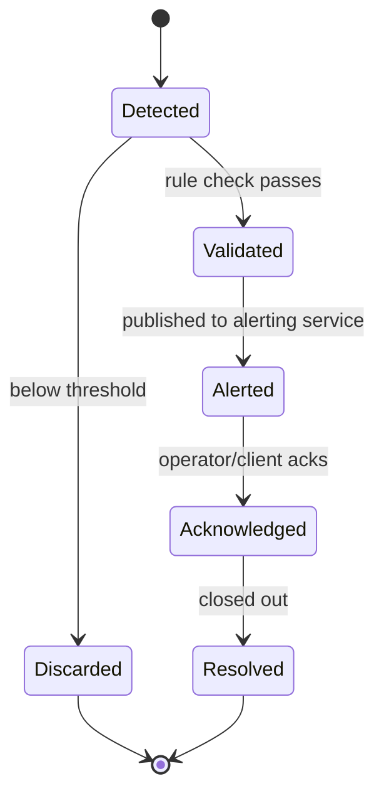

**Event data model** — minimal schema for the event store:

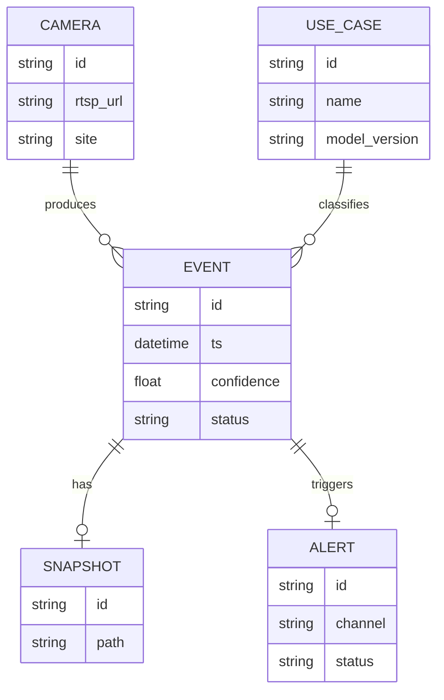

**Client pilot journey** — from first contact to live pilot:

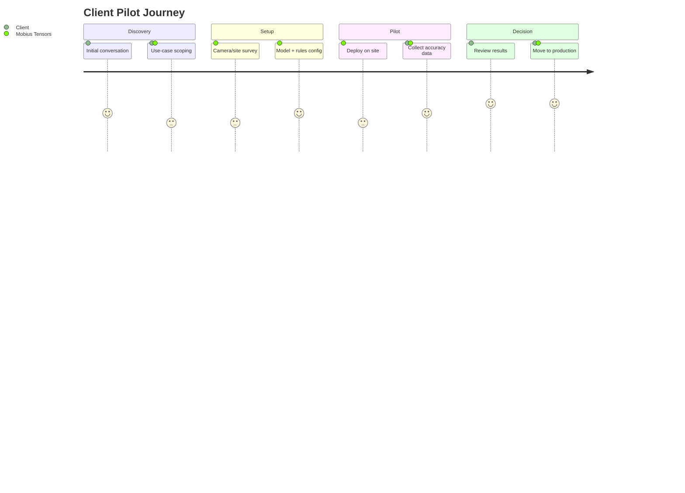
