

# Mobius Tensors — Complete Architecture

2026-09-22 · @Someone

---

This is the single reference for **how the company, the product, and the system fit together** — business model down to server topology. It consolidates and cross-links the other two docs rather than replacing them:

- [Mobius Tensors — AI Solution Platform.md](Mobius%20Tensors%20—%20AI%20Solution%20Platform.md) — product vision, use cases, roadmap, open risks
- [Implementation Plan — From Trained Model to App.md](Implementation%20Plan%20—%20From%20Trained%20Model%20to%20App.md) — step-by-step build path, glossary
- [`server/detect.py`](server/detect.py) — the first working piece of this architecture, in code

## 1. Architecture Layers

Four layers, each depending only on the one below it — a change in how a use case works (Product layer) shouldn't require touching how servers are provisioned (Infrastructure layer), and vice versa.

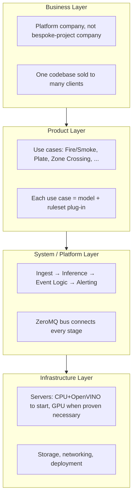

## 2. Business Architecture

The company's structural bet: one shared platform serves every client, instead of a bespoke build per client.

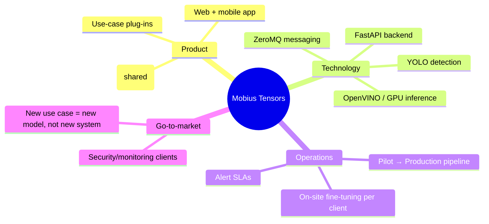

## 3. System Context (who talks to Mobius Tensors)

The platform as a black box, and everything around it that it has to interact with.

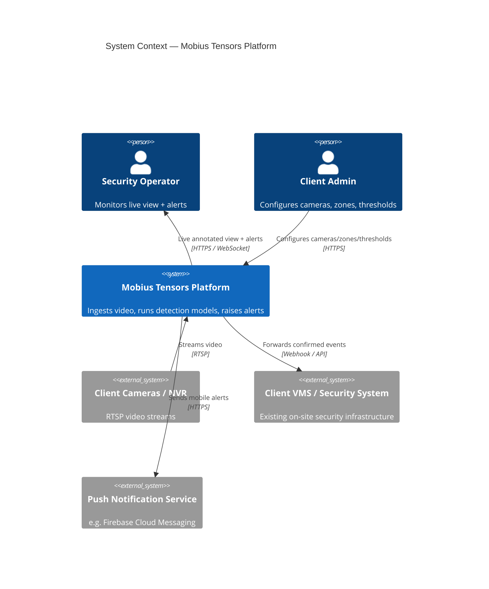

## 4. Container Architecture (single site)

Zooming into the platform: the actual running pieces and how they talk to each other. This is the architecture the other two docs describe in prose — here it's the map.

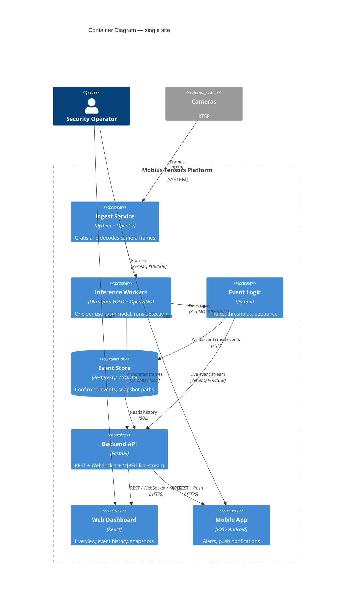

## 5. Component Architecture — Inference Worker

The one component most of the platform's value (and risk) sits in. Every use case gets one of these, differing only in which model and confidence threshold it loads.

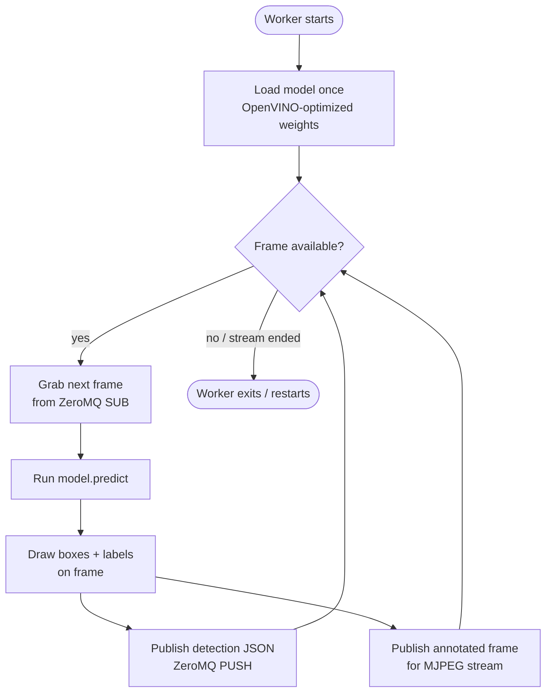

## 6. Data Architecture

**Data flow** — what happens to a frame from capture to either storage or deletion:

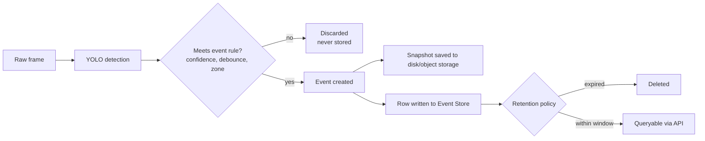

**Entity model** — the event store's shape, extended with `SITE`/`CLIENT` for when the platform serves more than one location:

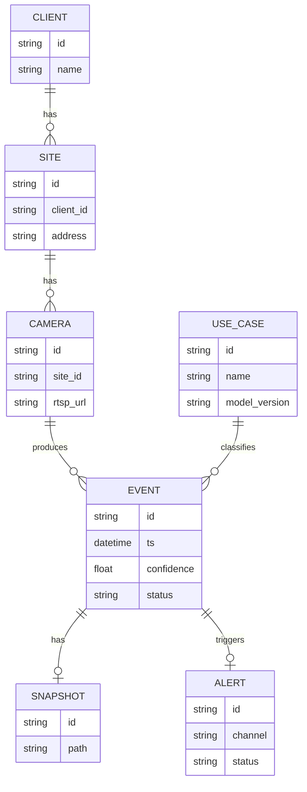

## 7. Security & Network Architecture

The rule that matters most here: **ZeroMQ never crosses a network boundary the public internet can reach.** Everything internal stays internal; the Backend API is the only door.

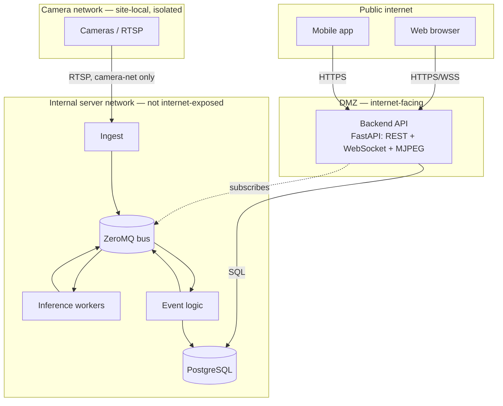

## 8. Deployment Architecture — Phase 0/1 (single site, draft/pilot)

Matches the roadmap's early phases: one server, CPU-only, everything on one box.

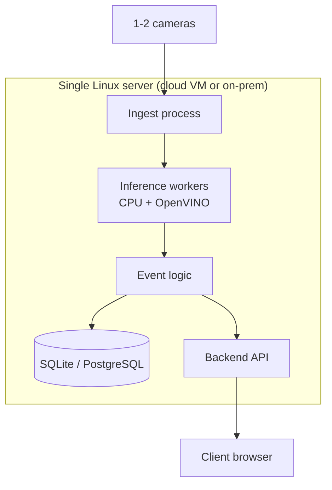

## 9. Deployment Architecture — Phase 3/4 (multi-site, scaled)

Where the platform goes once a client (or several) needs more than one server can handle: still one platform, more instances of it, with a thin control plane to keep them manageable centrally.

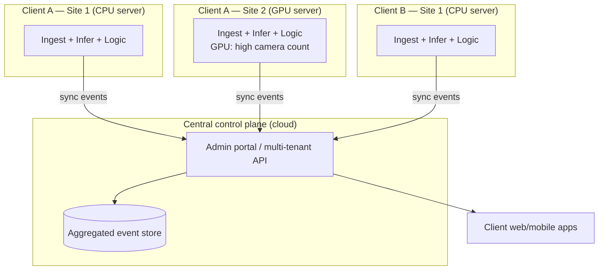

## 10. Scaling Decision: CPU+OpenVINO vs GPU+TensorRT

A concrete decision framework, not a philosophy — captures the reasoning already established for the project: default to CPU, move to GPU only when a benchmark proves you need to.

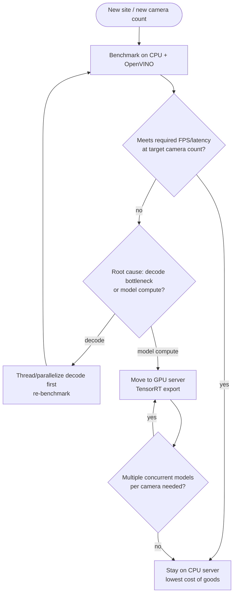

## 11. Client Lifecycle Architecture

How a client moves through the system over time — ties the business layer back to the deployment layer.

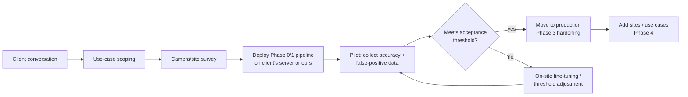

## 12. Full System Synthesis

Everything above, in one picture — business rationale at the top, running code at the bottom.

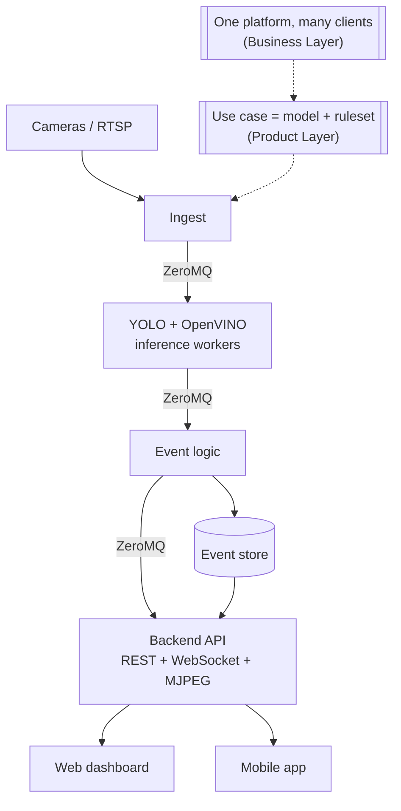

## Related docs

- Use-case details, roadmap, and open risks → [Mobius Tensors — AI Solution Platform.md](Mobius%20Tensors%20—%20AI%20Solution%20Platform.md)
- Why each piece exists (plain-language build order + glossary) → [Implementation Plan — From Trained Model to App.md](Implementation%20Plan%20—%20From%20Trained%20Model%20to%20App.md)
- First running piece of this architecture → [`server/detect.py`](server/detect.py)
