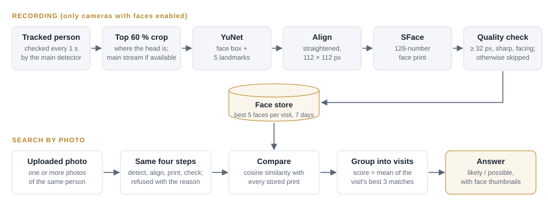
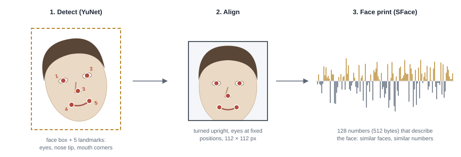
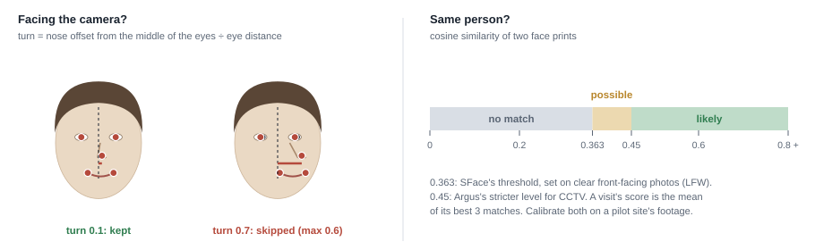
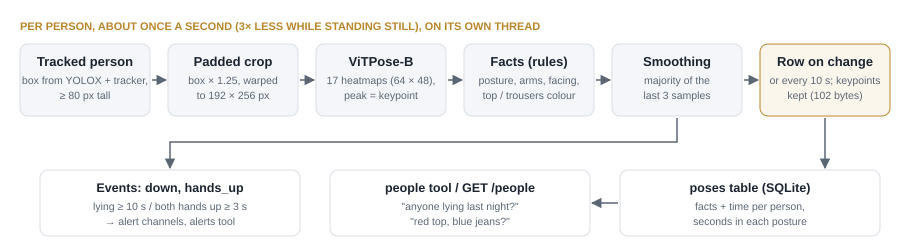
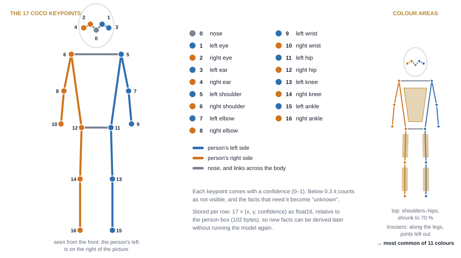
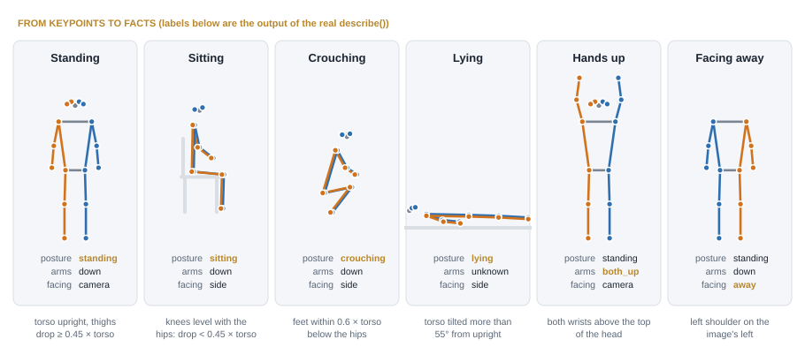
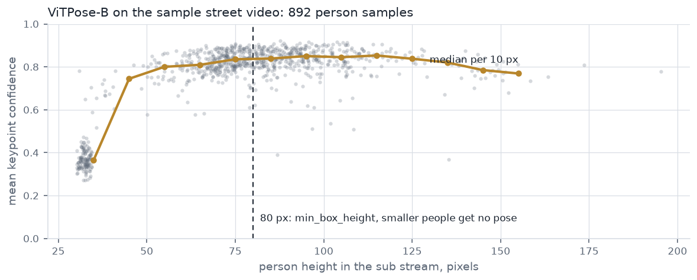
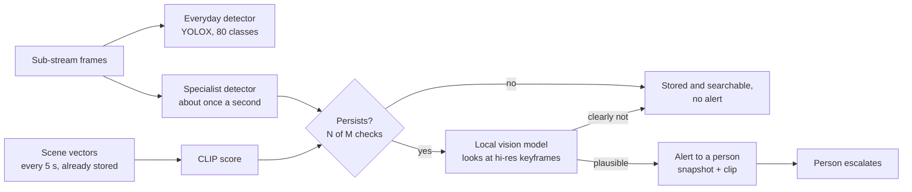

# Argus — Documentation

*After Argus Panoptes, the hundred-eyed watchman of Greek myth (πανόπτης, "all-seeing"), who never
closed all his eyes at once.*

*October 2026. Product, technical and model-research documentation of the Argus code in this
repository: [projects/argus](../../projects/argus/), including the
[engine](../../projects/argus/ENGINE.md) it is built on. Every claim was checked
against the code. Keep it that way when editing: if a feature is on the roadmap, say so. The
partner programme is in its own document ([Partner Program — Study](Partner%20Program%20—%20Study.md)).*

**Contents**

- **Part 1, Product:** 1 In one line · 2 Short description · 3 The problem · 4 What Argus does ·
  5 Kinds of answer · 6 Where it fits · 7 Private by design · 8 Alerts · 9 Where it is today ·
  10 Limits · 11 How to try it
- **Part 2, Technical:** 12 Architecture · 13 Code layout · 14 Models in use · 15 How a question is
  answered · 16 Face search · 17 Body poses · 18 Storage and API · 19 On site
- **Part 3, Model research:** 20 Short answer · 21 What a model must pass · 22 Where new models plug
  in · 23 Fire and smoke · 24 Weapons · 25 Other models · 26 Suggested order · Sources

**New on 2026-10-09**

- **Four more body-pose facts** (section 17.3): *bending* over (a new posture, which also stops a
  person bent over with straight legs from counting as lying), *head down* (looking at a phone or a
  desk), *still / walking / running*, and *carrying* a backpack, handbag, suitcase or umbrella.
  Searchable in the chat (`people`) and the API (`/people`). Unit-tested only so far: check them
  on a site's own footage before promising them to a client.
- **One test UI.** The engine's test bench (models, thresholds, zones, faces) is now the
  *Test bench* tab of the Argus test UI, so one command and one port run everything (section 13).

---

# Part 1 — Product

## 1. In one line

Argus lets you ask your cameras what happened, in plain language, and answers with the frames
as evidence.

## 2. Short description (website, brochure, LinkedIn)

Most camera AI answers one question: "is X happening right now?". Argus answers a different one:
"what happened?". It keeps a searchable memory of what your cameras see (every tracked object,
plus regular snapshots of each scene), so you can ask later: *"Was there a white van at the gate
yesterday evening?"*, *"How many cars came in today?"*. It answers in sentences and lists the
frames it checked. It also notes what people were doing (standing, sitting, bending, lying on
the floor, hands up, walking or running, carrying a bag or a suitcase) and what colours they wore,
so *"Did anyone fall in the warehouse last night?"* gets an exact answer. It can alert you when something happens in an area you choose, or when someone stays
down. It runs on your own server, without a GPU, and by default even the language model that
answers runs locally. Your footage stays in the building.

## 3. The problem

Sites record far more video than anyone watches. Most footage is only opened after something has
gone wrong, and then a recorder lets you jump to a time, not to a moment: someone scrubs through
hours of footage. Classic camera AI answers "is X happening right now?" only for the rules set up
in advance; today's question was usually not one of them.

## 4. What Argus does

1. **Record.** One recorder per camera detects and tracks every object across the 80 everyday
   object types the detector knows (people, vehicles, animals, bags, furniture…). Each tracked
   object is stored as a searchable description every couple of seconds, and every few seconds
   the whole scene is stored too, so things the detector has no name for can still be found.
   About once a second, each person's body pose (17 keypoints: head, shoulders, elbows, wrists,
   hips, knees, ankles) is turned into a few facts: posture, hands raised, facing the camera,
   head down, still / walking / running, a bag or suitcase on them, and the colour of their top
   and trousers. Where the client has approved it, faces are recorded as
   face prints (section 16).
2. **Ask.** A question is split into *what*, *when* and *which camera*. Time ranges can be plain
   words ("yesterday 6pm to 9pm", "this morning", "last 2 hours", "last friday") or exact times.
   Sightings of the same tracked object are merged into one visit.
3. **Answer.** A language model looks things up in the store (up to six rounds of lookups per
   question), answers in sentences, and lists the thumbnails it looked at as evidence.
4. **Alert.** The same recorder fires alerts on areas and lines drawn on each camera (enter,
   leave, stay too long, cross), plus *person down* and *hands up* from body poses (section 8).

## 5. Kinds of answer, and it says which

| Kind | How | Good for |
| --- | --- | --- |
| **Counted (exact)** | Straight from the detector and tracker: what, when, how many. One tracked object = one visit. | "How many cars came in today?", "What happened 6pm to 9pm?", "Anyone with a dog this morning?" |
| **Described (ranked)** | Visual search (CLIP) by appearance, colour, clothing, or things with no detector class. Ranked best matches, not certainties. | "A man in a red jacket near a car?", "A white van at the gate?" |
| **Pose (measured)** | Body keypoints of each person: seconds standing / sitting / crouching / bending / lying, hands above the head, facing the camera, head down, still / walking / running, a backpack / handbag / suitcase / umbrella on them, main colour of the top and of the trousers (11 colour names). Facts per visit, not a ranking (section 17). | "Anyone lying on the floor last night?", "Hands up near the till?", "Anyone running in the car park?", "Who came in with a suitcase?", "Red top and blue jeans?" |
| **Face (scored, on approval only)** | A face print from an uploaded photo compared with the faces recorded on the cameras. Each visit is labelled *likely* or *possible* (section 16). | "Did the person in this photo come to the office between 1 and 4?" |

"Together" ("a person with a dog") means the same camera at the same time (within 15 seconds by
default), not touching in the image.

## 6. Where it fits

Any site with cameras and questions:

| Site | Example question |
| --- | --- |
| Gates and car parks | "How many trucks came in this morning?" |
| Warehouses and yards | "Was anyone at the loading bay camera yesterday evening?" |
| Campuses and public spaces | "When did a bag first appear by the bench?" |
| Construction sites | "Was there a white van at the gate yesterday evening?" |

## 7. Private by design

- Runs on the site's own server; cameras stay on the site network. Footage never leaves the
  building.
- One memory store per site, on that server. Retention is a setting (30 days by default for
  sightings; recordings 7 days).
- The default chat model runs locally (Qwen3 4B through Ollama, Apache-2.0, on CPU). A larger
  local model (Qwen3 30B-A3B) needs about 20 GB of RAM or a GPU.
- A cloud model (Claude) is an opt-in switch. It receives the question and the text search
  results (times, cameras, labels, thumbnail file names), never images or video.
- **Biometrics off by default.** Face recognition is off unless the client has approved it in
  writing (face prints are biometric data). It can be limited to some cameras, and face prints
  are deleted after 7 days. The chat model never sees an attached photo, only its name (section 16).
- Body poses identify people far less than faces, but a way of walking can still be recognised:
  they follow the sightings' retention, can be limited to some cameras, and the raw keypoints can
  be left out (`store_keypoints: false`), keeping only the facts.
- **Commercially clean.** Every model ships under a permissive licence (Apache-2.0 or MIT) for
  code, weights and training data. AGPL/GPL and research-only models are excluded (section 21).

## 8. Alerts when it matters

Argus also alerts, from the same recorder that builds the memory: alerts for the rules set in
advance, memory for every other question.

- **Areas and lines:** draw zones and tripwires on each camera. Events: an object *enters*,
  *leaves*, *stays longer than* N seconds (e.g. a car parked in a fire lane), or *crosses* a line
  (in, out or both directions).
- **Per customer:** each rule is limited to chosen object types (only `person` in the yard, only
  `truck` at the gate), and every site has its own rules in its config.
- **Anywhere in the picture:** a zone without points covers the whole frame ("a dog appears").
- **Person down, hands up:** from the body poses, an event when someone stays lying for 10 s
  (a fall, someone unwell) or keeps both hands above the head for 3 s. Both are settings, and
  they go through the same channels as area and line events. Checked so far with unit tests and
  the sample street video, not yet on real or staged falls: validate on site before relying on it.
- **Delivery:** channels, each with its own filter: which rules, events and objects, at which
  hours ("22:00-06:00"), and a cooldown so nobody gets flooded. Webhook (into the client's own
  systems, or Slack/Teams/n8n/Zapier) and email work today, with a JPEG snapshot of the moment.
- **Ask about alerts:** every event is stored with its snapshot, whatever the channels sent, and
  the chat has an `alerts` tool: "did any alert go off last night?", "who entered the yard?".
- **Tested (2026-10-06):** Argus's own recorder on the sample street video, a whole-frame zone
  and a line: every event stored with a snapshot (102), a webhook channel filtered to the line
  with a 30 s cooldown received 3 messages, and the chat tool listed the events for "last night".
  Email is covered by unit tests (no real mail server in that run).
- **Setup:** the `zones:` and `alerts:` sections in `projects/argus/configs/default.yaml` (empty by
  default, with commented examples).
- **Next channels:** Telegram, WhatsApp (Business API, pre-approved templates), SMS and an
  on-site siren or relay; each is one small class in the shared alert code (overview in the
  engine docs, `projects/argus/ENGINE.md`).

**Not available yet:** rules only work on the 80 detector types (plus the two pose events). Fire
and smoke, or any object a customer names that is not one of the 80, need a model trained for it
(the code loads custom models; the training step is still to build). Alerts from a description
("a white van at the gate") would reuse the visual search, but its matches are ranked, so each site
would need tuning. Weapons are not offered: no model, and both false alarms and misses are costly
(section 24).

## 9. Where it is today

| Working now | Next |
| --- | --- |
| Recording and indexing per camera, all 80 object types plus scene snapshots | Fire and smoke detection (own model, open datasets; section 23) |
| Plain-language questions from the command line (`ask.py`), no language model needed | A fixed set of test questions on recorded footage, to compare chat models |
| Chat (`chat.py`) with switchable models, local by default; evidence listed as thumbnail files | Scene captions from a small vision-language model, for questions CLIP handles badly (counting, "what was he doing") |
| Main-stream recording with full-resolution crops | A multi-camera timeline: following one visit across cameras |
| Alerts by area and line (or anywhere in the picture), per object type, to webhook and email with filters; the chat answers about past alerts | Telegram, WhatsApp, SMS and on-site siren channels |
| Body poses: posture (with bending), hands up, facing, head down, still / walking / running, carried bags and clothing colours, searchable in the chat (`people`) and the API (`/people`); person-down and hands-up alerts; skeletons on the test UI's live view | Person-down alerts checked on staged falls at a pilot site, with a false-alarm count per day; the new facts (bending, head down, motion, carrying) checked on real footage |
| Face search by photo (opt-in, section 16) | Detectors trained per customer; alerts from a description; chat in the browser; API login |

## 10. Limits worth saying out loud

- "Everything" is sampled: each tracked object every 2 s, each scene every 5 s, and objects
  smaller than 40 px tall are not described. All three are tunable per site.
- Visual search results are ranked guesses; the evidence frames are there so a person can check.
- Visit counts depend on the tracker keeping an object in view; a long occlusion can split one
  visit into two.
- Small local models follow tool instructions less reliably than large ones.
- Poses need people at least 80 px tall in the picture. Colours are lost at night (infrared) and
  shift under coloured lighting. Posture comes from rules on the keypoints: someone half hidden
  behind a desk is "unknown", and sitting and crouching can be confused (section 17).
- *Running* is measured from movement across the picture: someone far away walking straight
  towards the camera can read as still. *Carrying* only sees the four bag-like objects the detector
  knows, and a bag set down right next to someone counts until they walk away from it.
- Face thresholds were set on clear photos, not CCTV: calibrate per pilot site. Faces need to be at
  least 32 px wide, which a sub-stream frame rarely gives (section 16).
- Alert rules only cover the 80 detector classes plus the two pose events.
- Retention purging runs inside the HTTP server (`src/argus/engine/server.py`), so a site
  needs that service running for old sightings to be deleted.
- The API has **no authentication yet**: keep it on `127.0.0.1` or behind a proxy with login.

## 11. How to try it

A pilot on the client's own recorded footage: we index a sample, they ask their own questions,
then they decide. A partner programme (Silver / Gold / Platinum, 10–30 %) is drafted for
introducers and CCTV installers.

---

# Part 2 — Technical

## 12. Architecture

```text
 IP cameras (RTSP)
   ├─ sub stream ──► detect (YOLOX) ─► track (IoU tracker) ─► zone / line rules ─► alerts ─► webhook, email
   │                                         │
   │                                         ├─► CLIP index: objects (every 2 s), scenes + 2x2 tiles (every 5 s)
   │                                         ├─► pose index: 17 keypoints → posture, arms, facing, head, colours;
   │                                         │   tracks → motion, carrying (~1/s)
   │                                         └─► face index: YuNet + SFace, best 5 faces per visit (opt-in)
   └─ main stream ─► ffmpeg: 1-minute MP4s (copy, no re-encode) + keyframes for full-resolution crops
                                             │
                               one SQLite store per site (events, sightings, faces, poses + media)
                                             │
                                             ├─► ask.py     plain-language search, rules only (no LLM)
                                             ├─► chat.py    LLM + tools, answers with evidence
                                             └─► server.py  FastAPI: search, people, events, media, recordings
```

One recorder process per camera; each heavy step (CLIP, pose, faces) runs on its own thread and
**skips samples rather than slowing detection**, so a busy scene is sampled more sparsely instead
of lagging behind.

## 13. Code layout

The code is one Python package, `argus`, in `projects/argus`, with one `uv` environment
(Python ≥ 3.11):

- **`argus.engine`** (~25 modules): detector, tracker, zones, alerts, store, indexer,
  CLIP / face / pose models, query parser, search, FastAPI server, camera discovery,
  main-stream recording, Gradio test bench (`app.py`).
- **`argus`** (the product layer on top of the engine): `record.py`, `ask.py`, `chat.py` (chat CLI), `tools.py` (what the LLM may call), `llm.py`
  (model backends) and `ui.py` (test UI: record, find a person by photo, chat, reports, and the
  engine's test bench as its last tab: models, thresholds, zones and faces on photos, videos and
  cameras). One command starts it all, on one port:
  `uv run --directory projects/argus --group ui -m argus.ui` (`--port` to change from 7860).

About 7,200 lines of Python and ~120 unit tests (`uv run pytest`). Other folders:
`docs/` (this document, the partner programme, the presentation), `Brochures/`, `Images/argus/`
(brand kit).

## 14. Models in use

| Role | Model | Licence | Cost on a laptop CPU |
| --- | --- | --- | --- |
| Object detection | YOLOX-Nano (COCO, 80 classes), larger YOLOX variants selectable | Apache-2.0 | 4 MB model, real time |
| Visual search | CLIP ViT-B/32 (OpenCLIP, LAION-400M), float32 | MIT | ~55 ms per crop, 2 KB per vector |
| Body pose | ViTPose-B, COCO only | Apache-2.0 | 100–175 ms per person |
| Faces (opt-in) | YuNet detector + SFace recogniser (OpenCV Zoo) | MIT / Apache-2.0 | 128-number face print; SFace 99.4 % on LFW |
| Chat (default) | Qwen3 4B via Ollama; others selectable | Apache-2.0 | CPU |

All vision models run as ONNX graphs with numpy/OpenCV pre- and post-processing: no PyTorch at
run time and a straightforward port to C++. PyTorch is only used in one-off export scripts.
Candidates for new models are in Part 3.

## 15. How a question is answered

**1. Parse.** `query.py` turns the sentence into *what / when / camera* with rules (today,
yesterday, last friday, after 10pm, last 2 hours, camera names and aliases). No LLM needed.

**2. Look up.** The chat model gets up to five tools over the store (`people` and `face` only
where pose and faces are enabled) and may run up to six rounds of lookups:

| Tool | Answers | Kind |
| --- | --- | --- |
| `objects` | what was tracked, when, how many; "together with" (same camera within 15 s) | exact |
| `search` | CLIP text-to-image search over objects and scene tiles | ranked |
| `people` | posture time, hands up, facing, head down, still / walking / running, carried bags, clothing colours | exact |
| `alerts` | what the alert rules fired | exact |
| `face` | visits matching an attached photo (likely / possible) | scored |

**3. Group and cite.** Sightings of the same track are merged into one *visit*; the answer lists
the thumbnails it relied on.

Models are config entries, not code: any OpenAI-compatible server (Ollama, llama.cpp, LM Studio,
vLLM) or the Anthropic API. Each camera has an `about:` block (location, aliases, what it covers,
face quality, normal hours) that goes into the model's instructions.

## 16. Face search (opt-in)

Face search answers questions like *"Did the person in this photo come to the office between 1
and 4?"*. It is the only **biometric** feature in Argus. Biometrics are measurements of the body
that can identify a person (face, fingerprint, iris, voice); a face print is one, so data
protection laws such as the GDPR treat it as sensitive data. Therefore:

- Face recording is **off** (`faces.enabled: false`) until the client approves it in writing.
- It can be limited to some cameras (`faces.cameras`), ideally those whose `about.faces` is `good`
  (faces big and frontal enough).
- Face prints are deleted after 7 days (`face_retention_days`).
- The chat model never sees an attached photo: its face print stays in Argus and the model refers
  to it by name (`photo1`).

Searches by appearance ("a man in a red jacket") are not biometric: they describe, they don't
identify. Code: [faces.py](../../projects/argus/src/argus/engine/faces.py) (models and quality),
[indexer.py](../../projects/argus/src/argus/engine/indexer.py) (recording),
[search.py](../../projects/argus/src/argus/engine/search.py) (matching and visits),
[tools.py](../../projects/argus/src/argus/tools.py) (the chat's `face` tool).



### 16.1 Two small models

Both are ONNX models from the OpenCV Zoo, run by OpenCV on CPU.

| Step | Model | Licence | What it gives |
| --- | --- | --- | --- |
| Find the face | **YuNet** (`face_detection_yunet_2023mar.onnx`) | MIT | A box around each face and 5 landmarks: both eyes, the nose tip, both mouth corners |
| Describe the face | **SFace** (`face_recognition_sface_2021dec.onnx`) | Apache-2.0 | A *face print*: 128 numbers. 99.4 % accuracy on the Labeled Faces in the Wild (LFW) verification benchmark ([model card](https://huggingface.co/opencv/face_recognition_sface)) |

Download both with `uv run -m argus.engine.download_model faces` in `projects/argus`.

### 16.2 Recording

1. The main detector finds and tracks each **person**. About once a second
   (`faces.interval_seconds`), Argus takes that person's box, using the full-resolution
   main-stream keyframe when one is available.
2. It crops the **top 60 %** of the person, where the head is, and runs **YuNet** on a copy
   resized to 320–640 px on its longer side. YuNet misses faces much bigger than ~300 px (a
   selfie at full size scored 0.72, at 640 px 0.93), and small crops need enlarging. The box and
   landmarks are scaled back, so the next steps use the full-resolution crop.
3. The 5 landmarks are used to **align** the face: turned upright, eyes moved to fixed positions,
   cut to 112 × 112 pixels.
4. **SFace** turns the aligned face into a **face print** of 128 numbers, scaled to length 1.
5. A **quality check** (16.3) decides whether the face is good enough to keep.
6. Each visit keeps only its **5 best faces** (`faces.max_per_track`), ranked by quality, so someone
   sitting at a desk for an hour is not 3,600 rows. Each kept face is stored with a small thumbnail
   as evidence.



### 16.3 Quality check

Blurred, tiny or side-on faces "match everyone a little", which is worse than no face at all. Every
face is measured before it is stored or searched with:

| Check | Measure | Default |
| --- | --- | --- |
| Size | Shorter side of the face box | ≥ 32 px on cameras (`min_face_size`), ≥ 40 px in an uploaded photo |
| Sharpness | Variance of the Laplacian of the aligned face (sharp ≈ 30–300, motion blur < 10) | ≥ 15 (`min_sharpness`) |
| Facing | *Turn*: nose-tip offset from the middle of the eyes, divided by the eye distance (≈ 0–0.3 facing the camera, ≈ 0.5 at 60°) | ≤ 0.6 (`max_turn`) |

To rank a visit's faces, the four measures are combined into one quality value (0–1): detector
confidence × size × frontal × sharp.



### 16.4 Searching with a photo

1. **Upload** one or more photos of the same person (test UI, chat or `POST /search/face`). The
   photo goes through the same steps: detect, align, face print, quality check. If no face is
   found at 640 px, detection is retried at full size (small faces in a big group photo), then
   at 320 px.
2. **Which face?** Faces are numbered left to right. A photo with several faces is used only when
   one is clearly the subject (at least twice as big as any other); otherwise Argus asks which one.
   An unusable face is refused with the reason ("too small", "blurred", "turned away from the
   camera") instead of being searched.
3. **Compare.** The photo's print is compared with every stored face print in the time range and
   cameras asked, by **cosine similarity** (1 = identical, around 0 = unrelated).
4. **Group into visits.** Matches of the same person track on the same camera form one visit.
   Its score is the **mean of its best 3 matches** (one lucky frame is weak evidence, three good
   ones are strong). The visit covers the whole track: someone seen from behind at 13:40 who shows
   their face at 13:44 arrived at 13:40.
5. **Answer.** A visit scoring ≥ 0.45 is **likely** the same person; 0.363–0.45 is only
   **possible**; below 0.363, no match. Each visit comes with its best face thumbnail, and the
   answer says how many faces each camera recorded in the range: no match is not proof the person
   was not there (faces turned away or too far are not recorded).

### 16.5 Accuracy on CCTV

SFace's 99.4 % and its 0.363 threshold were measured on LFW: clear, mostly front-facing photos.
CCTV faces are smaller, blurred, seen from above and grey under infrared, so accuracy on site will
be lower. The 0.45 "likely" level is Argus's stricter guess for CCTV. **Calibrate both levels on a
pilot site's own footage** before trusting them, and treat every match as a lead for a person to
check with the thumbnails.

Camera placement matters more than the model. On a typical overview camera's sub stream, faces are
far too small:


*Sub-stream frame (768 × 576) from OpenCV's sample street video. YuNet finds three faces, but they
are 8–10 px wide, far below the 32 px minimum, so none is stored. Faces need the main stream and a
camera at a door or gate, where people walk towards it at head height.*

### 16.6 Settings

```yaml
faces:
  enabled: false               # needs the client's written approval
  cameras: []                  # empty = every camera; better: only those with `about.faces: good`
  min_face_size: 32
  interval_seconds: 1          # look for a face on each tracked person this often
  max_per_track: 5             # keep a person's 5 clearest faces per visit
  min_sharpness: 15            # skip blurred faces
  max_turn: 0.6                # skip faces turned away
```

Retention is `face_retention_days: 7` in the store section of the same file.

## 17. Body poses: what people were doing

Body poses answer questions like *"Did anyone fall in the warehouse last night?"*, *"Anyone with
their hands up near the till?"*, *"Was anyone running in the car park?"*, *"Who came in with a
suitcase?"* or *"A man in a red top and blue jeans this morning?"*, and raise the *person down* and
*hands up* alerts. A pose model finds 17 points on each person's body
(*keypoints*); simple rules turn them into a few facts that are stored and searched exactly, like
the counted answers.

Keypoints say much less about who someone is than a face print, but a way of walking can still be
recognised. So poses follow the search index's retention (30 days), can be limited to some cameras
(`pose.cameras`), and the raw keypoints can be left out (`store_keypoints: false`), keeping only
the facts. Code: [pose.py](../../projects/argus/src/argus/engine/pose.py) (model, facts, colours),
[pose_index.py](../../projects/argus/src/argus/engine/pose_index.py) (sampling, smoothing, storage,
events), [tools.py](../../projects/argus/src/argus/tools.py) (the chat's `people` tool).



### 17.1 The 17 keypoints

Argus uses the COCO keypoint layout, the standard set most pose models are trained on: five on the
head (nose, eyes, ears) and six pairs on the body (shoulders, elbows, wrists, hips, knees, ankles).
"Left" always means the person's own left, so on someone facing the camera the left keypoints are
on the right of the picture. That is what makes *facing* measurable.



| Model | Licence | Training data | Use |
| --- | --- | --- | --- |
| **ViTPose-B "simple"** (`pose_vitpose_b.onnx`, 344 MB, made by `export_pose.py`) | Apache-2.0 | COCO keypoints only | **Default, shippable** |
| RTMPose-t (`pose_rtmpose_t.onnx`, 13 MB, `download_model.py pose_rtmpose_t`) | Apache-2.0 | 7 datasets, some research-only | Trials only |

Both are *top-down*: they don't search the whole frame for people. They take the person boxes the
detector and tracker already have, so the pose step costs one model run per person, not per frame.

### 17.2 How a keypoint is found

1. **Crop.** The person's box is enlarged by 25 % (the models were trained with some margin) and
   warped to the model's 192 × 256 px input. The main-stream keyframe is used when the person was
   matched in one: more pixels per joint.
2. **Heatmaps.** ViTPose returns one small map (48 × 64) per keypoint: how likely that body part is
   at each spot. The peak of the map is the keypoint, and its height is the **confidence** (0–1).
   A keypoint under 0.3 counts as not visible.
3. **Back to the picture.** The 17 points are mapped back to image pixels with the inverse of the
   crop's warp.


*A real crop from the sample street video, run through ViTPose-B. Left: the 17 keypoints (blue =
the person's left side, orange = right). The others: the heatmap of one keypoint each, and the
peak it gives. A sharp, single peak means high confidence; a wrist against a dark coat is fainter.*

### 17.3 From keypoints to facts

No second model: the facts are rules on the keypoints, measured against the person's own **torso
length** (shoulders to hips), so they work at any distance from the camera.

| Fact | Values | Rule |
| --- | --- | --- |
| `posture` | standing, sitting, crouching, bending, lying, unknown | Torso tilted more than 55° from upright: **bending** if the legs go straight down from the hips (feet more than 0.8 torso below them, under them), otherwise **lying**. Less tilted: **crouching** if the feet are less than 0.6 torso below the hips, **sitting** if the knees are less than 0.45 torso below the hips, **bending** if the torso leans more than 35°, else **standing**. **Unknown** when shoulders or hips are not visible |
| `arms` | down, one_up, both_up, unknown | A wrist counts as up when it is clearly (0.1 torso) above the top of the head. Not measured on someone lying |
| `facing` | camera, side, away, unknown | Shoulder order first: the person's left shoulder on the image's left means **away**. Then the face: nose and both eyes in the right order means **camera**, part of the face means **side** |
| `head` | up, down, unknown | **Down** when the nose is more than 0.15 torso below the ears (level with them when looking ahead): looking at a phone, a desk, the floor. Needs the nose and an ear; not measured on someone lying or seen from behind |
| `upper_colour`, `lower_colour` | black, white, grey, red, orange, yellow, green, blue, purple, pink, brown | The most common colour name in the torso area (shoulders to hips, shrunk to 70 % to leave arms and background out) and along the legs (joints left out). None if no colour covers at least 35 % of the area |

Two more facts come from the tracker rather than the keypoints, sampled at the same moments:

| Fact | Values | Rule |
| --- | --- | --- |
| `motion` | still, walking, running, unknown | How far the person's box moved since their last sample, in **body heights per second** (so it doesn't depend on the distance): the shift of its centre, plus its change of size for someone walking towards or away from the camera. Under 0.15: **still**; from 1.5: **running** (walking is about 0.8); in between: **walking**. **Unknown** on a person's first sample or after more than 10 s unseen |
| `carrying` | backpack, handbag, suitcase, umbrella (several possible) | One of these four detector classes whose box centre is inside the person's box (widened by 15 % each side) and which is smaller than the person. Stored as a list ("backpack,suitcase"), empty when nothing |



*Drawn figures, but the facts under each are the output of the real `describe()` function in
`pose.py` run on their keypoints.*

### 17.4 Storing and alerting

- **Sampling.** Each person about once a second (`interval_seconds`), three times less often while
  they stand still, on its own thread: pose never slows detection or the search index, and on a
  busy camera samples are skipped rather than queued.
- **Smoothing.** A fact counts once it is the majority of the last 3 samples, so one bad frame
  doesn't make a standing person "lying" (motion and carrying too: one missed bag detection
  doesn't drop it).
- **Rows on change.** A row is written only when the smoothed facts change, plus a heartbeat every
  10 s: an hour at a desk is about 360 rows, not 3,600, and the time spent in each posture is still
  exact to the heartbeat. Each row (about 250 bytes) keeps the 17 keypoints relative to the person
  box (102 bytes), so a new fact can be derived later without running the model again.
- **Events.** `down` (rule `person_down`) when a person stays lying for 10 s, `hands_up` when both
  hands stay up for 3 s. They go to the same store, snapshots and alert channels as area and line
  events (section 8), and the chat finds them with its `alerts` tool.
- **Search.** The chat's `people` tool and `GET /people` filter by posture, arms, facing, head
  (`head_down` / `head=down`), motion, carrying, colours, camera and time (posture, motion, carrying
  and head down: for at least 2 s), and return each visit with the seconds spent in each posture
  and motion, the seconds with the head down, and what the person carried.
- **Older stores.** A store made before the head, motion and carrying facts gets the three columns
  when it is opened; its older rows simply have no value for them.

### 17.5 Accuracy and limits

On the sample street video, the facts come out as below (not corrected by hand).


*Frame 606 of OpenCV's sample street video (768 × 576, shown at 2×), YOLOX-Nano + ViTPose-B on
CPU. Labels: posture, facing, then top / trousers colour. The red-and-black jacket reads "black":
the colour is the one that covers most of the torso area.*

Keypoint confidence drops sharply below about 45 px, and holds above 0.8 from about 55 px. A
confident keypoint can still be in the wrong place, and colours and posture need more pixels than
a keypoint does, so the 80 px minimum (`min_box_height`) stays on the safe side.



Known limits:

- **Not yet validated on real falls.** Person-down is checked with unit tests and the sample street
  video only. Before relying on it at a site: staged falls on the site's cameras, and a count of
  false alarms per day.
- **Posture comes from rules.** Someone half hidden behind a desk is "unknown"; sitting and
  crouching can be confused, especially side-on. Bending, head down, motion and carrying are so
  far checked with unit tests on drawn keypoints and tracks only, not on real footage.
- **Head down** sees the head, not the phone: someone reading, writing or looking at the floor
  counts too. For "on the phone", the chat can also try the visual search.
- **Motion** is measured in the picture: walking straight towards or away from a far camera
  changes the box little and can read as still; a person whose track jumps to someone else nearby
  can read as running for a moment (smoothing hides one sample).
- **Carrying** needs the detector to find the bag (small bags far away are often missed), and only
  knows backpack, handbag, suitcase and umbrella. A bag on the floor next to someone, or in front
  of someone further back, counts as theirs while the boxes overlap.
- **Colours** are lost at night (infrared images are grey) and shift under coloured lighting.
- **Occlusion.** A person partly hidden by someone else or by an object gets misplaced or missing
  keypoints, and often "unknown" facts (a person behind a sign on the sample video did).

### 17.6 Speed

ViTPose-B is the slowest model per person in Argus, which is why it runs about once a second per
person on its own thread. RTMPose-t is about 20× faster but stays trials-only until a COCO-only
small model replaces it (section 25.4).


*Measured 2026-10-09 on an Intel i7-13700H laptop, CPU only, one person per run (median of 25).
Section 14's 100–175 ms is the range seen during development; it depends on the CPU and its load.*

### 17.7 Settings

```yaml
pose:
  enabled: true
  cameras: []                  # empty = every camera
  model: models/pose_vitpose_b.onnx   # trials: pose_rtmpose_t.onnx
  interval_seconds: 1          # per tracked person; 3x less often while they stand still
  min_box_height: 80           # pixels: smaller people give unreliable keypoints
  heartbeat_seconds: 10        # a row on every change, and at least this often
  store_keypoints: true        # 102 bytes a row: new facts can be derived later without the model
  alerts: [down]               # down (lying for down_seconds) | hands_up (both hands up)
  down_seconds: 10
  hands_up_seconds: 3
```

## 18. Storage and API

- **SQLite, one file per site:** `events` (with JPEG snapshots), `sightings` (CLIP vectors),
  `faces`, `poses` (one column per fact: posture, arms, facing, head, motion, carrying, colours). Pose rows are written only on change plus a 10 s heartbeat (~250 bytes each).
- **Retention:** sightings 30 days, face prints 7 days, recordings 7 days (or sooner when disk is
  low). Purging runs inside the API server.
- **Search** is brute force with numpy, fine for a pilot; sqlite-vec or pgvector for large sites.
- **API (FastAPI):** `/search`, `/search/face`, `/people`, `/events`, `/media`, `/recordings`
  (links open the video 3 s before the moment), `/cameras`, `/health`, `/maintenance/purge`.

## 19. On site

- **Hardware:** a standard server, no GPU. Detection (YOLOX), search (CLIP), pose and faces run on
  CPU through ONNX Runtime / OpenCV.
- **Cameras:** any IP camera with RTSP (Hikvision, Dahua, Reolink, Uniview, Axis presets, or a
  plain URL), declared in YAML; passwords in `.env`. The detector reads the light sub stream; the
  full-quality main stream can be saved untouched in one-minute files (needs ffmpeg ≥ 5.1).
- **Main-stream keyframes** (1 per second) give sharp crops for search results and faces, at the
  cost of one extra detection per second per camera.
- **Footprint:** describing one object takes about 55 ms on a laptop CPU; each sighting stores a
  2 KB search vector plus a small thumbnail. Recording at 1080p, 4 Mbit/s is about **43 GB per
  camera per day**. On busy scenes Argus samples more sparsely rather than falling behind.
- **Pose cost:** ViTPose-B takes about 100–175 ms per person on a laptop CPU, so each person is
  sampled about once a second (three times less while they stand still) on its own thread. A
  pose row (about 250 bytes) is written only when something changes, and at least every 10 s.
- **Model choice:** any OpenAI-compatible server (Ollama, llama.cpp, LM Studio, vLLM) is a config
  entry, no code change.

---

# Part 3 — Model research: fire & smoke, weapons, and what else to add

State as of 6 October 2026. Licences were read from each project's GitHub or Hugging Face page on
that date. They change, so re-check before a model ships to a client. Numbers marked *estimate* are
ours and need measuring on the target server. Sources are at the bottom.

## 20. Short answer

| Need | Recommendation | Why |
| --- | --- | --- |
| **Fire & smoke** | Train our own YOLOX on open data (D-Fire, CC0; FASDD, CC BY 4.0). Run it about once a second next to the everyday detector, alert only when the detection persists, and send the alert to a person. Add a free smoke/fire score on the scene vectors Argus already stores. | Every ready-made fire model we found is AGPL (trained with Ultralytics) or research-only. The open datasets are fine. Single-frame detectors raise too many false alarms; a 2026 study cut them from 52 % to 4 % with multi-frame confirmation. |
| **Weapons** | Keep "not offered". For a client pilot only: person crop from the main stream → weapon detector → persistence check → local vision model as a veto → **a guard decides**. Data from Open Images (CC BY 4.0) plus staged footage on the client's own cameras. | 0.1 % false positives at 25 fps is 90 false alarms an hour. Commercial systems still fail in public (a bag of chips led to a student being handcuffed, October 2025). Most CCTV gun datasets are non-commercial. |
| **Cheapest win** | Replace the CLIP weights (B/32, LAION-400M) with OpenCLIP B/32 LAION-2B (MIT). | Same architecture and speed, better on every benchmark we checked: COCO retrieval +3.9, Flickr +5.2, ImageNet +3.6 points. |
| **Next most useful** | A `look` tool: a small local vision-language model (Qwen3.5 2B/4B or Gemma 4 E2B/E4B, both Apache-2.0, vision supported in Ollama) reads the evidence frames when a question needs it. | Covers what CLIP can't (counting, "what was he doing"), double-checks alerts, and costs nothing until asked. |
| **Also worth adding** | Plate reading (fast-plate-ocr, MIT), person-down from pose (RTMPose, Apache-2.0, 3–5 ms per person on CPU), open-vocabulary auto-labelling for objects a customer names (OWLv2 / OmDet-Turbo, Apache-2.0), sound events from camera microphones (YAMNet, Apache-2.0). | All run on CPU through ONNX and have permissive licences. |

## 21. What a model must pass to enter Argus

1. **Commercial-use licence for code, weights *and* training data**: Apache-2.0, MIT, BSD, CC0, CC BY.
   Not AGPL/GPL, not CC BY-NC, not "research only".
2. **Runs on CPU** through ONNX Runtime at a cost a site server can carry for all its cameras.
3. **Portable to C++**: an ONNX graph plus pre/post-processing in plain numpy/OpenCV.
4. **Fits an existing slot** (section 22): the `Detector` protocol, the CLIP vectors, or a chat tool.

The trap: most free fire and gun models on Hugging Face were trained with Ultralytics, whose position
is that models trained and exported with its AGPL code are AGPL too (unless you buy its enterprise
licence). That rules out nearly every ready-made fire and gun model, including Pyronear's YOLO11
wildfire models.

Web-scraped datasets (even CC0 or CC BY collections) don't clear the copyright of each photo. Training
on them is common practice; keep a short model card per trained model listing every dataset and its
licence, so a client's lawyer can check.

### Excluded (checked 2026-10-06)

| Model / data | Licence | Note |
| --- | --- | --- |
| Ultralytics YOLOv5/v8/11/26, YOLOv10, YOLOv12, YOLOE, and weights trained with them (most Hugging Face fire/gun models, Pyronear YOLO11) | AGPL-3.0 | Copyleft reaches the shipped model |
| YOLOv6, YOLOv7, YOLOv9 (original repo), YOLO-World, DOSOD | GPL-3.0 | Same |
| YOLO-NAS weights | Non-commercial | |
| MetaCLIP / MetaCLIP 2 | CC BY-NC 4.0 | |
| MobileCLIP2, DFN CLIP | Apple research licence | |
| Moondream 3 | BSL 1.1, no third-party service | We would be the service |
| Rex-Omni | IDEA licence + Qwen research licence | |
| SAM 3 | SAM Licence: forbids use related to "the development or use of guns or illegal weapons" | Can't touch the weapons work; also GPU-sized |
| SH17 (PPE), OmniFall (falls, as a whole), RWF-2000 (fights), SAFIRE (fire benchmark) | Non-commercial | Evaluation at most |
| DETR family (RT-DETR, D-FINE, DEIM, RF-DETR) | Apache-2.0 | Licence fine, but already ruled out as too heavy for GPU-less servers |

## 22. Where new models plug in

| Slot | Today | What a new model needs |
| --- | --- | --- |
| **Detector** ([detector.py](../../projects/argus/src/argus/engine/detector.py)) | One YOLOX ONNX per pipeline; a custom-trained YOLOX only needs `class_names` in the config | `Pipeline` holds a single detector ([pipeline.py](../../projects/argus/src/argus/engine/pipeline.py)). A second model (fire/smoke, weapons, plates) needs a small composite `Detector` that runs each model at its own interval and merges the boxes. One combined COCO + fire model is not worth it: COCO would have to be re-labelled for the new classes. |
| **CLIP vectors** | Every scene (frame + 2×2 tiles) every 5 s and every tracked object every 2 s are embedded and stored | A linear classifier on stored vectors costs one dot product. |
| **Hi-res crops** | Main-stream keyframes (~1/s) give full-resolution crops of tracked objects | The right input for small things: guns, plates, faces. |
| **Chat tools** ([tools.py](../../projects/argus/src/argus/tools.py), [llm.py](../../projects/argus/src/argus/llm.py)) | Text only: the model sees JSON results, never pixels | A `look` tool that runs a *local* vision model and returns text. The cloud model (Claude) then still never receives images. |

Rare, costly events (fire, weapons) should all go through the same chain: cheap signals first,
persistence second, a second opinion third, and a person last.



## 23. Fire and smoke

### 23.1 What to expect

- **False alarms are the problem, not misses.** A 2026 review of fire detection on surveillance video
  puts precision at about 75 % in the best cases and 60 % on average: detectors find fire but also
  find many things that aren't.
- **Persistence fixes most of it.** Dumitru & Spînu (2026) cut the fire/smoke false-alarm rate on
  video clips from 52 % to 4 % (fire 69 % → 6 %, smoke 22 % → 0 %) with multi-frame confirmation and
  confidence-weighted voting. MULTICAST did the same for guns (section 24).
- **Confusers**: sunsets, clouds, fog, steam (firefighting water vapour is often called smoke), warm
  lamps and streetlights, headlights, emergency lights, reflections.
- **Night**: cameras switch to infrared grayscale and flames saturate, so colour cues vanish. Training
  data must include grayscale/IR images.
- **Data beats architecture**: models trained on one dataset transfer poorly to another (20-year
  dataset review). On the FireAndSmoke dataset, YOLOv5 through YOLOv10 all reach about 0.91 mAP@50 for
  fire. Footage from the client's own cameras matters more than which detector we pick.
- **Vision-language models are weak at fire scenes too**: on SAFIRE (September 2026), ten open models
  of 8–38B parameters averaged 61.9 %. Use them to veto obvious confusers, never to detect alone.
- **Standards**: NFPA 72 accepts video smoke/flame detection only when the whole system is *listed*
  for it (UL 268B covers video image smoke detectors). Argus's fire alerts are an extra pair of
  eyes, not the fire alarm, and must be described that way.

### 23.2 Datasets we can use

| Dataset | Size | Classes | View | Licence | Use |
| --- | --- | --- | --- | --- | --- |
| **D-Fire** | 21,527 images; 14,692 fire + 11,865 smoke boxes; 9,838 images with neither | fire, smoke (YOLO format) | Ground level, mostly web images | CC0 (authors note they hold no copyright over the source images) | **Train** |
| **FASDD** | 122,634 images (FASDD_CV ≈ 95k ground level, plus drone and satellite subsets) | flame, smoke | Mixed | CC BY 4.0 | **Train** (CV subset) |
| **Pyro-SDIS** (Pyronear) | 12,378 images, 12,137 smoke boxes, 1,634 negatives | smoke | Fixed towers, long-range wildfire | Apache-2.0 | Train, only for outdoor sites with a horizon view |
| Pyronear OpenFire | 1k–10k images | Wildfire | Outdoor | Apache-2.0 | Optional |
| FireAndSmoke (Catargiu et al., 2024) | 22k+ images, 93k instances | fire, smoke, **other** (sunsets, lamps, headlights, emergency lights…) | Ground level | CC BY per the paper; the repo has no licence file | Hard negatives, once the licence is confirmed |
| FireSense | 49 videos | fire/smoke vs none | Ground level | CC BY 4.0 | Test (video) |
| MIVIA fire / smoke | 31 fire + 149 smoke videos | fire / smoke vs none | Ground level | Check | Test (video) |
| MmodalFire (2026) | 65 indoor videos with smoke-density, temperature and IR/UV sensor traces | fire / non-fire | Indoor | Check | Test, indoor |
| SAFIRE (2026) | 83k captioned images, 20 scenario types | Classification, Q&A | Mixed | CC BY 4.0, but the paper limits it to non-commercial research | Benchmark only |

### 23.3 Models and training

- **No ready-made model we can ship.** Public weights are Ultralytics (AGPL), Darknet/YOLOv5 weights
  from the D-Fire authors' repo (not our format; YOLOv5 is AGPL), or research code.
- **Train YOLOX ourselves** with the official repo (Apache-2.0), starting from COCO weights. The export
  uses the same ONNX layout and decoder Argus already runs, so the only config change is
  `path` plus `class_names: [fire, smoke]`.
  - Start with **YOLOX-Tiny** (416 px, 6.45 GFLOPs). Move to **YOLOX-S** (640 px, 26.8 GFLOPs) if small
    or distant smoke is missed.
  - Data: all of D-Fire + FASDD_CV, Pyro-SDIS only for outdoor sites. Remove near-duplicates across
    datasets (perceptual hash) *before* splitting, because web-scraped sets overlap.
  - Augment for CCTV: grayscale (night IR), H.264/JPEG artefacts, downscaling to sub-stream
    resolution, blur.
  - Expect roughly 78–81 % mAP@0.5 on D-Fire, which is what published lightweight YOLO variants reach
    (YOLOv11-CHBG 78.4 %, YOLOGX 80.9 %; heavier ones up to 89.7 %). mAP is not the acceptance metric
    though (section 23.5).
  - Cost: hours on one rented GPU, not days (*estimate*).
- **Alternative trainer**: LibreYOLO (MIT code, trains YOLOX and YOLOv9, exports ONNX/OpenVINO).
  Friendlier API, but a young project with one main maintainer; the official YOLOX repo is the safer
  default.

### 23.4 Recommended design

1. **Free score from CLIP.** Argus already embeds every scene every 5 s, and `search` can already rank
   scenes for "smoke" (the scene tiles exist precisely for things the detector has no class for).
   - Zero-shot: compare scene vectors with "smoke", "flames", "a fire" against negatives ("fog",
     "steam", "sunset", "car headlights", "a lamp").
   - Then a linear probe: logistic regression on the 512-number vectors of D-Fire/FASDD images,
     embedded with the same CLIP model. Store a smoke/fire score per scene.
   - Use: questions like "any smoke in the warehouse last night?", and one vote in the persistence
     check. Not alarm-grade on its own: on SAFIRE, a CLIP + SVM classifier reached F1 ≈ 0.79 with 30 %
     of the labels.
2. **Specialist detector** (YOLOX-Tiny fire/smoke) every 0.5–1 s instead of every frame, since fire
   develops over seconds. Boxes allow zones ("smoke near the generator") and growth checks. At two runs
   a second it costs about as much as YOLOX-Nano at 10 fps (*estimate* from FLOPs).
3. **Persistence check**, no model: alert only if the detector or the CLIP score fires in N of the
   last M checks (e.g. 5 of 8 over ~8 s), in about the same place. Flames flicker and smoke spreads;
   a static lamp does neither.
4. **Second opinion, then a person.** For a candidate that persists, send 2–3 hi-res keyframes to the
   local vision model: "Is there real fire or smoke? yes/no and one reason". It may veto (a kettle's
   steam, a sunset), never confirm alone. Then alert a person with the snapshot and clip.
5. **Cheaper signals where a site has them.**
   - Cameras with microphones: YAMNet recognises "Smoke detector, smoke alarm" and "Fire alarm". An
     existing alarm going off is a very specific signal and costs almost nothing to hear.
   - Cameras with built-in fire analytics (thermal / bi-spectrum, Hikvision HEOP, Dahua WizMind): take
     their events over ONVIF instead of detecting again.

### 23.5 Acceptance test (per site, before alerts go live)

- **False alarms per camera per day** on at least 7 days of the client's normal footage. Agree the
  target with the client before the pilot.
- **Detection rate and seconds to alert** on positive clips: MIVIA, FireSense and MmodalFire videos,
  plus a controlled smoke test on site if the client allows it.

## 24. Weapons

### 24.1 Why "not offered" is still right

- **Base rates.** Guns are rare, frames are not: a 0.1 % false-positive rate at 25 fps gives 90 false
  alarms an hour on one camera (University of Granada). Guards switch such systems off.
- **Small objects on the sub stream.** A handgun is a handful of pixels in a 640×360 frame, often
  partly hidden by a hand or clothing.
- **Confusers**: phones, wallets, cards, umbrellas, drills, black bags, shadows.
- **Pose is a weak cue**: a February 2026 study notes that people carrying guns tend to walk normally,
  so "arm extended" rules add little.
- **Real deployments still fail in public:**
  - Omnilert, Baltimore County, October 2025: an empty Doritos bag was flagged as a gun; police
    handcuffed and searched a student.
  - ZeroEyes routes every detection through a 24/7 human verification centre before alerting, and
    still had false alarms: a shadow of a student's arm triggered a school lockdown in Texas
    (October 2023); theatre prop guns triggered a lockdown and police response at a university
    (June 2024).
  - The FTC acted against Evolv (November 2024) for overstating what its AI weapon screening detects.
    The order bans unsupported claims and let some school customers cancel their contracts.

Lesson for us: never let a model call the police, and only claim what our own site tests show.

### 24.2 Datasets

| Dataset | Content | Licence | Use |
| --- | --- | --- | --- |
| **Open Images V7** | Boxes for Handgun, Rifle, Shotgun, Weapon, Knife, Kitchen knife, Dagger, Sword, and confusers (phones, umbrellas…). Everyday photos, not CCTV | Annotations CC BY 4.0; images listed as CC BY 2.0 | **Main training source** |
| OD-WeaponDetection (University of Granada) | Pistol and knife detection, plus "Sohas": pistol, knife, smartphone, bill, purse, card (the classic confusers) | Repo: CC BY 4.0; project page says "research purpose" | Train after written confirmation |
| YouTube-GDD | Frames from YouTube videos, with context | Repo Apache-2.0; the frames belong to the uploaders | Caution |
| US Real-time gun detection in CCTV (University of Seville) | Real university CCTV + Unity synthetic images | CC BY-NC 4.0; commercial use by agreement | Test, or ask |
| UCLM firearm action dataset (2024) | 398 videos: handgun, machine gun, none; PTZ camera + phones, actors | CC BY-NC 3.0; commercial use with permission | Test, or ask |
| CCTV-Gun benchmark | Combines Monash Guns, Seville and UCF-Crime | Each source's terms (mostly research) | Test only |

### 24.3 If a client asks for a pilot

1. **Where**: only chosen cameras and zones (entrances, cash desks), chosen hours.
2. **Input**: tracked people → hi-res crop from the main-stream keyframe (Argus already builds these
   for search) → detection on the crop, where the gun has many more pixels than in the sub stream.
3. **Detector**: YOLOX-S on person crops; classes handgun, long gun, knife, *plus confuser classes*
   (phone, wallet, umbrella, tool). Confuser classes reduce false positives in the Granada studies.
4. **Persistence** on the same track over several crops. MULTICAST (spatial + temporal confirmation)
   removed 80 % of false alarms compared with a single-frame Faster R-CNN; a two-stage detector with a
   temporal window removed 71 % at 34 fps.
5. **Local vision model as a veto** on the crops ("is this person holding a gun?").
6. **A guard decides**, on a phone, with the crop and the clip. Wording: "possible weapon, please
   check". Argus never escalates by itself.
7. **Data we own**: staged walk-throughs with replica/airsoft guns on the client's own cameras (real
   angles, lenses, IR) + Open Images + synthetic renders if needed.
8. **Acceptance**: false alarms per camera per day on a normal week, and detection rate on staged
   walk-throughs. Marketing quotes only these numbers.

Knives: the everyday COCO detector already has a `knife` class, but it learned kitchens, not CCTV.
Treat knives exactly like guns.

## 25. Other models worth adding

### 25.1 Better search vectors (CLIP)

| Model (OpenCLIP name) | Licence | GFLOPs | ImageNet zero-shot | COCO retrieval\* | Flickr retrieval\* | Work to switch |
| --- | --- | --- | --- | --- | --- | --- |
| ViT-B-32-quickgelu `laion400m_e32` (**today**) | MIT | 14.8 | 62.9 | 44.0 | 70.3 | — |
| **ViT-B-32 `laion2b_s34b_b79k`** | MIT | 14.8 | 66.6 | 47.8 | 75.4 | `ARCH = "ViT-B-32"` + weights URL in [export_clip.py](../../projects/argus/src/argus/engine/export_clip.py); re-embed |
| ViT-B-32 `datacomp_xl_s13b_b90k` | MIT | 14.8 | 69.2 | 45.3 | 70.0 | Same |
| ViT-B-32-256 `datacomp_s34b_b86k` | MIT | 17.5 | 72.8 | 48.9 | 74.9 | Also 256 px input in `clip_onnx.preprocess` (fixed at 224 today) |
| ViT-B-16-SigLIP `webli` | Apache-2.0 | 46.4 | 76.0 | 56.8 | 81.9 | ~3× CPU per crop; different tokenizer and normalisation |

\* Retrieval scores from the OpenCLIP benchmark table, comparable within the table.

- **LAION-2B B/32 is a drop-in**: best retrieval at today's cost (~55 ms per crop on a laptop CPU).
- Bigger jumps (SigLIP / SigLIP 2 B/16, PE-Core B/16, all Apache-2.0) cost about 3× per crop. Worth it
  on GPU sites, or for objects only. SigLIP 2 is multilingual, which matters if clients will ask in
  languages other than English.
- Vectors from two models can't be compared. Tag each stored row with its model, or start a new store
  and let the old rows expire (30 days), or re-embed from the recordings (7 days).
- Keep float32: int8 already reordered results too much (see [REPORT.md](../../projects/argus/REPORT.md)).

### 25.2 A `look` tool with a local vision-language model

**Design**: a new chat tool, `look(evidence, question)`. The chat model passes thumbnails or hi-res
crops it already found; a local vision model answers in text. It runs locally even when the chat model
is Claude, so images never leave the site; only the text answer reaches the cloud model, and the privacy section (section 7) should say so.

**Why at question time**: captioning every scene every 5 s on every camera is too heavy for a CPU.
At question time only the top 4–8 frames need reading. Per-scene captions (on the roadmap) can come
later, sparsely, with the smallest models.

**Bonus**: Qwen3.5's small models are natively multimodal *and* call tools. `qwen3.5:4b` could replace
today's `qwen3:4b` and look at frames itself. Decide with the planned evaluation questions.

| Model | Sizes | Licence | Runs in | Notes |
| --- | --- | --- | --- | --- |
| **Qwen3.5** (Feb 2026) | 0.8B, 2B, 4B, 9B | Apache-2.0 | Ollama (vision, tools, thinking; 1.2–7.6 GB), llama.cpp | Same family as today's chat model |
| **Gemma 4** (2026) | E2B, E4B (also 12B, 26B-A4B, 31B) | Apache-2.0 | Ollama (vision, tools, audio) | Visual token budget 70–1120: a direct speed-vs-detail knob on CPU |
| Qwen3-VL | 2B, 4B, 8B | Apache-2.0 | Ollama, llama.cpp | Previous generation, good at boxes and grounding |
| SmolVLM2 | 256M, 500M, 2.2B | Apache-2.0 | llama.cpp, ONNX | Small enough for sparse per-scene captions |
| Florence-2 | 0.23B, 0.77B | MIT | ONNX / transformers | Captions, phrase grounding and OCR in one small model |
| Granite Vision | 2B | Apache-2.0 | Ollama (3.2) | Tuned for documents and charts |
| InternVL3.5 | 1B, 2B | Apache-2.0 | transformers | |
| Moondream 2 | ~2B | Apache-2.0 | Ollama | Caption, detect, point (Moondream 3 is excluded) |

Speed: on CPU, expect seconds per image for 1–4B models, growing with image size; keep images around
384–640 px (*estimate, measure*). Unsloth's Qwen3.5 GGUF files don't do vision in Ollama (separate
projector file); use Ollama's own `qwen3.5` tags, or llama.cpp's `llama-server` with `--mmproj`.

### 25.3 Number plates

| Part | Option | Licence | Note |
| --- | --- | --- | --- |
| Reading | **fast-plate-ocr** (small CCT models, ONNX) | MIT, weights included (author's statement, 2026) | Global model with optional region prediction; sub-millisecond per plate on a GPU, tiny on CPU |
| Finding plates | **Train YOLOX** on Open Images "Vehicle registration plate" + regional data | CC BY 4.0 annotations | Fits the pipeline; run on vehicle crops |
| Finding plates (ready-made) | open-image-models YOLOv9-t/s | MIT code; weights trained with a fork of the GPL-3.0 YOLOv9 repo, on ~11k web images | Legal check first |
| Finding plates (ready-made) | OpenCV Zoo LPD-YuNet | Apache-2.0 | Trained on Chinese plates only |
| Other text | PaddleOCR PP-OCR | Apache-2.0 | Truck logos, signs, container numbers |

Gives exact answers to "when did plate 123-ABC come in?", and matches the plates service line.

### 25.4 Pose: person down, hands up — **built (2026-10-08)**

How it works, with figures: section 17.

Now in the code: [pose.py](../../projects/argus/src/argus/engine/pose.py) (model + facts),
[pose_index.py](../../projects/argus/src/argus/engine/pose_index.py) (sampling, storage, events), the
`poses` table, `GET /people` and the chat's `people` tool. Facts stored per person: posture
(standing / sitting / crouching / lying), arms (hands above the head), facing, and the colour of
the top and trousers from the torso and leg areas the keypoints outline (11 colour names, no extra
model). Events: `down` (lying 10 s) and `hands_up` (both hands up 3 s).

Licence check of the ready-made weights (2026-10-08):

| Model | Weights licence | Training data | Speed here (laptop CPU, ONNX Runtime) | Use |
| --- | --- | --- | --- | --- |
| **ViTPose-B "simple"** (`usyd-community/vitpose-base-simple`, exported by `export_pose.py`) | Apache-2.0 | COCO keypoints only (backbone pre-trained with MAE on ImageNet-1k, as most backbones are) | 100–175 ms per person, 344 MB | **Default, shippable** |
| RTMPose-t (rtmlib / OpenMMLab ONNX, `download_model.py pose_rtmpose_t`) | Apache-2.0 | "body7": COCO + AI Challenger, CrowdPose, MPII, sub-JHMDB, Halpe, PoseTrack18; several are research-only or unclear | 10–17 ms per person, 13 MB | Trials only |
| RTMO / RTMPose COCO-only | Apache-2.0 | COCO (+ AI Challenger pre-training for RTMPose) | not measured | Only as PyTorch checkpoints: would need MMPose to export |
| YOLO-pose (Ultralytics), OpenPose | AGPL / non-commercial | | | Excluded |

Both formats load through the same code (heatmaps or SimCC, told apart by the ONNX outputs).
The cost gap is 10×: a COCO-only small model would be the next improvement, by exporting
RTMPose-s COCO from MMPose or fine-tuning one on COCO ourselves.

- **RTMPose** via **rtmlib** (Apache-2.0, ONNX Runtime/OpenVINO). It is top-down, so it runs on the
  person tracks Argus already has. On an Intel i7-11700 CPU: RTMPose-t 3.2 ms and RTMPose-s 4.5 ms per
  person (COCO AP 65.9 / 69.7); RTMPose-m 75.8 AP at 90+ fps. Prefer COCO-only checkpoints: the
  multi-dataset ones mix in sets with their own terms.
- **Person down** = keypoints + box shape + time on the ground, as a rule. Tune on CAUCAFall and EDF
  (CC BY 4.0); OmniFall as a whole is non-commercial, so evaluation only.
- MediaPipe Pose (Apache-2.0, in OpenCV Zoo, with C++ demos) is the alternative.
- PaddleDetection's PP-Human (Apache-2.0) has fall, fight, smoking and phone-call pipelines; useful as
  a reference design, but it needs Paddle → ONNX conversion.

### 25.5 Open-vocabulary detection: deep scan and auto-labelling

| Model | Licence | Speed |
| --- | --- | --- |
| OWLv2 base | Apache-2.0 | ~3 s per 640×480 image on CPU (third-party measurement) |
| OmDet-Turbo-T | Apache-2.0 | ~20 fps in PyTorch fp32, 140 fps with TensorRT on an A100; no CPU numbers published |
| Grounding DINO tiny | Apache-2.0 | Heavy; repo idle since 2024 |
| Florence-2 | MIT | "Several seconds" per image on CPU |

Excluded: YOLO-World (GPL-3.0), YOLOE (AGPL-3.0), DOSOD (GPL-3.0).

Two uses, both fine at seconds per image:

1. **Deep scan** (already planned in [REPORT.md](../../projects/argus/REPORT.md)): run on a
   chosen time window of recorded keyframes, as a background job.
2. **Auto-labelling**: when a customer names an object that is not one of the 80 ("forklift",
   "pallet", "ladder"), the open-vocabulary model labels their footage, a person fixes the labels, and
   we train a YOLOX specialist that runs live. This closes the gap named in section 8 ("any object
   a customer names… need a model trained for it").

### 25.6 Sound events

**YAMNet** (Apache-2.0, MobileNet, 521 AudioSet classes) recognises "Smoke detector, smoke alarm",
"Fire alarm", "Gunshot, gunfire", "Explosion", "Glass" / "Shatter", "Screaming", "Shout", "Car alarm"
and sirens, at negligible CPU cost. Only for cameras with microphones, and only where local law allows
listening: classify in memory and keep only the event label, never the audio.

### 25.7 Following a person across cameras

For the multi-camera timeline on the roadmap: start with the CLIP object vectors Argus already stores,
plus which cameras are next to each other and how long the walk takes. If that's not enough: OpenCV Zoo's
Youtu ReID (Apache-2.0, ONNX, C++ demo), or OSNet (torchreid, MIT code). The usual re-ID training sets
(Market-1501, MSMT17) are released for research, and DukeMTMC was withdrawn by its authors in 2019, so
check the weights' training data. Treat re-ID like faces: client approval first.

### 25.8 Safety gear (PPE), for industrial clients

Train YOLOX on **SHWD** (MIT; 7,581 images, helmeted vs bare heads) and **Hard Hat Workers** (public
domain; some Roboflow variants CC BY 4.0). SH17 is CC BY-NC-SA, so excluded.

### 25.9 Fights and violence

Postpone. The datasets are mostly YouTube or movie clips under research terms (RWF-2000 needs its
lab's approval for commercial use), and video models are heavy on CPU. Meanwhile: pose rules (several
people, fast limb motion, someone down) as candidates, checked by the `look` tool.

### 25.10 Rules that need no new model

- **Camera tampering**: picture blurred (Laplacian variance), blocked (flat histogram), too dark, or
  moved (compare with a reference frame). Operationally very valuable.
- **Abandoned object**: a bag or suitcase track that stays still for N minutes with no person near it.
- **Crowding / queue**: person count in a zone above N.
- **Wrong way**: already possible with a one-direction line rule.

### 25.11 The everyday detector

Keep YOLOX. Data, not architecture, limits fire and weapons. Permissive alternatives if we ever need
them: NanoDet-Plus (Apache-2.0, also in OpenCV Zoo, very fast on CPU), PP-PicoDet / PP-YOLOE+
(Apache-2.0), DAMO-YOLO (Apache-2.0), and MultimediaTechLab/YOLO (MIT training code for the YOLOv9 and
YOLOv7 architectures).

## 26. Suggested order

| # | Step | Size | Gives |
| --- | --- | --- | --- |
| 1 | CLIP B/32 LAION-2B: export, re-index the sample video, compare answers on the test questions | S | Better search everywhere |
| 2 | Smoke/fire CLIP score on scene vectors: zero-shot, then a probe trained on D-Fire/FASDD | S | "Any smoke last night?" + a cheap vote for alerts |
| 3 | `look` tool with a local vision model; try `qwen3.5:4b` as the chat model | M | Counting, actions, a second opinion on alerts |
| 4 | Composite detector + YOLOX fire/smoke + persistence check + veto | M–L | Fire/smoke alerts, ready for a pilot |
| 5 | Plate detector (YOLOX) + fast-plate-ocr | M | Exact plate search |
| 6 | ~~Pose on person tracks + person-down rule~~ **Done 2026-10-08** (ViTPose-B); next: a COCO-only small model, staged-fall test | M | Person-down alerts, "red top" exact search |
| 7 | Open-vocabulary auto-labelling → per-customer YOLOX | L | "Any object the customer names" |
| 8 | Sound events (YAMNet) where cameras have microphones and the law allows | S–M | Smoke alarms, breaking glass, screams |
| 9 | Weapons pilot with one client: staged data, a guard in the loop | L | Only if the false-alarm test passes |

S = days, M = 1–3 weeks, L = longer (rough).

## Sources

**Fire and smoke**

- D-Fire dataset (licence file: CC0): https://github.com/gaia-solutions-on-demand/DFireDataset
- FASDD: https://essd.copernicus.org/preprints/essd-2023-73/
- Pyro-SDIS: https://huggingface.co/datasets/pyronear/pyro-sdis
- Pyronear OpenFire: https://huggingface.co/datasets/pyronear/openfire
- FireAndSmoke dataset and YOLOv5–v10 comparison: https://pmc.ncbi.nlm.nih.gov/articles/PMC11398105/
- Fire and smoke datasets in 20 years (review): https://arxiv.org/abs/2503.14552
- MIVIA fire detection dataset: https://mivia.unisa.it/datasets/video-analysis-datasets/fire-detection-dataset/
- MmodalFire (Scientific Data, 2026): https://www.nature.com/articles/s41597-026-06810-6
- SAFIRE benchmark (2026): https://arxiv.org/abs/2609.07823
- Temporal event validation, 52 % → 4 % false alarms (Dumitru & Spînu, 2026): https://arxiv.org/abs/2607.03131
- Track-level verification of fire/smoke alarms (STV-FSANet, 2026): https://doi.org/10.3390/s26154970
- Real-time fire detection from video surveillance cameras, where are we now?: https://www.researchgate.net/publication/400740974_Real-time_fire_detection_from_videosurveillance_cameras_where_are_we_now
- YOLOv11-CHBG on D-Fire: https://www.mdpi.com/2571-6255/8/9/338
- SFFA-YOLO: https://doi.org/10.3390/app16031599
- UL 268B (video image smoke detectors): https://www.shopulstandards.com/ProductDetail.aspx?UniqueKey=19730
- NFPA 72 and video image detection: https://www.jensenhughes.com/insights/whats-the-deal-with-video-image-detection
- Hikvision HEOP fire and smoke detection: https://partner.hikvision.com/tpp/Solution/SolutionDetail?Id=3c3a9953-f653-45ad-917e-9fb395e317c0
- YOLOX: https://github.com/Megvii-BaseDetection/YOLOX
- LibreYOLO: https://github.com/LibreYOLO/libreyolo

**Weapons**

- Omnilert incident (CNN): https://www.cnn.com/2025/10/25/us/baltimore-student-chips-ai-gun-detection-hnk
- AI Incident Database #1250: https://incidentdatabase.ai/cite/1250/
- ZeroEyes operations center: https://zeroeyes.com/operations-center
- ZeroEyes false alarms and expert criticism (StateScoop, 2024): https://statescoop.com/zeroeyes-school-safety-ai-firearm-detection-2024/
- FTC action against Evolv: https://www.ftc.gov/news-events/news/press-releases/2024/11/ftc-takes-action-against-evolv-technologies-deceiving-users-about-its-ai-powered-security-screening
- False-positive reduction in handgun detection (90 false alarms/hour): https://link.springer.com/article/10.1007/s00521-020-05365-w
- MULTICAST: https://arxiv.org/abs/2104.11653
- Effective strategies for real-time weapons detection (−71 % false positives): https://doi.org/10.3390/app14188198
- Are handgun detection models ready for camera surveillance? (2026): https://link.springer.com/chapter/10.1007/978-3-032-15993-9_8
- Handgun detection with pose + appearance: https://arxiv.org/abs/2010.13753
- Open Images boxable classes: https://storage.googleapis.com/openimages/v7/oidv7-class-descriptions-boxable.csv
- Open Images licence: https://storage.googleapis.com/openimages/web/index.html
- OD-WeaponDetection: https://github.com/ari-dasci/OD-WeaponDetection and https://sci2s.ugr.es/weapons-detection
- YouTube-GDD: https://github.com/UCAS-GYX/YouTube-GDD
- US Real-time gun detection in CCTV dataset: https://github.com/Deepknowledge-US/US-Real-time-gun-detection-in-CCTV-An-open-problem-dataset
- UCLM firearm action dataset: https://pmc.ncbi.nlm.nih.gov/articles/PMC10827673/
- CCTV-Gun benchmark: https://github.com/srikarym/CCTV-Gun
- SAM 3 licence: https://github.com/facebookresearch/sam3/blob/main/LICENSE

**Other models**

- OpenCLIP benchmark results: https://github.com/mlfoundations/open_clip/blob/main/docs/openclip_results.csv
- OpenCLIP B/32 LAION-2B: https://huggingface.co/laion/CLIP-ViT-B-32-laion2B-s34B-b79K
- SigLIP 2: https://huggingface.co/google/siglip2-base-patch16-224
- Perception Encoder: https://huggingface.co/facebook/PE-Core-B16-224
- Qwen3.5: https://huggingface.co/Qwen/Qwen3.5-4B and https://ollama.com/library/qwen3.5
- Gemma 4: https://huggingface.co/google/gemma-4-E4B-it and https://ollama.com/library/gemma4
- Qwen3-VL: https://huggingface.co/Qwen/Qwen3-VL-4B-Instruct
- SmolVLM2: https://huggingface.co/HuggingFaceTB/SmolVLM2-500M-Video-Instruct
- Florence-2: https://huggingface.co/microsoft/Florence-2-base
- Moondream 3 licence: https://huggingface.co/moondream/moondream3-preview
- Running Qwen3.5 locally (Unsloth): https://unsloth.ai/docs/models/qwen3.5
- fast-plate-ocr: https://github.com/ankandrew/fast-plate-ocr
- Plate model weight licences (author's answers): https://github.com/ankandrew/fast-alpr/issues/49, https://github.com/ankandrew/open-image-models/issues/20, https://github.com/ankandrew/open-image-models/issues/22
- OpenCV Zoo: https://github.com/opencv/opencv_zoo
- RTMPose: https://arxiv.org/abs/2303.07399
- rtmlib: https://github.com/Tau-J/rtmlib
- ViTPose-B simple (Apache-2.0, COCO): https://huggingface.co/usyd-community/vitpose-base-simple
- ViTPose paper: https://arxiv.org/abs/2204.12484
- OmniFall: https://arxiv.org/abs/2505.19889
- PP-Human: https://github.com/PaddlePaddle/PaddleDetection/blob/release/2.9/deploy/pipeline/README_en.md
- RWF-2000: https://github.com/mchengny/RWF2000-Video-Database-for-Violence-Detection
- OWLv2: https://huggingface.co/google/owlv2-base-patch16-ensemble
- OWLv2 CPU timing: https://github.com/kurtvalcorza/owlv2-detection-pipeline
- OmDet-Turbo: https://arxiv.org/abs/2403.06892
- Grounding DINO: https://github.com/IDEA-Research/GroundingDINO
- YOLO-World: https://github.com/AILab-CVC/YOLO-World
- YOLOE: https://github.com/THU-MIG/yoloe
- YAMNet: https://github.com/tensorflow/models/tree/master/research/audioset/yamnet
- SHWD: https://github.com/njvisionpower/Safety-Helmet-Wearing-Dataset
- Hard Hat Workers: https://public.roboflow.com/object-detection/hard-hat-workers
- SH17: https://github.com/ahmadmughees/SH17dataset
- NanoDet: https://github.com/RangiLyu/nanodet
- MultimediaTechLab/YOLO: https://github.com/MultimediaTechLab/YOLO
