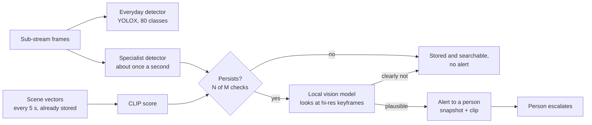

# Research — Models for Argus: Fire & Smoke, Weapons, and What Else to Add

State as of 6 October 2026. Licences were read from each project's GitHub or Hugging Face page on
that date. They change, so re-check before a model ships to a client. Numbers marked *estimate* are
ours and need measuring on the target server. Sources are at the bottom.

## 0. Short answer

| Need | Recommendation | Why |
| --- | --- | --- |
| **Fire & smoke** | Train our own YOLOX on open data (D-Fire, CC0; FASDD, CC BY 4.0). Run it about once a second next to the everyday detector, alert only when the detection persists, and send the alert to a person. Add a free smoke/fire score on the scene vectors Argus already stores. | Every ready-made fire model we found is AGPL (trained with Ultralytics) or research-only. The open datasets are fine. Single-frame detectors raise too many false alarms; a 2026 study cut them from 52 % to 4 % with multi-frame confirmation. |
| **Weapons** | Keep "not offered". For a client pilot only: person crop from the main stream → weapon detector → persistence check → local vision model as a veto → **a guard decides**. Data from Open Images (CC BY 4.0) plus staged footage on the client's own cameras. | 0.1 % false positives at 25 fps is 90 false alarms an hour. Commercial systems still fail in public (a bag of chips led to a student being handcuffed, October 2025). Most CCTV gun datasets are non-commercial. |
| **Cheapest win** | Replace the CLIP weights (B/32, LAION-400M) with OpenCLIP B/32 LAION-2B (MIT). | Same architecture and speed, better on every benchmark we checked: COCO retrieval +3.9, Flickr +5.2, ImageNet +3.6 points. |
| **Next most useful** | A `look` tool: a small local vision-language model (Qwen3.5 2B/4B or Gemma 4 E2B/E4B, both Apache-2.0, vision supported in Ollama) reads the evidence frames when a question needs it. | Covers what CLIP can't (counting, "what was he doing"), double-checks alerts, and costs nothing until asked. |
| **Also worth adding** | Plate reading (fast-plate-ocr, MIT), person-down from pose (RTMPose, Apache-2.0, 3–5 ms per person on CPU), open-vocabulary auto-labelling for objects a customer names (OWLv2 / OmDet-Turbo, Apache-2.0), sound events from camera microphones (YAMNet, Apache-2.0). | All run on CPU through ONNX and have permissive licences. |

## 1. What a model must pass to enter Argus

1. **Commercial-use licence for code, weights *and* training data**: Apache-2.0, MIT, BSD, CC0, CC BY.
   Not AGPL/GPL, not CC BY-NC, not "research only".
2. **Runs on CPU** through ONNX Runtime at a cost a site server can carry for all its cameras.
3. **Portable to C++**: an ONNX graph plus pre/post-processing in plain numpy/OpenCV.
4. **Fits an existing slot** (section 2): the `Detector` protocol, the CLIP vectors, or a chat tool.

The trap: most free fire and gun models on Hugging Face were trained with Ultralytics, whose position
is that models trained and exported with its AGPL code are AGPL too (unless you buy its enterprise
licence). That rules out nearly every ready-made fire and gun model, including Pyronear's YOLO11
wildfire models.

Web-scraped datasets (even CC0 or CC BY collections) don't clear the copyright of each photo. Training
on them is common practice; keep a short model card per trained model listing every dataset and its
licence, so a client's lawyer can check.

### Excluded (checked 2026-10-06)

| Model / data | Licence | Note |
| --- | --- | --- |
| Ultralytics YOLOv5/v8/11/26, YOLOv10, YOLOv12, YOLOE, and weights trained with them (most Hugging Face fire/gun models, Pyronear YOLO11) | AGPL-3.0 | Copyleft reaches the shipped model |
| YOLOv6, YOLOv7, YOLOv9 (original repo), YOLO-World, DOSOD | GPL-3.0 | Same |
| YOLO-NAS weights | Non-commercial | |
| MetaCLIP / MetaCLIP 2 | CC BY-NC 4.0 | |
| MobileCLIP2, DFN CLIP | Apple research licence | |
| Moondream 3 | BSL 1.1, no third-party service | We would be the service |
| Rex-Omni | IDEA licence + Qwen research licence | |
| SAM 3 | SAM Licence: forbids use related to "the development or use of guns or illegal weapons" | Can't touch the weapons work; also GPU-sized |
| SH17 (PPE), OmniFall (falls, as a whole), RWF-2000 (fights), SAFIRE (fire benchmark) | Non-commercial | Evaluation at most |
| DETR family (RT-DETR, D-FINE, DEIM, RF-DETR) | Apache-2.0 | Licence fine, but already ruled out as too heavy for GPU-less servers |

## 2. Where new models plug in

| Slot | Today | What a new model needs |
| --- | --- | --- |
| **Detector** ([detector.py](../../projects/object-detection/src/detector.py)) | One YOLOX ONNX per pipeline; a custom-trained YOLOX only needs `class_names` in the config | `Pipeline` holds a single detector ([pipeline.py](../../projects/object-detection/src/pipeline.py)). A second model (fire/smoke, weapons, plates) needs a small composite `Detector` that runs each model at its own interval and merges the boxes. One combined COCO + fire model is not worth it: COCO would have to be re-labelled for the new classes. |
| **CLIP vectors** | Every scene (frame + 2×2 tiles) every 5 s and every tracked object every 2 s are embedded and stored | A linear classifier on stored vectors costs one dot product. |
| **Hi-res crops** | Main-stream keyframes (~1/s) give full-resolution crops of tracked objects | The right input for small things: guns, plates, faces. |
| **Chat tools** ([tools.py](../../projects/argus/src/tools.py), [llm.py](../../projects/argus/src/llm.py)) | Text only: the model sees JSON results, never pixels | A `look` tool that runs a *local* vision model and returns text. The cloud model (Claude) then still never receives images. |

Rare, costly events (fire, weapons) should all go through the same chain: cheap signals first,
persistence second, a second opinion third, and a person last.

## 3. Fire and smoke

### 3.1 What to expect

- **False alarms are the problem, not misses.** A 2026 review of fire detection on surveillance video
  puts precision at about 75 % in the best cases and 60 % on average: detectors find fire but also
  find many things that aren't.
- **Persistence fixes most of it.** Dumitru & Spînu (2026) cut the fire/smoke false-alarm rate on
  video clips from 52 % to 4 % (fire 69 % → 6 %, smoke 22 % → 0 %) with multi-frame confirmation and
  confidence-weighted voting. MULTICAST did the same for guns (section 4).
- **Confusers**: sunsets, clouds, fog, steam (firefighting water vapour is often called smoke), warm
  lamps and streetlights, headlights, emergency lights, reflections.
- **Night**: cameras switch to infrared grayscale and flames saturate, so colour cues vanish. Training
  data must include grayscale/IR images.
- **Data beats architecture**: models trained on one dataset transfer poorly to another (20-year
  dataset review). On the FireAndSmoke dataset, YOLOv5 through YOLOv10 all reach about 0.91 mAP@50 for
  fire. Footage from the client's own cameras matters more than which detector we pick.
- **Vision-language models are weak at fire scenes too**: on SAFIRE (September 2026), ten open models
  of 8–38B parameters averaged 61.9 %. Use them to veto obvious confusers, never to detect alone.
- **Standards**: NFPA 72 accepts video smoke/flame detection only when the whole system is *listed*
  for it (UL 268B covers video image smoke detectors). Argus's fire alerts are an extra pair of
  eyes, not the fire alarm, and must be described that way.

### 3.2 Datasets we can use

| Dataset | Size | Classes | View | Licence | Use |
| --- | --- | --- | --- | --- | --- |
| **D-Fire** | 21,527 images; 14,692 fire + 11,865 smoke boxes; 9,838 images with neither | fire, smoke (YOLO format) | Ground level, mostly web images | CC0 (authors note they hold no copyright over the source images) | **Train** |
| **FASDD** | 122,634 images (FASDD_CV ≈ 95k ground level, plus drone and satellite subsets) | flame, smoke | Mixed | CC BY 4.0 | **Train** (CV subset) |
| **Pyro-SDIS** (Pyronear) | 12,378 images, 12,137 smoke boxes, 1,634 negatives | smoke | Fixed towers, long-range wildfire | Apache-2.0 | Train, only for outdoor sites with a horizon view |
| Pyronear OpenFire | 1k–10k images | Wildfire | Outdoor | Apache-2.0 | Optional |
| FireAndSmoke (Catargiu et al., 2024) | 22k+ images, 93k instances | fire, smoke, **other** (sunsets, lamps, headlights, emergency lights…) | Ground level | CC BY per the paper; the repo has no licence file | Hard negatives, once the licence is confirmed |
| FireSense | 49 videos | fire/smoke vs none | Ground level | CC BY 4.0 | Test (video) |
| MIVIA fire / smoke | 31 fire + 149 smoke videos | fire / smoke vs none | Ground level | Check | Test (video) |
| MmodalFire (2026) | 65 indoor videos with smoke-density, temperature and IR/UV sensor traces | fire / non-fire | Indoor | Check | Test, indoor |
| SAFIRE (2026) | 83k captioned images, 20 scenario types | Classification, Q&A | Mixed | CC BY 4.0, but the paper limits it to non-commercial research | Benchmark only |

### 3.3 Models and training

- **No ready-made model we can ship.** Public weights are Ultralytics (AGPL), Darknet/YOLOv5 weights
  from the D-Fire authors' repo (not our format; YOLOv5 is AGPL), or research code.
- **Train YOLOX ourselves** with the official repo (Apache-2.0), starting from COCO weights. The export
  uses the same ONNX layout and decoder Argus already runs, so the only config change is
  `path` plus `class_names: [fire, smoke]`.
  - Start with **YOLOX-Tiny** (416 px, 6.45 GFLOPs). Move to **YOLOX-S** (640 px, 26.8 GFLOPs) if small
    or distant smoke is missed.
  - Data: all of D-Fire + FASDD_CV, Pyro-SDIS only for outdoor sites. Remove near-duplicates across
    datasets (perceptual hash) *before* splitting, because web-scraped sets overlap.
  - Augment for CCTV: grayscale (night IR), H.264/JPEG artefacts, downscaling to sub-stream
    resolution, blur.
  - Expect roughly 78–81 % mAP@0.5 on D-Fire, which is what published lightweight YOLO variants reach
    (YOLOv11-CHBG 78.4 %, YOLOGX 80.9 %; heavier ones up to 89.7 %). mAP is not the acceptance metric
    though (section 3.5).
  - Cost: hours on one rented GPU, not days (*estimate*).
- **Alternative trainer**: LibreYOLO (MIT code, trains YOLOX and YOLOv9, exports ONNX/OpenVINO).
  Friendlier API, but a young project with one main maintainer; the official YOLOX repo is the safer
  default.

### 3.4 Recommended design

1. **Free score from CLIP.** Argus already embeds every scene every 5 s, and `search` can already rank
   scenes for "smoke" (the scene tiles exist precisely for things the detector has no class for).
   - Zero-shot: compare scene vectors with "smoke", "flames", "a fire" against negatives ("fog",
     "steam", "sunset", "car headlights", "a lamp").
   - Then a linear probe: logistic regression on the 512-number vectors of D-Fire/FASDD images,
     embedded with the same CLIP model. Store a smoke/fire score per scene.
   - Use: questions like "any smoke in the warehouse last night?", and one vote in the persistence
     check. Not alarm-grade on its own: on SAFIRE, a CLIP + SVM classifier reached F1 ≈ 0.79 with 30 %
     of the labels.
2. **Specialist detector** (YOLOX-Tiny fire/smoke) every 0.5–1 s instead of every frame, since fire
   develops over seconds. Boxes allow zones ("smoke near the generator") and growth checks. At two runs
   a second it costs about as much as YOLOX-Nano at 10 fps (*estimate* from FLOPs).
3. **Persistence check**, no model: alert only if the detector or the CLIP score fires in N of the
   last M checks (e.g. 5 of 8 over ~8 s), in about the same place. Flames flicker and smoke spreads;
   a static lamp does neither.
4. **Second opinion, then a person.** For a candidate that persists, send 2–3 hi-res keyframes to the
   local vision model: "Is there real fire or smoke? yes/no and one reason". It may veto (a kettle's
   steam, a sunset), never confirm alone. Then alert a person with the snapshot and clip.
5. **Cheaper signals where a site has them.**
   - Cameras with microphones: YAMNet recognises "Smoke detector, smoke alarm" and "Fire alarm". An
     existing alarm going off is a very specific signal and costs almost nothing to hear.
   - Cameras with built-in fire analytics (thermal / bi-spectrum, Hikvision HEOP, Dahua WizMind): take
     their events over ONVIF instead of detecting again.

### 3.5 Acceptance test (per site, before alerts go live)

- **False alarms per camera per day** on at least 7 days of the client's normal footage. Agree the
  target with the client before the pilot.
- **Detection rate and seconds to alert** on positive clips: MIVIA, FireSense and MmodalFire videos,
  plus a controlled smoke test on site if the client allows it.

## 4. Weapons

### 4.1 Why "not offered" is still right

- **Base rates.** Guns are rare, frames are not: a 0.1 % false-positive rate at 25 fps gives 90 false
  alarms an hour on one camera (University of Granada). Guards switch such systems off.
- **Small objects on the sub stream.** A handgun is a handful of pixels in a 640×360 frame, often
  partly hidden by a hand or clothing.
- **Confusers**: phones, wallets, cards, umbrellas, drills, black bags, shadows.
- **Pose is a weak cue**: a February 2026 study notes that people carrying guns tend to walk normally,
  so "arm extended" rules add little.
- **Real deployments still fail in public:**
  - Omnilert, Baltimore County, October 2025: an empty Doritos bag was flagged as a gun; police
    handcuffed and searched a student.
  - ZeroEyes routes every detection through a 24/7 human verification centre before alerting, and
    still had false alarms: a shadow of a student's arm triggered a school lockdown in Texas
    (October 2023); theatre prop guns triggered a lockdown and police response at a university
    (June 2024).
  - The FTC acted against Evolv (November 2024) for overstating what its AI weapon screening detects.
    The order bans unsupported claims and let some school customers cancel their contracts.

Lesson for us: never let a model call the police, and only claim what our own site tests show.

### 4.2 Datasets

| Dataset | Content | Licence | Use |
| --- | --- | --- | --- |
| **Open Images V7** | Boxes for Handgun, Rifle, Shotgun, Weapon, Knife, Kitchen knife, Dagger, Sword, and confusers (phones, umbrellas…). Everyday photos, not CCTV | Annotations CC BY 4.0; images listed as CC BY 2.0 | **Main training source** |
| OD-WeaponDetection (University of Granada) | Pistol and knife detection, plus "Sohas": pistol, knife, smartphone, bill, purse, card (the classic confusers) | Repo: CC BY 4.0; project page says "research purpose" | Train after written confirmation |
| YouTube-GDD | Frames from YouTube videos, with context | Repo Apache-2.0; the frames belong to the uploaders | Caution |
| US Real-time gun detection in CCTV (University of Seville) | Real university CCTV + Unity synthetic images | CC BY-NC 4.0; commercial use by agreement | Test, or ask |
| UCLM firearm action dataset (2024) | 398 videos: handgun, machine gun, none; PTZ camera + phones, actors | CC BY-NC 3.0; commercial use with permission | Test, or ask |
| CCTV-Gun benchmark | Combines Monash Guns, Seville and UCF-Crime | Each source's terms (mostly research) | Test only |

### 4.3 If a client asks for a pilot

1. **Where**: only chosen cameras and zones (entrances, cash desks), chosen hours.
2. **Input**: tracked people → hi-res crop from the main-stream keyframe (Argus already builds these
   for search) → detection on the crop, where the gun has many more pixels than in the sub stream.
3. **Detector**: YOLOX-S on person crops; classes handgun, long gun, knife, *plus confuser classes*
   (phone, wallet, umbrella, tool). Confuser classes reduce false positives in the Granada studies.
4. **Persistence** on the same track over several crops. MULTICAST (spatial + temporal confirmation)
   removed 80 % of false alarms compared with a single-frame Faster R-CNN; a two-stage detector with a
   temporal window removed 71 % at 34 fps.
5. **Local vision model as a veto** on the crops ("is this person holding a gun?").
6. **A guard decides**, on a phone, with the crop and the clip. Wording: "possible weapon, please
   check". Argus never escalates by itself.
7. **Data we own**: staged walk-throughs with replica/airsoft guns on the client's own cameras (real
   angles, lenses, IR) + Open Images + synthetic renders if needed.
8. **Acceptance**: false alarms per camera per day on a normal week, and detection rate on staged
   walk-throughs. Marketing quotes only these numbers.

Knives: the everyday COCO detector already has a `knife` class, but it learned kitchens, not CCTV.
Treat knives exactly like guns.

## 5. Other models worth adding

### 5.1 Better search vectors (CLIP)

| Model (OpenCLIP name) | Licence | GFLOPs | ImageNet zero-shot | COCO retrieval\* | Flickr retrieval\* | Work to switch |
| --- | --- | --- | --- | --- | --- | --- |
| ViT-B-32-quickgelu `laion400m_e32` (**today**) | MIT | 14.8 | 62.9 | 44.0 | 70.3 | — |
| **ViT-B-32 `laion2b_s34b_b79k`** | MIT | 14.8 | 66.6 | 47.8 | 75.4 | `ARCH = "ViT-B-32"` + weights URL in [export_clip.py](../../projects/object-detection/src/export_clip.py); re-embed |
| ViT-B-32 `datacomp_xl_s13b_b90k` | MIT | 14.8 | 69.2 | 45.3 | 70.0 | Same |
| ViT-B-32-256 `datacomp_s34b_b86k` | MIT | 17.5 | 72.8 | 48.9 | 74.9 | Also 256 px input in `clip_onnx.preprocess` (fixed at 224 today) |
| ViT-B-16-SigLIP `webli` | Apache-2.0 | 46.4 | 76.0 | 56.8 | 81.9 | ~3× CPU per crop; different tokenizer and normalisation |

\* Retrieval scores from the OpenCLIP benchmark table, comparable within the table.

- **LAION-2B B/32 is a drop-in**: best retrieval at today's cost (~55 ms per crop on a laptop CPU).
- Bigger jumps (SigLIP / SigLIP 2 B/16, PE-Core B/16, all Apache-2.0) cost about 3× per crop. Worth it
  on GPU sites, or for objects only. SigLIP 2 is multilingual, which matters if clients will ask in
  languages other than English.
- Vectors from two models can't be compared. Tag each stored row with its model, or start a new store
  and let the old rows expire (30 days), or re-embed from the recordings (7 days).
- Keep float32: int8 already reordered results too much (see [REPORT.md](../../projects/object-detection/REPORT.md)).

### 5.2 A `look` tool with a local vision-language model

**Design**: a new chat tool, `look(evidence, question)`. The chat model passes thumbnails or hi-res
crops it already found; a local vision model answers in text. It runs locally even when the chat model
is Claude, so images never leave the site; only the text answer reaches the cloud model, and the
privacy section of the product description should say so.

**Why at question time**: captioning every scene every 5 s on every camera is too heavy for a CPU.
At question time only the top 4–8 frames need reading. Per-scene captions (on the roadmap) can come
later, sparsely, with the smallest models.

**Bonus**: Qwen3.5's small models are natively multimodal *and* call tools. `qwen3.5:4b` could replace
today's `qwen3:4b` and look at frames itself. Decide with the planned evaluation questions.

| Model | Sizes | Licence | Runs in | Notes |
| --- | --- | --- | --- | --- |
| **Qwen3.5** (Feb 2026) | 0.8B, 2B, 4B, 9B | Apache-2.0 | Ollama (vision, tools, thinking; 1.2–7.6 GB), llama.cpp | Same family as today's chat model |
| **Gemma 4** (2026) | E2B, E4B (also 12B, 26B-A4B, 31B) | Apache-2.0 | Ollama (vision, tools, audio) | Visual token budget 70–1120: a direct speed-vs-detail knob on CPU |
| Qwen3-VL | 2B, 4B, 8B | Apache-2.0 | Ollama, llama.cpp | Previous generation, good at boxes and grounding |
| SmolVLM2 | 256M, 500M, 2.2B | Apache-2.0 | llama.cpp, ONNX | Small enough for sparse per-scene captions |
| Florence-2 | 0.23B, 0.77B | MIT | ONNX / transformers | Captions, phrase grounding and OCR in one small model |
| Granite Vision | 2B | Apache-2.0 | Ollama (3.2) | Tuned for documents and charts |
| InternVL3.5 | 1B, 2B | Apache-2.0 | transformers | |
| Moondream 2 | ~2B | Apache-2.0 | Ollama | Caption, detect, point (Moondream 3 is excluded) |

Speed: on CPU, expect seconds per image for 1–4B models, growing with image size; keep images around
384–640 px (*estimate, measure*). Unsloth's Qwen3.5 GGUF files don't do vision in Ollama (separate
projector file); use Ollama's own `qwen3.5` tags, or llama.cpp's `llama-server` with `--mmproj`.

### 5.3 Number plates

| Part | Option | Licence | Note |
| --- | --- | --- | --- |
| Reading | **fast-plate-ocr** (small CCT models, ONNX) | MIT, weights included (author's statement, 2026) | Global model with optional region prediction; sub-millisecond per plate on a GPU, tiny on CPU |
| Finding plates | **Train YOLOX** on Open Images "Vehicle registration plate" + regional data | CC BY 4.0 annotations | Fits the pipeline; run on vehicle crops |
| Finding plates (ready-made) | open-image-models YOLOv9-t/s | MIT code; weights trained with a fork of the GPL-3.0 YOLOv9 repo, on ~11k web images | Legal check first |
| Finding plates (ready-made) | OpenCV Zoo LPD-YuNet | Apache-2.0 | Trained on Chinese plates only |
| Other text | PaddleOCR PP-OCR | Apache-2.0 | Truck logos, signs, container numbers |

Gives exact answers to "when did plate 123-ABC come in?", and matches the plates service line.

### 5.4 Pose: person down, hands up

- **RTMPose** via **rtmlib** (Apache-2.0, ONNX Runtime/OpenVINO). It is top-down, so it runs on the
  person tracks Argus already has. On an Intel i7-11700 CPU: RTMPose-t 3.2 ms and RTMPose-s 4.5 ms per
  person (COCO AP 65.9 / 69.7); RTMPose-m 75.8 AP at 90+ fps. Prefer COCO-only checkpoints: the
  multi-dataset ones mix in sets with their own terms.
- **Person down** = keypoints + box shape + time on the ground, as a rule. Tune on CAUCAFall and EDF
  (CC BY 4.0); OmniFall as a whole is non-commercial, so evaluation only.
- MediaPipe Pose (Apache-2.0, in OpenCV Zoo, with C++ demos) is the alternative.
- PaddleDetection's PP-Human (Apache-2.0) has fall, fight, smoking and phone-call pipelines; useful as
  a reference design, but it needs Paddle → ONNX conversion.

### 5.5 Open-vocabulary detection: deep scan and auto-labelling

| Model | Licence | Speed |
| --- | --- | --- |
| OWLv2 base | Apache-2.0 | ~3 s per 640×480 image on CPU (third-party measurement) |
| OmDet-Turbo-T | Apache-2.0 | ~20 fps in PyTorch fp32, 140 fps with TensorRT on an A100; no CPU numbers published |
| Grounding DINO tiny | Apache-2.0 | Heavy; repo idle since 2024 |
| Florence-2 | MIT | "Several seconds" per image on CPU |

Excluded: YOLO-World (GPL-3.0), YOLOE (AGPL-3.0), DOSOD (GPL-3.0).

Two uses, both fine at seconds per image:

1. **Deep scan** (already planned in [REPORT.md](../../projects/object-detection/REPORT.md)): run on a
   chosen time window of recorded keyframes, as a background job.
2. **Auto-labelling**: when a customer names an object that is not one of the 80 ("forklift",
   "pallet", "ladder"), the open-vocabulary model labels their footage, a person fixes the labels, and
   we train a YOLOX specialist that runs live. This closes the product description's gap ("any object
   a customer names… need a model trained for it").

### 5.6 Sound events

**YAMNet** (Apache-2.0, MobileNet, 521 AudioSet classes) recognises "Smoke detector, smoke alarm",
"Fire alarm", "Gunshot, gunfire", "Explosion", "Glass" / "Shatter", "Screaming", "Shout", "Car alarm"
and sirens, at negligible CPU cost. Only for cameras with microphones, and only where local law allows
listening: classify in memory and keep only the event label, never the audio.

### 5.7 Following a person across cameras

For the multi-camera timeline on the roadmap: start with the CLIP object vectors Argus already stores,
plus which cameras are next to each other and how long the walk takes. If that's not enough: OpenCV Zoo's
Youtu ReID (Apache-2.0, ONNX, C++ demo), or OSNet (torchreid, MIT code). The usual re-ID training sets
(Market-1501, MSMT17) are released for research, and DukeMTMC was withdrawn by its authors in 2019, so
check the weights' training data. Treat re-ID like faces: client approval first.

### 5.8 Safety gear (PPE), for industrial clients

Train YOLOX on **SHWD** (MIT; 7,581 images, helmeted vs bare heads) and **Hard Hat Workers** (public
domain; some Roboflow variants CC BY 4.0). SH17 is CC BY-NC-SA, so excluded.

### 5.9 Fights and violence

Postpone. The datasets are mostly YouTube or movie clips under research terms (RWF-2000 needs its
lab's approval for commercial use), and video models are heavy on CPU. Meanwhile: pose rules (several
people, fast limb motion, someone down) as candidates, checked by the `look` tool.

### 5.10 Rules that need no new model

- **Camera tampering**: picture blurred (Laplacian variance), blocked (flat histogram), too dark, or
  moved (compare with a reference frame). Operationally very valuable.
- **Abandoned object**: a bag or suitcase track that stays still for N minutes with no person near it.
- **Crowding / queue**: person count in a zone above N.
- **Wrong way**: already possible with a one-direction line rule.

### 5.11 The everyday detector

Keep YOLOX. Data, not architecture, limits fire and weapons. Permissive alternatives if we ever need
them: NanoDet-Plus (Apache-2.0, also in OpenCV Zoo, very fast on CPU), PP-PicoDet / PP-YOLOE+
(Apache-2.0), DAMO-YOLO (Apache-2.0), and MultimediaTechLab/YOLO (MIT training code for the YOLOv9 and
YOLOv7 architectures).

## 6. Suggested order

| # | Step | Size | Gives |
| --- | --- | --- | --- |
| 1 | CLIP B/32 LAION-2B: export, re-index the sample video, compare answers on the test questions | S | Better search everywhere |
| 2 | Smoke/fire CLIP score on scene vectors: zero-shot, then a probe trained on D-Fire/FASDD | S | "Any smoke last night?" + a cheap vote for alerts |
| 3 | `look` tool with a local vision model; try `qwen3.5:4b` as the chat model | M | Counting, actions, a second opinion on alerts |
| 4 | Composite detector + YOLOX fire/smoke + persistence check + veto | M–L | Fire/smoke alerts, ready for a pilot |
| 5 | Plate detector (YOLOX) + fast-plate-ocr | M | Exact plate search |
| 6 | RTMPose on person tracks + person-down rule | M | Person-down alerts |
| 7 | Open-vocabulary auto-labelling → per-customer YOLOX | L | "Any object the customer names" |
| 8 | Sound events (YAMNet) where cameras have microphones and the law allows | S–M | Smoke alarms, breaking glass, screams |
| 9 | Weapons pilot with one client: staged data, a guard in the loop | L | Only if the false-alarm test passes |

S = days, M = 1–3 weeks, L = longer (rough).

## Sources

**Fire and smoke**

- D-Fire dataset (licence file: CC0): https://github.com/gaia-solutions-on-demand/DFireDataset
- FASDD: https://essd.copernicus.org/preprints/essd-2023-73/
- Pyro-SDIS: https://huggingface.co/datasets/pyronear/pyro-sdis
- Pyronear OpenFire: https://huggingface.co/datasets/pyronear/openfire
- FireAndSmoke dataset and YOLOv5–v10 comparison: https://pmc.ncbi.nlm.nih.gov/articles/PMC11398105/
- Fire and smoke datasets in 20 years (review): https://arxiv.org/abs/2503.14552
- MIVIA fire detection dataset: https://mivia.unisa.it/datasets/video-analysis-datasets/fire-detection-dataset/
- MmodalFire (Scientific Data, 2026): https://www.nature.com/articles/s41597-026-06810-6
- SAFIRE benchmark (2026): https://arxiv.org/abs/2609.07823
- Temporal event validation, 52 % → 4 % false alarms (Dumitru & Spînu, 2026): https://arxiv.org/abs/2607.03131
- Track-level verification of fire/smoke alarms (STV-FSANet, 2026): https://doi.org/10.3390/s26154970
- Real-time fire detection from video surveillance cameras, where are we now?: https://www.researchgate.net/publication/400740974_Real-time_fire_detection_from_videosurveillance_cameras_where_are_we_now
- YOLOv11-CHBG on D-Fire: https://www.mdpi.com/2571-6255/8/9/338
- SFFA-YOLO: https://doi.org/10.3390/app16031599
- UL 268B (video image smoke detectors): https://www.shopulstandards.com/ProductDetail.aspx?UniqueKey=19730
- NFPA 72 and video image detection: https://www.jensenhughes.com/insights/whats-the-deal-with-video-image-detection
- Hikvision HEOP fire and smoke detection: https://partner.hikvision.com/tpp/Solution/SolutionDetail?Id=3c3a9953-f653-45ad-917e-9fb395e317c0
- YOLOX: https://github.com/Megvii-BaseDetection/YOLOX
- LibreYOLO: https://github.com/LibreYOLO/libreyolo

**Weapons**

- Omnilert incident (CNN): https://www.cnn.com/2025/10/25/us/baltimore-student-chips-ai-gun-detection-hnk
- AI Incident Database #1250: https://incidentdatabase.ai/cite/1250/
- ZeroEyes operations center: https://zeroeyes.com/operations-center
- ZeroEyes false alarms and expert criticism (StateScoop, 2024): https://statescoop.com/zeroeyes-school-safety-ai-firearm-detection-2024/
- FTC action against Evolv: https://www.ftc.gov/news-events/news/press-releases/2024/11/ftc-takes-action-against-evolv-technologies-deceiving-users-about-its-ai-powered-security-screening
- False-positive reduction in handgun detection (90 false alarms/hour): https://link.springer.com/article/10.1007/s00521-020-05365-w
- MULTICAST: https://arxiv.org/abs/2104.11653
- Effective strategies for real-time weapons detection (−71 % false positives): https://doi.org/10.3390/app14188198
- Are handgun detection models ready for camera surveillance? (2026): https://link.springer.com/chapter/10.1007/978-3-032-15993-9_8
- Handgun detection with pose + appearance: https://arxiv.org/abs/2010.13753
- Open Images boxable classes: https://storage.googleapis.com/openimages/v7/oidv7-class-descriptions-boxable.csv
- Open Images licence: https://storage.googleapis.com/openimages/web/index.html
- OD-WeaponDetection: https://github.com/ari-dasci/OD-WeaponDetection and https://sci2s.ugr.es/weapons-detection
- YouTube-GDD: https://github.com/UCAS-GYX/YouTube-GDD
- US Real-time gun detection in CCTV dataset: https://github.com/Deepknowledge-US/US-Real-time-gun-detection-in-CCTV-An-open-problem-dataset
- UCLM firearm action dataset: https://pmc.ncbi.nlm.nih.gov/articles/PMC10827673/
- CCTV-Gun benchmark: https://github.com/srikarym/CCTV-Gun
- SAM 3 licence: https://github.com/facebookresearch/sam3/blob/main/LICENSE

**Other models**

- OpenCLIP benchmark results: https://github.com/mlfoundations/open_clip/blob/main/docs/openclip_results.csv
- OpenCLIP B/32 LAION-2B: https://huggingface.co/laion/CLIP-ViT-B-32-laion2B-s34B-b79K
- SigLIP 2: https://huggingface.co/google/siglip2-base-patch16-224
- Perception Encoder: https://huggingface.co/facebook/PE-Core-B16-224
- Qwen3.5: https://huggingface.co/Qwen/Qwen3.5-4B and https://ollama.com/library/qwen3.5
- Gemma 4: https://huggingface.co/google/gemma-4-E4B-it and https://ollama.com/library/gemma4
- Qwen3-VL: https://huggingface.co/Qwen/Qwen3-VL-4B-Instruct
- SmolVLM2: https://huggingface.co/HuggingFaceTB/SmolVLM2-500M-Video-Instruct
- Florence-2: https://huggingface.co/microsoft/Florence-2-base
- Moondream 3 licence: https://huggingface.co/moondream/moondream3-preview
- Running Qwen3.5 locally (Unsloth): https://unsloth.ai/docs/models/qwen3.5
- fast-plate-ocr: https://github.com/ankandrew/fast-plate-ocr
- Plate model weight licences (author's answers): https://github.com/ankandrew/fast-alpr/issues/49, https://github.com/ankandrew/open-image-models/issues/20, https://github.com/ankandrew/open-image-models/issues/22
- OpenCV Zoo: https://github.com/opencv/opencv_zoo
- RTMPose: https://arxiv.org/abs/2303.07399
- rtmlib: https://github.com/Tau-J/rtmlib
- OmniFall: https://arxiv.org/abs/2505.19889
- PP-Human: https://github.com/PaddlePaddle/PaddleDetection/blob/release/2.9/deploy/pipeline/README_en.md
- RWF-2000: https://github.com/mchengny/RWF2000-Video-Database-for-Violence-Detection
- OWLv2: https://huggingface.co/google/owlv2-base-patch16-ensemble
- OWLv2 CPU timing: https://github.com/kurtvalcorza/owlv2-detection-pipeline
- OmDet-Turbo: https://arxiv.org/abs/2403.06892
- Grounding DINO: https://github.com/IDEA-Research/GroundingDINO
- YOLO-World: https://github.com/AILab-CVC/YOLO-World
- YOLOE: https://github.com/THU-MIG/yoloe
- YAMNet: https://github.com/tensorflow/models/tree/master/research/audioset/yamnet
- SHWD: https://github.com/njvisionpower/Safety-Helmet-Wearing-Dataset
- Hard Hat Workers: https://public.roboflow.com/object-detection/hard-hat-workers
- SH17: https://github.com/ahmadmughees/SH17dataset
- NanoDet: https://github.com/RangiLyu/nanodet
- MultimediaTechLab/YOLO: https://github.com/MultimediaTechLab/YOLO
