<div align="center">


# Mobius Tensors — AI Solution Platform

    

2026-09-21 · @Someone · merged on 2026-10-06 from the Platform, Architecture, Roadmap, Implementation Plan and Ideas docs

</div>

---

> **Status, October 2026.** This is the plan written in September 2026. The code has since taken a
> simpler shape: [`projects/argus`](../../projects/argus/)'s engine runs detection
> (YOLOX on ONNX Runtime), tracking, zone/line rules, alerts and search in **one process per
> camera** ([`pipeline.py`](../../projects/argus/src/argus/engine/pipeline.py)), and
> the Argus product layer builds video memory and chat on top of it. ZeroMQ
> services, the FastAPI dashboard backend and the multi-site control plane below are still plans.
> How to install a site today: [Site Installation Guide](Site%20Installation%20Guide%20—%20IP%20Cameras,%20PoE%20Switch%20and%20Server.md).

## Contents

**Part 1 — Company and product**
1. [Company overview](#1-company-overview)
2. [Product vision: first product](#2-product-vision-first-product)
3. [Use cases (draft scope)](#3-use-cases-draft-scope)
4. [Ideas: what else cameras could watch for](#4-ideas-what-else-cameras-could-watch-for)

**Part 2 — Architecture**
5. [Architecture layers](#5-architecture-layers)
6. [System context and containers](#6-system-context-and-containers)
7. [Pipeline and messaging](#7-pipeline-and-messaging)
8. [Technology stack](#8-technology-stack)
9. [Data architecture](#9-data-architecture)
10. [Security and network architecture](#10-security-and-network-architecture)
11. [Deployment and scaling](#11-deployment-and-scaling)
12. [Client lifecycle](#12-client-lifecycle)

**Part 3 — Plan**
13. [Roadmap phases](#13-roadmap-phases)
14. [Step by step: from trained model to app](#14-step-by-step-from-trained-model-to-app)
15. [What to build first](#15-what-to-build-first)
16. [Open questions and risks](#16-open-questions-and-risks)
17. [Glossary](#17-glossary)

---

# Part 1 — Company and product

## 1. Company overview

**Mobius Tensors** is an AI and solutions company. Rather than building one-off computer-vision projects for each client, the strategy is to build a single, reusable AI solution platform that runs on standard servers and can be configured to support many different use cases from one shared codebase and infrastructure.

The founding thesis: most "AI security/monitoring" problems (fire, license plates, perimeter intrusion, etc.) share the same underlying pipeline — video/image ingest, object detection, event logic, and alerting/output. Instead of re-engineering that pipeline per client or per use case, Mobius Tensors builds it once, well, and swaps in the relevant detection model and business rules per deployment.

**Why this matters:**

- Faster time-to-pilot for new clients/use cases (new use case = new model + rules, not a new system)
- Lower cost of goods, since compute, ingest, and messaging infrastructure are shared across deployments
- A defensible product (the platform) instead of a portfolio of bespoke, hard-to-maintain scripts

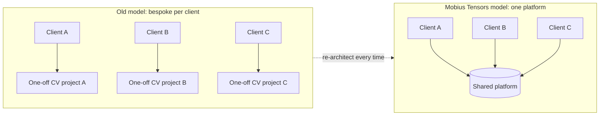

**Business architecture** — the structural bet: one shared platform serves every client, instead of a bespoke build per client.

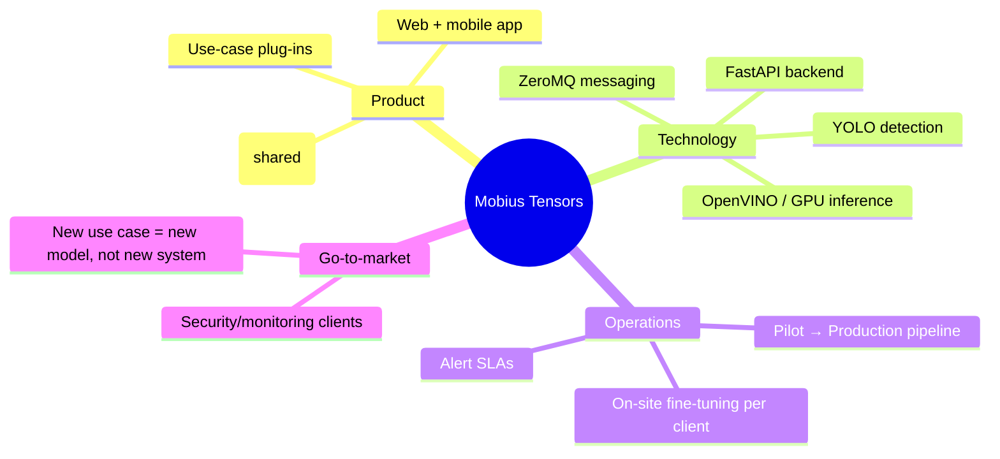

## 2. Product vision: first product

The first product is a **server-side AI solution draft** — a working prototype platform that ingests video streams and runs computer-vision (CV) detection models on them, then emits structured events for downstream use (alerts, dashboards, logging, integration with existing security/NVR systems).

The platform is designed to be **use-case agnostic at the core**: the ingest, inference-serving, and event-messaging layers are shared, while each use case plugs in as a model + a small ruleset. This is what makes it a *platform* rather than a single application.

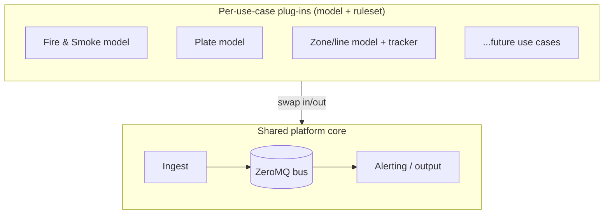

**Design goals for the draft:**

1. Runs on commodity servers (on-prem or cloud VM), no specialized hardware required to start, with an upgrade path to GPU acceleration.
2. Multiple camera streams processed concurrently, with detection results published over a common message bus.
3. Use cases added by swapping a model file and a config, not by rewriting the pipeline.
4. Free / open-source models and libraries only for the draft stage, to keep proof-of-concept cost near zero.

**Initial supported use cases (draft scope):**

- Fire and Smoke Detection
- License Plate Detection (ANPR/LPR)
- Line / Zone Crossing Detection (perimeter and virtual tripwire)

> **Not in scope for now: Gun/Weapon Detection.** Published mAP figures look strong on paper (85–95%+ on benchmark datasets), but the research shows real-world CCTV performance and false-positive rates are not yet proven. We won't sell it as a product until it's demonstrably mature; revisit if a client specifically requests it and budget allows dedicated on-site validation.

## 3. Use cases (draft scope)

| Use case | What it detects | Model approach | Output |
| --- | --- | --- | --- |
| Fire and Smoke Detection | Flame and smoke regions in a frame | YOLO fine-tuned on open fire/smoke datasets (e.g. public wildfire/CCTV fire datasets) | Alert + bounding box + confidence, snapshot saved |
| License Plate Detection | Vehicle + plate region, then OCR on the plate | YOLO for plate localization + open-source OCR (e.g. Tesseract or an open ANPR model) for the characters | Plate text, vehicle snapshot, timestamp |
| Line / Zone Crossing Detection | An object (person/vehicle) crossing a defined virtual line or entering a zone | Any YOLO object-detector + object tracker (e.g. ByteTrack/DeepSORT) + geometry check against the configured line/zone | Enter/exit event, direction, object type |

**Fire and Smoke Detection**

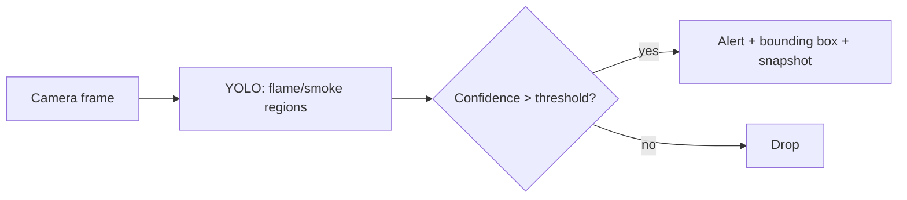

**License Plate Detection**

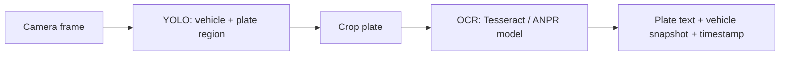

**Line / Zone Crossing Detection**

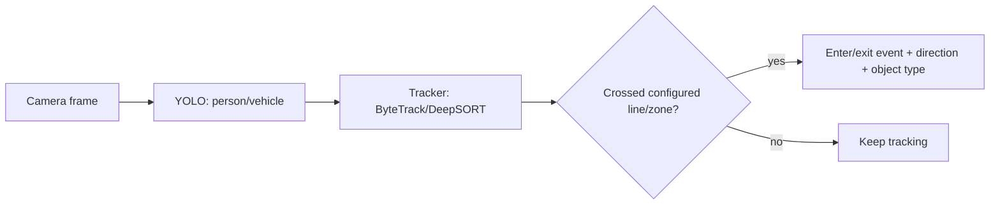

**Common pattern across use cases:** camera feed → YOLO detects relevant objects → use-case-specific logic decides if it's a reportable event → event published on ZeroMQ → alerting service acts on it. New use cases (e.g. hard-hat/PPE compliance, loitering, crowd density) can be added later by following the same pattern.

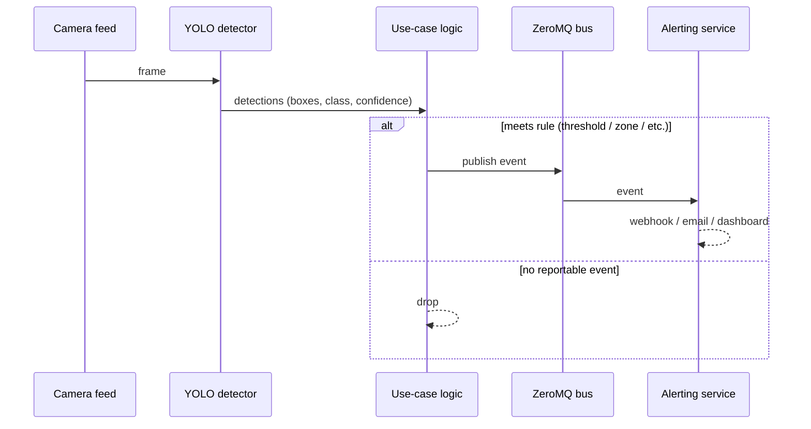

## 4. Ideas: what else cameras could watch for

Things this platform could detect or watch for, using cameras. All of them fit the same camera → model → logic → alert pattern.

**Trust Level** is a rough read of how reliable the detection is today, based on published benchmarks/industry reports (not our own testing):

- 🟢 **Mature** — solid, well-established, production-ready in good conditions
- 🟡 **Needs tuning** — works, but accuracy varies a lot by setup/site and needs calibration
- 🔴 **Experimental** — high false-positive rate, not reliable enough to act on alone yet

### Safety

| Idea | Notes | Trust Level (Benchmark) | Caveat |
| --- | --- | --- | --- |
| Fire & Smoke Detection | | 🟡 Needs tuning — mAP 74-90%, up to ~95% on some datasets | Confused by fog/steam/dust; thin/transparent smoke often missed |
| Gun Detection | | 🔴 Experimental — 84-94% on clean benchmarks, ~73% mAP on realistic ones | Real CCTV footage is far lower quality than benchmark images |
| Shoplifting Detection | | 🔴 Experimental — 89.5% precision but only ~59% recall (zero-shot); ~85% acc (older CNNs) | Behavior-based, not object-based — highly pose/scene dependent |
| Knife Detection | | 🟡 Needs tuning — mAP 70-99% across datasets | Small object at range, motion blur; benchmarks skew toward close-up shots |
| Fall Detection | for elderly care or hospital rooms | 🟢 Mature (controlled settings) — 96-99.7% accuracy | Benchmarks use staged falls; cluttered real environments perform worse |
| Perimeter Watch | see if someone crosses a fence or line they shouldn't | 🟡 Needs tuning — near-100% for simple line-crossing rules | Degrades with weather, distance, low light; animals/foliage cause false alarms |
| Loitering Detection | someone staying too long in one spot | 🟡 Needs tuning — rule-based, no formal benchmark | Very threshold-sensitive: too short = false alarms, too long = misses |
| Fight Detection | | 🟡 Needs tuning — 77-94% accuracy (RWF-2000 benchmark) | Benchmark clips are staged; real scenes (rough play vs. fighting) are ambiguous |
| Left Bag / Package Detection | spot bags left alone | 🟡 Needs tuning — ~91-96% precision/accuracy | Clutter/occlusion in busy scenes; ambiguity in who "owns" a bag |
| Tailgating Detection | more than one person walking through a door meant for one | 🟡 Needs tuning — no independent published benchmark, vendor claims only | Crowded/rapid entries and camera angle strongly affect accuracy |
| Face Mask Check | | 🟢 Mature — 90%+ across multiple models (MAFA dataset) | Accuracy drops at side angles/occlusion, dark masks vs. skin tone |
| Crowd Size Detection | too many people in one place | 🟡 Needs tuning (moderate density); 🔴 Experimental at extremes | Accuracy collapses when very sparse (false positives) or very dense (occlusion) |
| Lonely Kid Detection | child alone in a supermarket, garden/park, etc., with no adult nearby for a set dwell time (e.g. 50 seconds, or a few minutes for a lower-alert tier) | 🔴 Experimental — no established benchmark; combines child/adult age classification (~85-90% on coarse bins) with person tracking to check for a nearby adult | Age estimation from video is unreliable at a distance; a dwell timer helps avoid false alarms from brief occlusion, but the right threshold is scene-dependent and still needs tuning |

### Traffic & Vehicles

| Idea | Notes | Trust Level (Benchmark) | Caveat |
| --- | --- | --- | --- |
| Car Plate Reading | | 🟢 Mature (good conditions) — 93-95%+ recognition accuracy | Degrades a lot in rain/fog/low-light or non-standard plates |
| Car Speed Check | | 🟢 Mature (well-calibrated) — median error ~0.58 km/h (BrnoCompSpeed) | Very sensitive to camera calibration — a bad setup skews every reading |
| Wrong-Way Driving | | 🟡 Needs tuning — vendor claims ~99%, but one independent study found only ~61% real-world recall | Big gap between vendor marketing numbers and field-test results |
| Running a Red Light | | 🟡 Needs tuning — 82-100% across studies, ~92% typical | Needs precise camera/trigger calibration for legal-grade evidence |
| Bad Parking | illegal or double parking | 🟡 Needs tuning — 91-95%+ accuracy | Sensitive to occlusion by other vehicles and lighting/weather |
| Vehicle Counting | how many cars pass, traffic flow | 🟢 Mature — 90-99% accuracy, beat induction loops in one field test | Degrades under heavy congestion, occlusion, bad weather |
| Crash Detection | | 🔴 Experimental — 88-97% on curated benchmarks, but zero-shot models "perform poorly" | Crashes are rare, so training data is scarce; poor generalization outside curated sets |
| Helmet Check | for motorcycle riders | 🟢 Mature — 93-95% accuracy/mAP | Occlusion, distance/resolution, other headgear resembling helmets |
| Seatbelt Check | | 🔴 Experimental — claims of 98-99% but only 56-63% mAP on unseen vehicle types | Poor generalization across camera angles/interiors; windshield glare |
| Parking Spot Checker | is a spot free or taken | 🟢 Mature — 97-98% accuracy, AUC 0.99 | Shadows, weather, and camera drift reduce accuracy over time without recalibration |
| Vehicle Type Sorting | car, truck, bus, motorcycle | 🟢 Mature (clean images) — 90-97.7% top-1 accuracy | Benchmarks assume clean, near-frontal images — real road angles are less tested |
| ArUco / AprilTag Vehicle Tracking | sticker/tag codes on vehicles for exact tracking of position and speed (good for yards, fleets, test tracks) | 🟢 Mature — deterministic marker detection (not ML), near-100% under good conditions | Sensitive to motion blur, low light, and marker occlusion |

### Retail & Business

| Idea | Notes | Trust Level (Benchmark) | Caveat |
| --- | --- | --- | --- |
| Queue Length Check | how long the line is | 🟡 Needs tuning — no standardized benchmark; occlusion is the main issue | Crowded checkout occlusion; telling "waiting in line" from "passing through" |
| People Counting | how many people walked in | 🟢 Mature — 95-99.5% (3D stereo); legacy 2D/thermal only 80-90% | Overlapping people/groups reduce accuracy; big gap between tech tiers |
| Where People Walk | heatmap of customer movement in a store | 🟡 Needs tuning — no standalone accuracy benchmark (derived from tracking) | Cross-camera re-identification errors compound tracking drift |
| Empty Shelf Check | | 🟡 Needs tuning — 83.7-86.3% AP in published studies | Dense/cluttered shelves, viewing angle, and lighting reduce accuracy |
| Checkout Fraud Check | catching cashier tricks like not scanning items | 🟡 Needs tuning — vendor case studies only (e.g. ~90% loss reduction), no peer-reviewed benchmark | Evidence is mostly vendor ROI claims; false positives burden staff review |

### Factory & Workplace Safety

| Idea | Notes | Trust Level (Benchmark) | Caveat |
| --- | --- | --- | --- |
| Safety Gear Check | hard hats, vests, gloves | 🟡 Needs tuning — wide range, 66-97% depending on detector | Distance, lighting, partial occlusion cause big swings between studies |
| No-Go Zone Check | someone entering a zone they shouldn't | 🟡 Needs tuning — ~92% frame-level accuracy, F1 ~0.92-0.93 | Needs careful zone/geofence calibration per site |
| Spill / Leak Detection | | 🔴 Experimental (RGB) / 🟡 Needs tuning (thermal, 90-99%) | RGB struggles with low contrast/reflections, generalizes poorly across sites |
| Tired Worker Detection | drowsiness | 🟡 Needs tuning — 94-97.6% accuracy (driving-specific benchmark) | Benchmark is driving-focused; general workplace poses/lighting differ a lot |

### Environment & Public Space

| Idea | Notes | Trust Level (Benchmark) | Caveat |
| --- | --- | --- | --- |
| Flood Water Level Check | | 🟡 Needs tuning — 84-91% precision/recall, ~21cm error (drone-based) | Water's changing appearance (turbidity, reflections, season) hurts reliability |
| Illegal Dumping / Littering | | 🔴 Experimental — wide range, 74-99.5% depending on method | Fast movements missed; garbage confused with bare soil; little real-world validation |
| Animal Intrusion | animals on farms or reserves | 🟡 Needs tuning — F1 ~96%, presence accuracy 90-97% | Similar-species confusion, small/distant animals, background clutter |
| Graffiti / Vandalism Detection | | 🔴 Experimental — wide range, 66-99% depending on class | Confuses legal murals/street art with vandalism |
| Crop Health Check | using drone footage | 🟢 Mature — 89-99%+ (established remote-sensing technique) | Varies with cloud cover, growth stage, overlapping disease symptoms |
| Smoke / Emissions Check | for factories | 🟡 Needs tuning — ~94% accuracy | Confused with steam/shadows/glare; semi-transparent smoke often missed |

### General Monitoring

| Idea | Notes | Trust Level (Benchmark) | Caveat |
| --- | --- | --- | --- |
| Motion Detection | | 🟢 Mature — modern "smart" motion detection 98-99% accuracy | Basic (non-AI) motion detection still fooled by shadows, foliage, light changes |
| Area Watch | watching a zone for people entering or being present | 🟡 Needs tuning — near-100% for simple, well-calibrated zone rules | Weather, distance, and camera angle degrade reliability, same as Perimeter Watch |

### Platform extras (not detection use cases)

- Face blur / privacy redaction (for compliance)
- Thermal/IR camera support (night intrusion)
- Edge deployment on Jetson/RPi (offline sites)
- Mobile push notifications for alerts

*Sources: synthesized from published benchmarks and papers (RWF-2000, ShanghaiTech, PKLot/CNRPark, NTHU-DDD, MAFA, PETS2006/AVSS, BrnoCompSpeed, Stanford Cars/CompCars, DCSASS, ACCIDENT benchmark, FASDD/D-Fire, OPIXray, etc.) plus vendor whitepapers, as of Sept 2026. The clearest overall pattern: simple object-presence tasks (plates, PPE, parking occupancy, vehicle type, fall detection) are the most mature; behavior/intent-inference tasks (shoplifting, loitering, fight detection, tailgating, checkout fraud) remain the least mature, mainly due to scarce real-world labeled data and inherent ambiguity in the behavior itself. Treat all of these as figures to sanity-check before relying on for our own use cases, not ground truth.*

---

# Part 2 — Architecture

## 5. Architecture layers

Four layers, each depending only on the one below it — a change in how a use case works (Product layer) shouldn't require touching how servers are provisioned (Infrastructure layer), and vice versa.

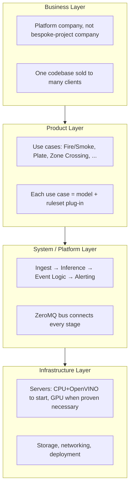

## 6. System context and containers

**System context** — the platform as a black box, and everything around it that it has to interact with.

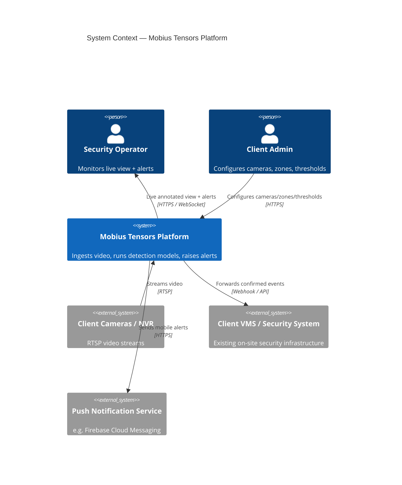

**Containers (single site)** — the actual running pieces and how they talk to each other.

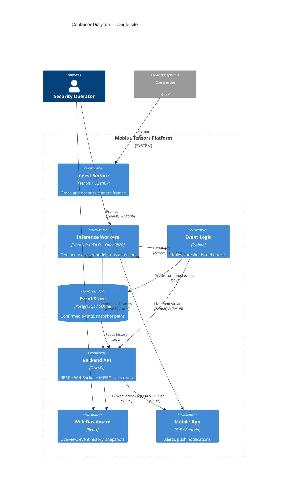

**Full system in one picture** — business rationale at the top, running code at the bottom.

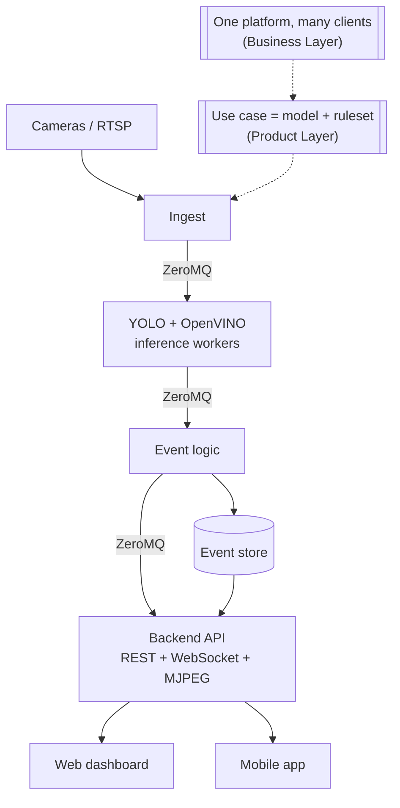

## 7. Pipeline and messaging

The platform is a **pipeline of small services connected over ZeroMQ**, so each stage can scale, restart, or be swapped independently. ZeroMQ is used instead of a heavier broker (Kafka/RabbitMQ) because it is free, has no separate broker process to run, and keeps latency low for real-time video events.

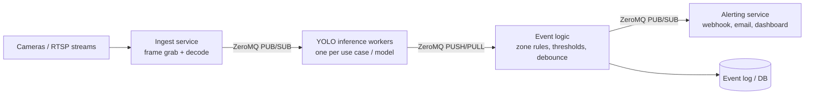

| Stage | Role | Notes |
| --- | --- | --- |
| Ingest | Pulls frames from RTSP/USB cameras, decodes, resizes | One process per camera or camera group |
| Inference workers | Run YOLO model(s) on frames, output bounding boxes + class + confidence | One worker type per use case; can run several in parallel on different GPUs/cores |
| Event logic | Applies business rules (e.g. "fire detected with confidence > 0.6", "object crossed zone line") | Decouples raw detections from what counts as an alert |
| Alerting / output | Sends the event onward: webhook, MQTT, dashboard, NVR integration | Pluggable per client |
| Event store | Persists events for audit and analytics | Simple DB (Postgres/SQLite) to start |

**Inference worker** — the one component most of the platform's value (and risk) sits in. Every use case gets one of these, differing only in which model and confidence threshold it loads.

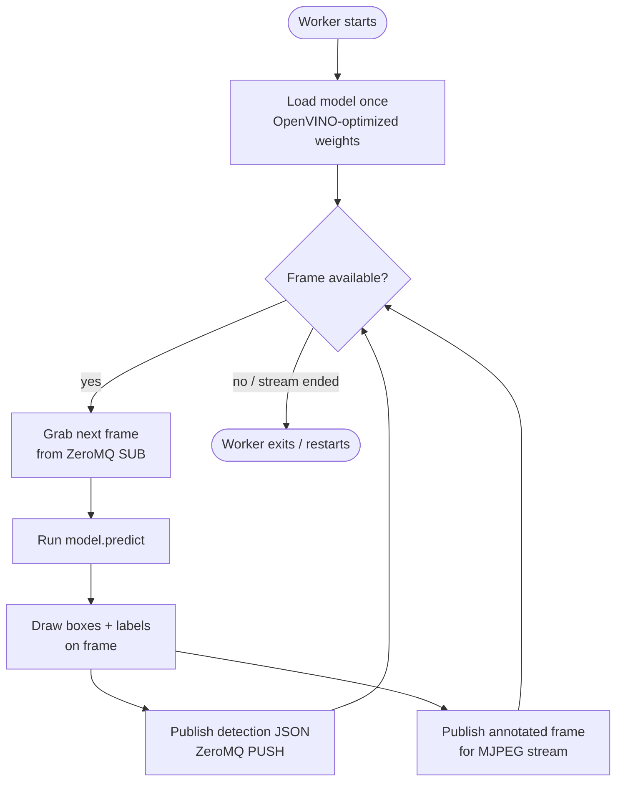

**Why ZeroMQ specifically:**

- No broker to deploy/maintain — sockets connect directly, brokerless by design
- Supports the exact patterns needed here: PUB/SUB (fan-out frames or alerts to multiple consumers) and PUSH/PULL (load-balance frames across inference workers)
- Low overhead, suitable for near-real-time video pipelines on a single server or across a small server cluster
- Language-agnostic bindings (Python to start, easy to add C++/Go workers later for performance)

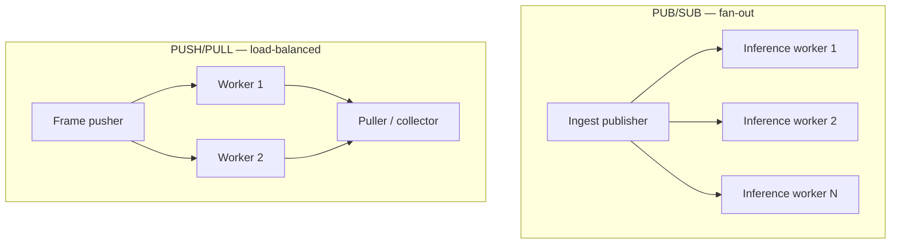

## 8. Technology stack

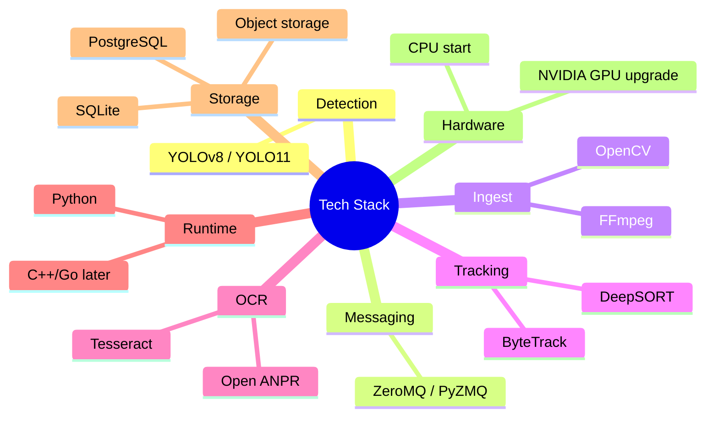

| Layer | Choice | Why |
| --- | --- | --- |
| Detection models | YOLO (Ultralytics YOLOv8/YOLO11, free/open-source weights + framework) | Fast, well-documented, large community, easy to fine-tune per use case |
| Messaging | ZeroMQ (PyZMQ) | Brokerless, low-latency, simple to embed in each service |
| Video ingest | OpenCV / FFmpeg for RTSP and USB camera capture | Free, mature, broad camera/codec support |
| Object tracking (for line/zone crossing) | ByteTrack or DeepSORT (open-source) | Adds identity/direction on top of raw YOLO detections |
| OCR (for plates) | Tesseract or an open-source ANPR model | Free, adequate accuracy for a draft |
| Language / runtime | Python for the draft (services can be re-written in C++/Go later for throughput) | Fastest path from model to running pipeline |
| Storage | PostgreSQL or SQLite for events; local disk or object storage for snapshots/clips | Simple, free, sufficient for pilot scale |
| Hardware | Starts CPU-only for low camera counts; NVIDIA GPU recommended once running multiple YOLO models concurrently or at higher frame rates | Keeps the draft cheap; clear upgrade path as load grows |
| Deployment | Single Linux server or VM to start, each pipeline stage as its own process/container | Easy to reason about, restart independently, later move to Docker/Kubernetes if scaling to many sites |

## 9. Data architecture

**Data flow** — what happens to a frame from capture to either storage or deletion:

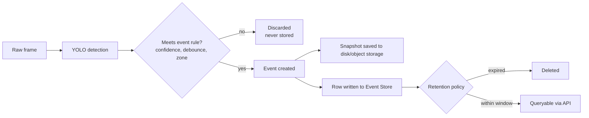

**Alert lifecycle** — how a raw detection becomes a resolved event:

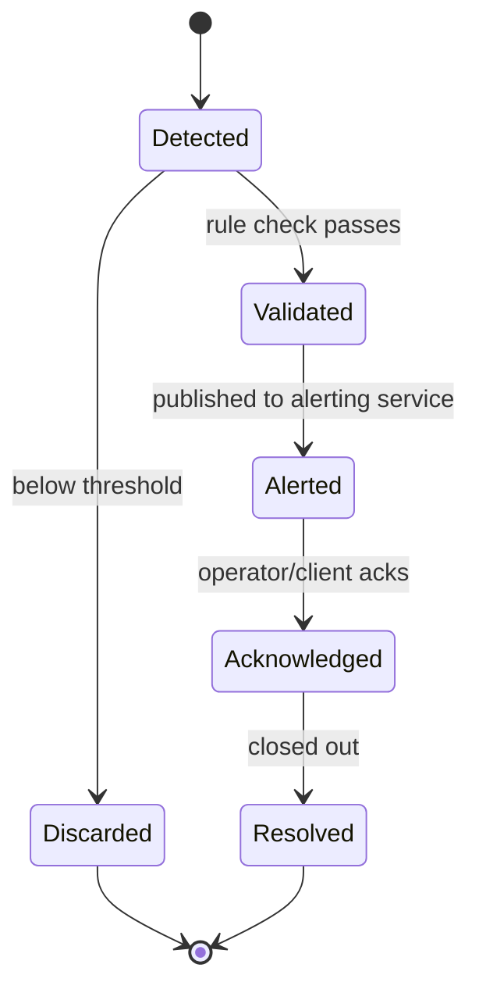

**Entity model** — the event store's shape, with `SITE`/`CLIENT` for when the platform serves more than one location (a single site needs only `CAMERA`, `USE_CASE`, `EVENT`, `SNAPSHOT`, `ALERT`):

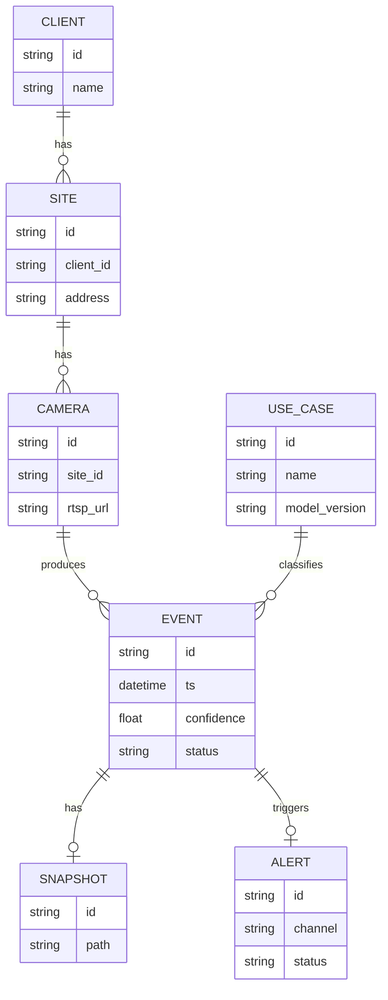

## 10. Security and network architecture

The rule that matters most here: **ZeroMQ never crosses a network boundary the public internet can reach.** Everything internal stays internal; the Backend API is the only door.

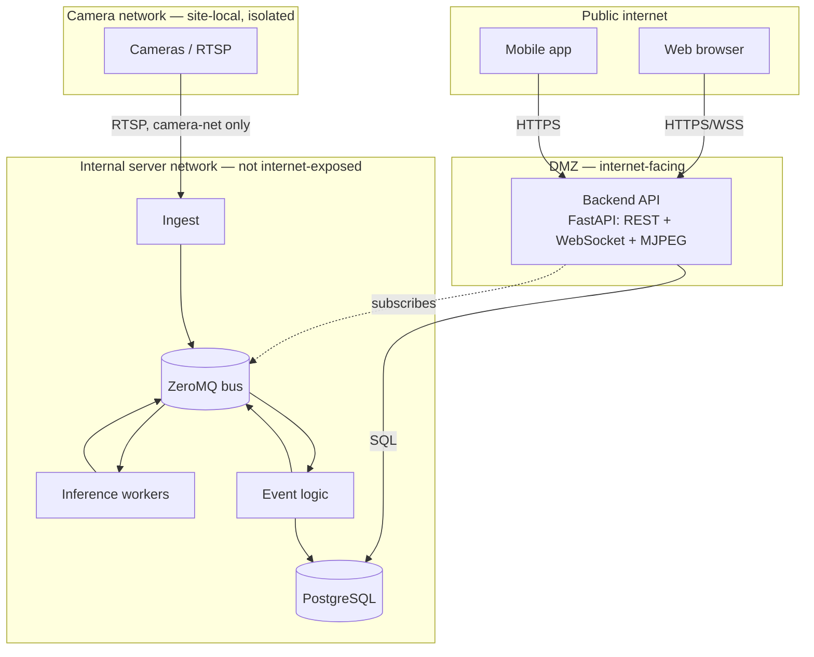

## 11. Deployment and scaling

**Phase 0/1 (single site, draft/pilot)** — one server, CPU-only, everything on one box.

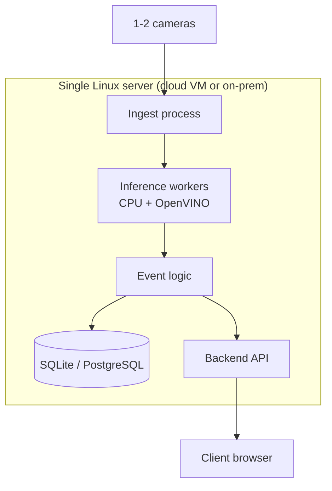

**Phase 3/4 (multi-site, scaled)** — once a client (or several) needs more than one server can handle: still one platform, more instances of it, with a thin control plane to keep them manageable centrally.

```mermaid
flowchart TB
  subgraph Cloud["Central control plane (cloud)"]
    Portal[Admin portal / multi-tenant API]
    CentralDB[(Aggregated event store)]
  end

  subgraph SiteA["Client A — Site 1 (CPU server)"]
    A1[Ingest + Infer + Logic]
  end
  subgraph SiteB["Client A — Site 2 (GPU server)"]
    B1[Ingest + Infer + Logic<br/>GPU: high camera count]
  end
  subgraph SiteC["Client B — Site 1 (CPU server)"]
    C1[Ingest + Infer + Logic]
  end

  A1 -- sync events --> Portal
  B1 -- sync events --> Portal
  C1 -- sync events --> Portal
  Portal --> CentralDB
  Portal --> WebAdmin[Client web/mobile apps]
```

<a id="scaling-decision"></a>

**Scaling decision: CPU+OpenVINO vs GPU+TensorRT** — default to CPU, move to GPU only when a benchmark proves you need to.

```mermaid
flowchart TD
  Start2([New site / new camera count]) --> Bench[Benchmark on CPU + OpenVINO]
  Bench --> Q1{Meets required FPS/latency<br/>at target camera count?}
  Q1 -- yes --> StayCPU[Stay on CPU server<br/>lowest cost of goods]
  Q1 -- no --> Q2{Root cause: decode bottleneck<br/>or model compute?}
  Q2 -- decode --> FixDecode[Thread/parallelize decode first<br/>re-benchmark]
  FixDecode --> Bench
  Q2 -- model compute --> GPU[Move to GPU server<br/>TensorRT export]
  GPU --> Q3{Multiple concurrent models<br/>per camera needed?}
  Q3 -- yes --> GPU
  Q3 -- no --> StayCPU
```

## 12. Client lifecycle

How a client moves through the system over time — ties the business layer back to the deployment layer.

```mermaid
flowchart LR
  Lead[Client conversation] --> Scope[Use-case scoping]
  Scope --> Survey[Camera/site survey]
  Survey --> Deploy[Deploy Phase 0/1 pipeline<br/>on client's server or ours]
  Deploy --> Pilot[Pilot: collect accuracy +<br/>false-positive data]
  Pilot --> Decision{Meets acceptance<br/>threshold?}
  Decision -- yes --> Prod[Move to production<br/>Phase 3 hardening]
  Decision -- no --> Tune[On-site fine-tuning /<br/>threshold adjustment]
  Tune --> Pilot
  Prod --> Scale[Add sites / use cases<br/>Phase 4]
```

```mermaid
journey
  title Client Pilot Journey
  section Discovery
    Initial conversation: 4: Client
    Use-case scoping: 3: Client, Mobius Tensors
  section Setup
    Camera/site survey: 3: Mobius Tensors
    Model + rules config: 4: Mobius Tensors
  section Pilot
    Deploy on site: 3: Mobius Tensors
    Collect accuracy data: 4: Client, Mobius Tensors
  section Decision
    Review results: 5: Client
    Move to production: 5: Client, Mobius Tensors
```

---

# Part 3 — Plan

## 13. Roadmap phases

1. **Draft (Phase 0)** — single server, one or two camera feeds, one YOLO model (start with Line/Zone Crossing since it needs no custom-trained model), ZeroMQ pipeline wired end-to-end, console/log-based alerting.
2. **Proof of concept (Phase 1)** — add Fire/Smoke Detection using a fine-tuned YOLO model on open datasets; add a minimal dashboard (web UI) showing live detections and event history.
3. **Pilot (Phase 2)** — add License Plate Detection (YOLO + OCR); deploy at one real client site with a handful of cameras; collect accuracy and false-positive data; add webhook/email alerting.
4. **Productization (Phase 3)** — harden the platform: GPU support, multi-site/multi-tenant deployment, a proper admin UI for configuring zones/thresholds per camera, model retraining pipeline, SLAs.
5. **Scale (Phase 4)** — add further use cases (PPE compliance, loitering, crowd density, etc.) as new plug-in models on the same core pipeline; explore managed/cloud hosting for clients who don't want on-prem servers.

```mermaid
flowchart LR
  P0["Phase 0 — Draft<br/>Zone crossing, 1 server, log alerts"]
  P1["Phase 1 — PoC<br/>+ Fire/Smoke, dashboard"]
  P2["Phase 2 — Pilot<br/>+ Plate (YOLO+OCR), real client site"]
  P3["Phase 3 — Productization<br/>GPU, multi-tenant, admin UI, SLAs"]
  P4["Phase 4 — Scale<br/>+ PPE/loitering/crowd, managed hosting"]

  P0 --> P1 --> P2 --> P3 --> P4
```

```mermaid
gantt
  title Indicative Roadmap Timeline
  dateFormat  YYYY-MM-DD
  section Phase 0
  Draft pipeline (zone crossing)      :p0, 2026-09-21, 30d
  section Phase 1
  Fire/Smoke model, dashboard         :p1, after p0, 45d
  section Phase 2
  Plate detection, pilot deployment   :p2, after p1, 60d
  section Phase 3
  Productization (GPU, multi-tenant)  :p3, after p2, 60d
  section Phase 4
  New use cases, managed hosting      :p4, after p3, 90d
```

## 14. Step by step: from trained model to app

The practical answer to: *"I train a model — then what? How does it get onto a server? How do I get output from the server? How does that reach a web/mobile app?"* Written assuming no prior background in serving ML models; every unfamiliar term is explained where it first appears (and in the [glossary](#17-glossary)).

```mermaid
flowchart LR
  A[1. Train model] --> B[2. Package + optimize model]
  B --> C[3. Run model on server<br/>inference service]
  C --> D[4. Get output out of server<br/>ZeroMQ / API]
  D --> E[5. Store events]
  E --> F[6. Backend API]
  F --> G[7. Web / mobile app]
```

### 14.1 Pick the first use cases

Don't start with all ~40 ideas at once. Pick 1-3 from the [ideas](#4-ideas-what-else-cameras-could-watch-for), favoring the 🟢 **Mature** ones (e.g. Motion Detection, Car Plate Reading, Fall Detection, PPE Check) over 🔴 **Experimental** ones (Gun, Shoplifting, Crash) — the mature ones need less data/tuning to get to something usable, and prove the pipeline end-to-end faster.

Define, per use case: target accuracy, acceptable false-positive rate, and what a "confirmed event" means.

### 14.2 Collect and label data

- Gather footage per use case — existing CCTV clips, public datasets, or synthetic/augmented data where real footage is scarce
- Label with a tool (Roboflow, CVAT, Label Studio)
- Split into train / validation / test sets

### 14.3 Train the model

You train a YOLO model (e.g. with Ultralytics' `yolo train` command) on your dataset (fire, plates, etc.). The output is a **weights file** — a single file (e.g. `best.pt`) containing everything the model learned. This is the artifact everything downstream depends on.

**Where this happens:** your own machine or a cloud GPU (e.g. Google Colab, a rented GPU box) — not the production server. Training is a one-time (or periodic, when you improve the model) offline step. It is completely separate from "running" the model live on camera feeds.

- Validate against the benchmarks noted in the ideas' Trust Level column
- Iterate — augment data, tune hyperparameters, retrain — until it clears an internal accuracy bar

### 14.4 Package and optimize for serving

A freshly trained `.pt` file works, but it's not optimized for real-time, always-on inference on a server (especially a CPU-only one). Pick a runtime based on the target hardware — no need to commit to one for the whole platform:

| Option | Hardware | Notes |
| --- | --- | --- |
| **OpenVINO** | CPU (+ Intel GPU/VPU) | Matches the "commodity server, no GPU required" starting point. `yolo export format=openvino` |
| **ONNX Runtime** | CPU, NVIDIA GPU (CUDA), AMD (ROCm), Intel | Hardware-agnostic middle ground — one export format, pick the execution provider per box. `yolo export format=onnx` |
| **TensorRT** | NVIDIA GPU only | Fastest option per-stream, but locks you to NVIDIA hardware. `yolo export format=engine` |
| **NVIDIA DeepStream** | NVIDIA GPU only | A full video-analytics pipeline (GPU-accelerated decode + TensorRT inference + batching), built for many camera streams per box rather than one model at a time — worth it once you're scaling GPU servers, overkill for a pilot |

- **What OpenVINO is:** a free toolkit from Intel that takes a trained model and converts + optimizes it to run fast on CPUs (and Intel GPUs/VPUs). You export your YOLO model once and get an optimized version that runs noticeably faster than the raw PyTorch model on a normal server CPU.
- **Why it matters:** the platform's design goal is "commodity servers, no GPU required to start." An optimized CPU runtime is what makes that realistic — without it, CPU inference is often too slow for real-time video.
- Start with OpenVINO for the pilot; move a use case to TensorRT/DeepStream later if it needs GPU-level throughput (e.g. many camera streams, a heavier model, or lower latency than CPU can hit).
- Benchmark real inference speed on the target server hardware, whichever runtime is chosen (see the [scaling decision](#scaling-decision)).

**Output of this step:** an optimized model file sitting in a folder on the server, ready to be loaded by a running program.

### 14.5 Run the model on the server (the "inference service")

*Someone has to write a small, always-running program that loads the model once and keeps feeding it frames.* Concretely, one Python process per camera-or-model does, in a loop:

```mermaid
flowchart TB
  L[Load optimized model once at startup] --> R[Loop forever]
  R --> F[Grab next frame from camera]
  F --> I[Run model.predict on frame]
  I --> O[Get back: boxes, classes, confidences]
  O --> P[Publish result — see 14.6]
  P --> R
```

This program is a normal long-running process (like a web server), started with something like `systemd`, `pm2`, or inside a Docker container, and restarted automatically if it crashes. There is one of these per use case/model (fire worker, plate worker, etc.), potentially several if you have many cameras. Camera ingestion is RTSP via OpenCV.

**This is "the server" in practice:** a Linux box (cloud VM or on-prem) running several of these small Python processes side by side, plus the pieces below.

### 14.6 Get output out of the server (ZeroMQ)

Each inference process produces detections many times per second. **ZeroMQ (ZMQ)** moves that data from "inside the inference loop" to "everywhere else that needs it" — without writing networking code by hand.

- **What ZeroMQ actually is:** a small library (`pip install pyzmq`) that gives you a `socket.send(data)` / `socket.recv()` API — but the "socket" can fan out to many listeners, load-balance across workers, etc., depending on the pattern you pick. There is no separate server process to install (unlike Kafka/RabbitMQ).
- **The pattern you'll use most:** PUB/SUB. The inference worker `PUB`lishes every detection event (as a small JSON message: `{"camera": "cam1", "class": "fire", "confidence": 0.87, "ts": ...}`). Any other process — the event-logic service, a logging service, a debug tool — can `SUB`scribe and receive a copy, without the publisher knowing or caring who's listening.
- **What happens after ZMQ:** a small "event logic" process subscribes to raw detections, applies your business rules (e.g. "only alert if confidence > 0.6 and it's the same camera 3 frames in a row"), and if it decides something is a real event, it (a) writes a row to a database and (b) publishes the event again on a different ZMQ channel for anything downstream (like the alerting/API service).

**In short: ZeroMQ is the "nervous system" connecting your small processes.** It's not the thing your web/mobile app talks to directly — that's 14.8.

### 14.7 Store events

The event-logic process writes confirmed events to a database — start with **SQLite**, move to **PostgreSQL**. A row is roughly: `id, camera_id, use_case, confidence, timestamp, snapshot_path, status`. Snapshot images/clips get saved to disk (or S3-style object storage later) and the row just stores the file path.

This database is the thing both the alerting logic and your future app will actually query — it's the source of truth, decoupled from the real-time ZMQ stream.

### 14.8 Backend API (the piece between "server" and "app")

Your web/mobile app **cannot** talk ZeroMQ directly (browsers and phones don't speak it, and you don't want to expose internal service sockets to the internet anyway). You need one more small service: a normal **HTTP API** (e.g. FastAPI in Python).

```mermaid
flowchart LR
  subgraph Backend["Backend API (FastAPI)"]
    Rest[REST endpoints<br/>GET /events, GET /cameras]
    WS[WebSocket<br/>live event push]
  end
  DB[(Postgres)] --> Rest
  Bus[ZeroMQ bus] -. subscribes .-> WS
  Rest --> App[Web / mobile app]
  WS --> App
```

- **REST endpoints** for anything historical/on-demand: "give me the last 50 events," "list cameras," "get this snapshot image."
- **A WebSocket (or Server-Sent Events) endpoint** for live updates: it subscribes to the ZeroMQ alert channel internally and pushes every event to connected apps/browsers, so the dashboard feels "live" without polling.

**This API is the actual boundary of your system** — everything before it (cameras, YOLO, ZeroMQ, event logic) is internal infrastructure; everything from here on is a normal web/mobile engineering problem.

### 14.9 Web / mobile app

- **Web dashboard:** a normal frontend (React, Vue, whatever) that calls the REST API for history and opens a WebSocket for live alerts. Shows camera feeds, event log, snapshots.
- **Mobile app:** same REST API, plus push notifications — the backend calls a push service (e.g. Firebase Cloud Messaging) when a high-priority event fires.

**Who talks to whom:**

```mermaid
flowchart TB
  Cam[Cameras / RTSP] --> Infer[YOLO + OpenVINO<br/>inference workers]
  Infer -- ZeroMQ PUB/SUB --> Logic[Event logic]
  Logic -- ZeroMQ PUB/SUB --> API[Backend API<br/>FastAPI: REST + WebSocket]
  Logic --> DB[(PostgreSQL)]
  DB --> API
  API -- HTTPS/WebSocket --> Web[Web dashboard]
  API -- HTTPS/Push --> Mobile[Mobile app]
```

**The rule of thumb:** ZeroMQ is only used *between your own backend processes on the server*. The moment data needs to leave the server and reach a browser or phone, it goes through the one HTTP/WebSocket API — that's the only thing the app ever talks to.

### 14.10 Deploy and pilot

- Deploy on a commodity, CPU-only server (per the platform's "no GPU required to start" goal) — see the [Site Installation Guide](Site%20Installation%20Guide%20—%20IP%20Cameras,%20PoE%20Switch%20and%20Server.md)
- Run against a real camera/site for a trial period
- Track real-world false-positive / false-negative rates — compare against the ideas' Trust Level assumptions

### 14.11 Iterate and expand

- Feed pilot false positives/negatives back into training data, retrain
- Once the pipeline is proven on the first use cases, add more from the [ideas](#4-ideas-what-else-cameras-could-watch-for) (agriculture, retail, workplace safety, etc.)
- Update the ideas' Trust Level column with real numbers as they come in, instead of published benchmarks

## 15. What to build first

You don't need all of this at once. Order of work:

1. Pick the use case (14.1), collect and label data (14.2), train and validate the first model (14.3).
2. One Python script: reads one camera (OpenCV), runs one optimized model, prints detections to the console — just prove detection works live (14.4-14.5, scoped down).
3. Add ZeroMQ: split that script into a publisher (camera+model) and a subscriber (prints/logs events) — proves the messaging pattern works.
4. Add a database: the subscriber writes events to SQLite instead of printing.
5. Add FastAPI: one `GET /events` endpoint reading from SQLite. Test it with a browser or `curl` — no frontend yet.
6. Add a WebSocket endpoint that subscribes to ZeroMQ and pushes live events.
7. Only then build a minimal web page that calls the API and opens the WebSocket.

Each step is independently testable before moving to the next — you don't need to understand or build the whole diagram at once.

## 16. Open questions and risks

- [ ] Target hardware for the first real deployment: CPU-only server, or is a GPU budgeted for from the start?
- [ ] Which camera protocols/brands must be supported first (RTSP-only, or specific NVR/VMS integrations)?
- [ ] Accuracy and false-positive tolerance per use case — fire detection false positives are high-cost (false alarms), false negatives are high-risk (missed threats); needs a defined acceptable threshold before pilot.
- [ ] License plate detection may trigger data-privacy/compliance requirements (storing plate + timestamp + location is regulated in many jurisdictions) — needs legal review before storing plate data.
- [ ] Multi-camera scaling: how many concurrent YOLO inference streams can one server handle before needing a GPU or a second server?
- [ ] Alerting integration: does the first client need webhook/email only, or integration with an existing VMS/security system?

```mermaid
quadrantChart
  title Risk Impact vs Likelihood
  x-axis Low Likelihood --> High Likelihood
  y-axis Low Impact --> High Impact
  quadrant-1 Watch closely
  quadrant-2 Address now
  quadrant-3 Low priority
  quadrant-4 Monitor
  Fire detection false positives: [0.6, 0.8]
  Plate data privacy/compliance: [0.6, 0.85]
  Camera/NVR protocol support: [0.5, 0.4]
  Multi-camera GPU scaling: [0.55, 0.55]
  Alerting integration scope: [0.35, 0.3]
```

## 17. Glossary

| Term | What it is, in one line |
| --- | --- |
| YOLO | The object-detection model itself — the thing that looks at a frame and says "car, 87% confident, here's the box." |
| OpenVINO | A free tool that converts your trained model into a version that runs faster on normal CPUs. |
| ONNX Runtime | A hardware-agnostic engine that runs one exported model file on CPU or GPU. |
| ZeroMQ (ZMQ) | A lightweight messaging library your own backend processes use to send data to each other, without a separate broker server. |
| PUB/SUB | A ZeroMQ pattern: one process broadcasts, any number of other processes can listen in. |
| Inference worker | The always-running program that loops: grab frame → run model → output detection. |
| Event logic | The program that decides which raw detections are actually worth alerting on (thresholds, rules). |
| Backend API | The one HTTP(S)/WebSocket service your web/mobile app is allowed to talk to — hides all the internal ZeroMQ/inference plumbing. |
| REST endpoint | A normal URL your app calls to fetch data on demand (e.g. `GET /events`). |
| WebSocket | A persistent connection the server uses to push live updates to the app without it having to keep asking. |
