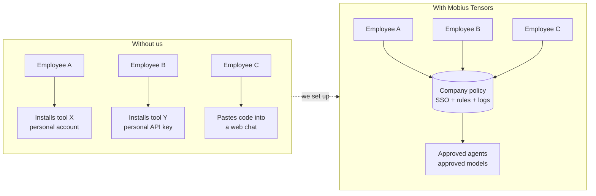
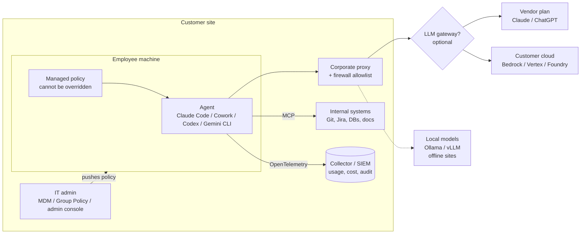
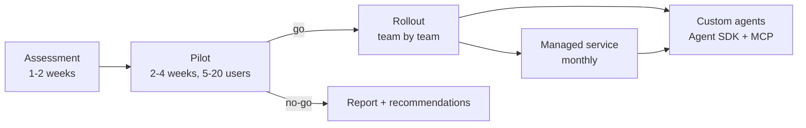

# Agent Deployment

*A Mobius Tensors project.*

Install and manage AI agents (Claude Code, Claude Desktop / Cowork, Codex, Gemini CLI, open-source agents)
on the customer's side: their machines, their network, their cloud account, under their rules.

The customer gets working agents with security policy, logging and cost control set up from day one,
instead of every employee installing tools on their own.



## How it fits together



## What we sell



| Package | What the customer gets |
| --- | --- |
| **Assessment** | Discovery call + questionnaire, a recommendation (which agent, where the model runs, which policies), cost estimate |
| **Pilot** | 5-20 users, one team, managed policy, telemetry, 2-4 weeks, short report with usage and issues |
| **Rollout** | Fleet install through their MDM / Group Policy / scripts, network allowlist, SSO, training session |
| **Managed service** | Version and policy updates, usage and cost reports, new MCP integrations, support |
| **Custom agents** | Agents built for their workflows with the Claude Agent SDK + MCP servers to their internal systems |

## Folder map

```text
agent-deployment/
├── README.md        this file
├── research.md      landscape: agents, where the model runs, admin controls per agent, risks, sources
├── playbook.md      step-by-step customer engagement: discovery → pilot → rollout → handover
└── templates/       starting policy files per agent (copy, then edit per customer)
```

## Status

Research and templates only. Nothing tested on a customer machine yet.

Next steps:

1. Run the playbook on our own machines first (Windows + Linux, Claude Code + Claude Desktop).
2. Write install scripts (PowerShell + bash) that install a pinned version and place the policy file.
3. Write a one-page offer / solution sheet for the brochures.
