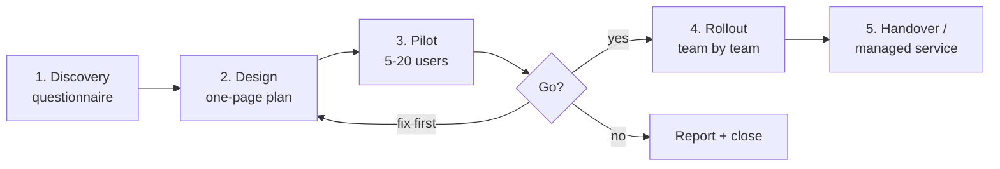
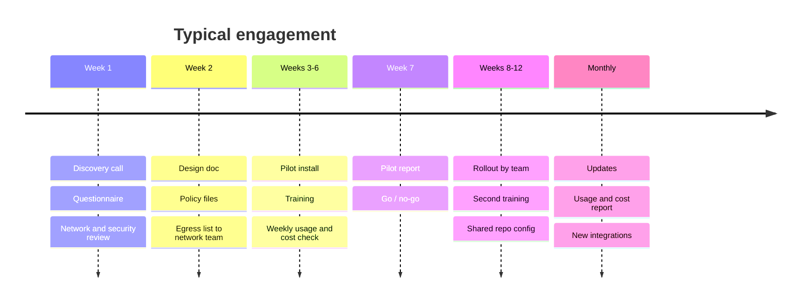
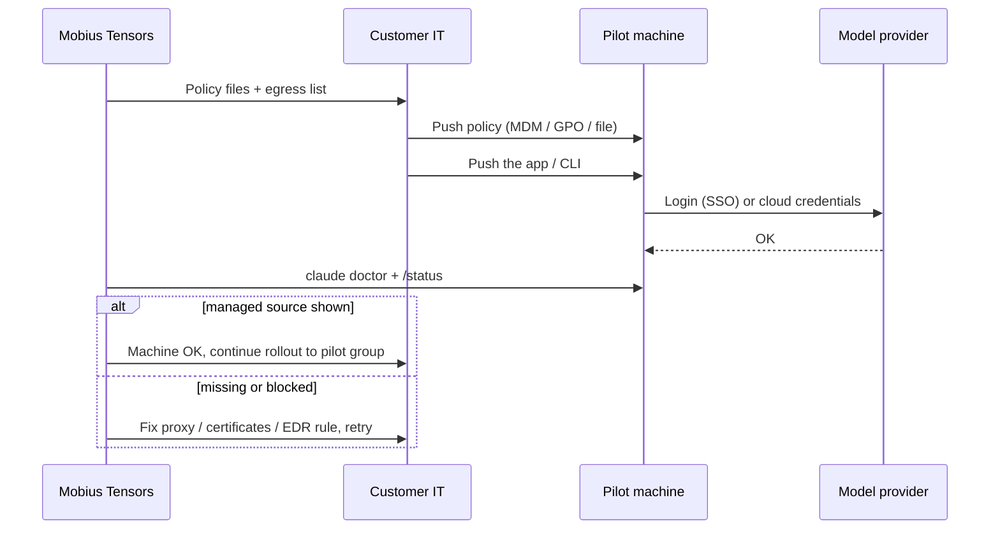

# Playbook — Customer Engagement

*A Mobius Tensors project.*

Steps for one customer, from first call to handover. Details per agent are in [research.md](research.md);
starting policy files are in [templates/](templates/).

## 1. Discovery

Questions to answer before recommending anything:

- [ ] **Users:** how many developers, how many non-developers? Which teams go first?
- [ ] **Machines:** Windows / macOS / Linux? Managed by Intune, Jamf, Group Policy, or nothing? Admin rights?
- [ ] **Cloud:** already on AWS, GCP or Azure? Existing contract / credits?
- [ ] **Data rules:** can code and documents leave the building? Leave the country? Any regulator (bank, health, government)?
- [ ] **Country:** is it on the vendors' supported-countries list? If not → cloud-provider route.
- [ ] **Network:** proxy? TLS inspection? Firewall allowlists? Fully offline machines?
- [ ] **Security tools:** EDR (CrowdStrike, Defender, Santa), application allowlisting?
- [ ] **Identity:** SSO provider (Entra ID, Okta, Google)?
- [ ] **Integrations wanted:** Git hosting, Jira / Linear, docs, databases, internal APIs (→ MCP servers)
- [ ] **Budget model:** per seat or per token? Monthly ceiling?

## 2. Design

Write a one-page design for the customer:

1. **Agents:** e.g. Claude Code for developers, Claude Desktop + Cowork for the rest.
2. **Inference:** vendor plan, customer cloud, gateway, or local models (see research.md §2).
3. **Policy:** start from `templates/`, adjust deny rules, MCP allowlist, sandbox, models, retention.
4. **Delivery:** server-managed (admin console), MDM profile, or file on disk.
5. **Monitoring:** where OpenTelemetry goes (their collector / SIEM / Grafana).
6. **Egress list** for their network team.

## 3. Pilot (2-4 weeks, 5-20 users)

- [ ] Test the full install on **one real customer machine** first (proxy, EDR, certificates break most installs).
- [ ] Deploy policy, then the app.
- [ ] Verify on every pilot machine:
  - Claude Code: `claude doctor`, then `/status` shows `Enterprise managed settings`
  - Claude Desktop: Help → Troubleshooting → Generate Diagnostic Report → `managed-config.txt`
- [ ] Kick-off training (1 hour): what the agent can do, what it is not allowed to do, how to ask it well.
- [ ] Weekly check: usage, cost, errors, blocked actions, user feedback.
- [ ] End-of-pilot report: adoption, cost per user, issues, policy changes, go / no-go.

## 4. Rollout

- [ ] Fix everything the pilot found; update the policy files.
- [ ] Stage by team, not all at once.
- [ ] Hand the network team the final egress list.
- [ ] Shared project config in their repos (`CLAUDE.md` / `AGENTS.md`, `.mcp.json`) so every clone works the same.
- [ ] Second training round, plus a short internal guide in their language.

## 5. Handover / managed service

- [ ] Document: what was installed, versions, where the policy lives, who owns it, how to update it.
- [ ] Update rhythm: stable channel + minimum version; review policy every quarter.
- [ ] Monthly report (managed service): active users, cost, top uses, incidents.
- [ ] Offboarding procedure: SSO removal, revoke API / gateway keys.
