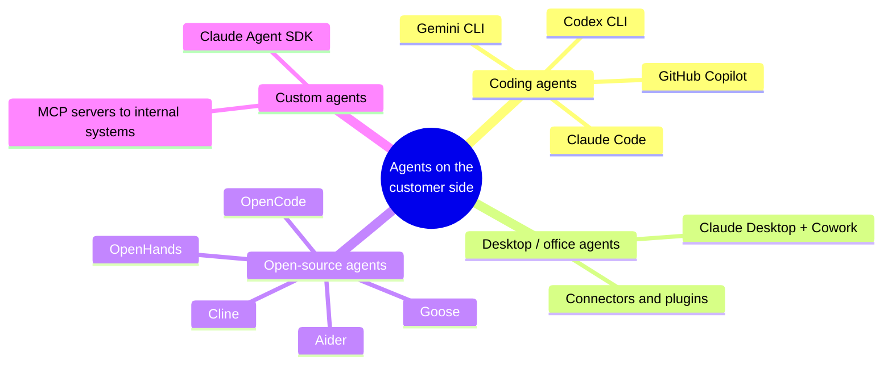
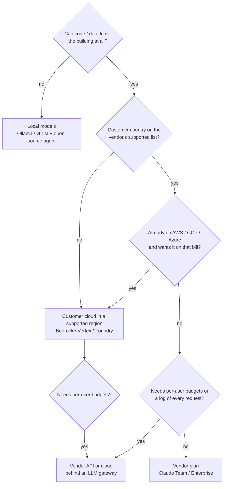
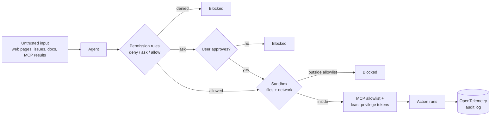

# Research — Deploying AI Agents on the Customer Side

*A Mobius Tensors project.*

State as of October 2026. Vendors change install methods, setting names and plans often:
re-check the official docs (linked at the bottom) before each customer.

## 1. What kinds of agents customers ask for

| Kind | Who uses it | Examples |
| --- | --- | --- |
| **Coding agents** | Developers | Claude Code (terminal, VS Code, JetBrains, desktop), OpenAI Codex CLI, Gemini CLI, GitHub Copilot |
| **Desktop / office agents** | Non-developers (finance, ops, legal, sales) | Claude Desktop with Cowork (works on local files, uses connectors and plugins) |
| **Open-source agents** | Customers who want no vendor lock-in or fully offline | OpenCode, Cline, Aider, Goose, OpenHands (with any model, including local ones) |
| **Custom agents** | A specific business process | Built with the Claude Agent SDK + MCP servers that reach the customer's internal systems |

Most customers will want **one coding agent for developers + one desktop agent for everyone else**.



## 2. Where the model runs (the main decision)

The agent runs on the employee's machine. The model (inference) runs somewhere else, and that choice drives
billing, data location, and what the security team will accept.



| Option | Billing | Good for | Notes |
| --- | --- | --- | --- |
| **Vendor plan** (Claude Team / Enterprise, ChatGPT Business / Enterprise) | Per seat | Most companies | Least setup. SSO, admin console, usage dashboard. Claude Team/Enterprise includes Claude Code and Claude on the web |
| **Vendor API** (Anthropic Console, OpenAI API) | Per token | Small teams, automation | API keys per user or per team |
| **Customer's cloud** (Amazon Bedrock, Google Cloud Agent Platform / Vertex AI, Microsoft Foundry) | Per token, on their cloud bill | Companies already on AWS / GCP / Azure | Uses their IAM, audit logs, regions, existing cloud contract |
| **LLM gateway** in front of any of the above (Claude apps gateway, LiteLLM, other) | Same as upstream | Central budgets, per-user keys, audit log of every request | One more service to run and keep up to date. Claude apps gateway is Anthropic's self-hosted one with IdP sign-in |
| **Local models** (Ollama, vLLM, on customer GPUs) | Hardware only | Air-gapped / data must not leave the building | Only open-source agents. Quality is well below frontier models; needs real GPUs for good speed |

Also check: Anthropic and OpenAI only serve [supported countries](https://www.anthropic.com/supported-countries).
If the customer's country is not supported, the cloud-provider route (Bedrock / Vertex / Foundry in a supported region)
is usually the way.

## 3. Admin controls per agent

### Claude Code

- **Install:** native installer (`curl -fsSL https://claude.ai/install.sh | bash`, `irm https://claude.ai/install.ps1 | iex`),
  WinGet `Anthropic.ClaudeCode`, Homebrew `claude-code`, signed apt / dnf / apk repos, or npm `@anthropic-ai/claude-code`.
  Releases have a GPG-signed manifest; Windows and macOS binaries are code-signed.
- **Requirements:** macOS 13+, Windows 10 1809+ / Server 2019+, Ubuntu 20.04+, Debian 10+, Alpine 3.19+, 4 GB RAM.
  On Windows, Git for Windows is optional (gives the Bash tool); sandboxing needs WSL 2.
- **Update control:** `autoUpdatesChannel: "stable"` (about a week behind latest), `requiredMinimumVersion` /
  `requiredMaximumVersion`, `DISABLE_UPDATES` when we ship versions ourselves.
- **Managed settings** (cannot be overridden by users):

  | Delivery | Location |
  | --- | --- |
  | File, macOS | `/Library/Application Support/ClaudeCode/managed-settings.json` |
  | File, Linux / WSL | `/etc/claude-code/managed-settings.json` |
  | File, Windows | `C:\Program Files\ClaudeCode\managed-settings.json` |
  | MDM, macOS | preference domain `com.anthropic.claudecode` |
  | Group Policy / Intune, Windows | `HKLM\SOFTWARE\Policies\ClaudeCode`, value `Settings` (JSON as `REG_SZ`) |
  | Server-managed | claude.ai admin console (Team / Enterprise), fetched at startup and hourly |

  ```mermaid
  flowchart TB
    M["1. Managed settings<br/>(file / MDM / admin console)<br/>set by the company"] --> CLI["2. Command line<br/>--settings"]
    CLI --> PL["3. Project local<br/>.claude/settings.local.json"]
    PL --> PS["4. Shared project<br/>.claude/settings.json"]
    PS --> U["5. User<br/>~/.claude/settings.json"]
    style M stroke-width:3px
  ```

  Higher wins. Nothing below managed settings can undo them.
  A `managed-settings.d/` folder next to the file lets several teams own separate parts of the policy.
  MDM starter templates (Jamf, Intune, Group Policy): `github.com/anthropics/claude-code/tree/main/examples/mdm`.
- **Main policy keys:** `forceLoginMethod` + `forceLoginOrgUUID` (only the company's org can log in),
  `allowedProviders` (e.g. only Bedrock), `availableModels`, `permissions.deny`,
  `permissions.disableBypassPermissionsMode`, `allowManagedPermissionRulesOnly`, `allowedMcpServers` +
  `allowManagedMcpServersOnly`, `strictKnownMarketplaces` (plugins), `sandbox`, `cleanupPeriodDays`.
- **Network:** honours `HTTPS_PROXY` (no SOCKS), trusts the OS certificate store (TLS-inspection proxies work),
  `NODE_EXTRA_CA_CERTS`, mTLS with `CLAUDE_CODE_CLIENT_CERT` / `CLAUDE_CODE_CLIENT_KEY`.
  Put these in the settings `env` block, not the shell, so background agents get them too.
  Required hosts: `api.anthropic.com`, `claude.ai`, `claude.com`, `platform.claude.com`, `downloads.claude.ai`
  (+ `registry.npmjs.org`, `github.com` for plugins / MCP). With Bedrock / Vertex / Foundry, model traffic goes to the
  cloud provider instead.
- **Monitoring:** OpenTelemetry metrics and logs (`CLAUDE_CODE_ENABLE_TELEMETRY=1` + standard `OTEL_*` variables) —
  sessions, tokens, cost, lines changed, commits, PRs, tool decisions. Set in managed settings so users can't redirect it.
- **Verify on a machine:** `claude doctor`, then `/status` inside a session (shows the managed source in use).

### Claude Desktop + Cowork

- **Install:** `.dmg` on macOS, `.msix` on Windows (Cowork needs the `.msix`, not the old `.exe`; machine-wide
  provisioning works through Intune). Cowork needs hardware virtualization and, on Windows, the Virtual Machine Platform
  feature — run the **Cowork readiness check** on one device of each hardware model first.
- **Config delivery:** Enterprise Admin Console (users sign in), MDM profile (`.mobileconfig` / `.reg` / ADMX exported
  from the app), or a bootstrap server we run that returns per-user config.

  ```mermaid
  flowchart LR
    Build[Build + test config<br/>in the app on an admin PC] --> Pick{Delivery}
    Pick -- "Admin console" --> AC[Anthropic hosts config<br/>users sign in]
    Pick -- "MDM profile" --> MDM[Export .mobileconfig / .reg<br/>push with Jamf / Intune / GPO]
    Pick -- "Bootstrap server" --> BS[We run an HTTPS endpoint<br/>per-user config at sign-in]
    MDM --> App[Push the app<br/>after the config]
    BS --> App
    AC --> App
    App --> Check[Diagnostic report<br/>managed-config.txt]
  ```

- **Policy locations:** macOS `/Library/Managed Preferences/com.anthropic.claudefordesktop.plist`;
  Windows `HKLM\SOFTWARE\Policies\Claude` (if anything is under HKLM, HKCU is ignored — put everything in one hive).
- **Can run on the customer's own inference** (Bedrock, Vertex, Foundry, a gateway): prompts go only to that provider.
- **Controls:** allowed egress hosts for the sandbox, allowed folders, managed MCP servers, block user MCP / unsigned
  extensions, OpenTelemetry endpoint, per-device token cap, retention periods, org plugins.
- **Air-gapped:** offline installers exist (several GB, include the VM workspace and CLI). Pair with
  `disableAutoUpdates` and `modelCatalogEnabled: false`.
- **EDR gotcha:** CrowdStrike / Defender ASR / Santa may block the agent helper binary. Allowlist by signer
  (Windows publisher "Anthropic, PBC"; macOS Team ID `Q6L2SF6YDW`), not by path.
- **Verify:** Help → Troubleshooting → Generate Diagnostic Report → `managed-config.txt`.

### OpenAI Codex CLI

- Open source (Apache-2.0). Works with a ChatGPT plan or an API key.
- `requirements.toml` = enforced limits (approval policy, sandbox mode, MCP servers, hooks, plugin sources).
  Location: `/etc/codex/requirements.toml` (Linux / macOS), `%ProgramData%\OpenAI\Codex\requirements.toml` (Windows).
- `managed_config.toml` = defaults users start with. macOS MDM domain `com.openai.codex`
  (`requirements_toml_base64`, `config_toml_base64`). Admins can also push requirements per group from the Codex Policies page.

### Gemini CLI

- Open source (Apache-2.0). `npm install -g @google/gemini-cli`.
- System settings override user and workspace settings: `/etc/gemini-cli/settings.json`,
  `C:\ProgramData\gemini-cli\settings.json`, `/Library/Application Support/GeminiCli/settings.json`
  (plus `system-defaults.json` for soft defaults).
- Enterprise route is Vertex AI with the customer's GCP IAM, audit logs and VPC controls.
- Keys: `security.auth.enforcedType`, `security.disableYoloMode`, `mcp.allowed`, `tools.core` / `tools.sandbox`,
  `telemetry`, `privacy.usageStatisticsEnabled`.

### Open-source agents with local models

- **Cline** (VS Code / JetBrains, Apache-2.0), **Aider** (terminal, git-native, Apache-2.0), **OpenCode**, **Goose**,
  **OpenHands** (MIT) — all can point to Ollama, vLLM or any OpenAI-compatible endpoint.
- Fits customers who can't send code outside (defense, banks, health) or have no internet on dev machines.
- Cost is GPUs: small models run on 16-32 GB RAM, useful coding models need a proper GPU server. Expect lower quality
  than Claude / GPT; set expectations in the assessment.
- Check each project's license before bundling it in an offer (same rule as our own products: permissive only).

## 4. What the customer's security team will ask

| Question | Answer to prepare |
| --- | --- |
| Where does our code / data go? | The inference option chosen in section 2. With Bedrock / Vertex / Foundry / local models it stays in their account or building |
| Is our data used for training? | Business / API terms of the vendor (check the current terms; Anthropic and OpenAI commercial terms say no by default) |
| Can users turn off the controls? | No — managed settings / requirements files / MDM policy override user settings |
| Can the agent run dangerous commands? | Permission rules (deny lists), approval prompts, sandbox (network + filesystem), bypass mode disabled |
| Can it read secrets? | Deny rules on `.env`, `secrets/`, key files; sandbox blocks reads by shell commands too |
| What tools / integrations can it use? | MCP server allowlist, plugin marketplace allowlist |
| How do we audit it? | OpenTelemetry to their SIEM / Grafana; cloud audit logs (CloudTrail etc.); gateway request logs |
| How do we control cost? | Seat plans have limits; API: gateway budgets, per-device token caps (Desktop), cost metrics in OTel |
| How do we offboard someone? | SSO deprovisioning; revoke per-user gateway / API key |

## 5. Risks to watch

Layers of control between an agent and anything dangerous:



- **Prompt injection** through web pages, issues, documents or MCP servers that the agent reads. Mitigate with
  MCP allowlists, sandboxed network, approval for risky commands, and least-privilege tokens for every MCP server.
- **Bypass / "yolo" modes** — always disable them in managed policy.
- **Secrets in prompts or logs** — deny rules + short local retention (`cleanupPeriodDays`).
- **Version drift** — use the stable channel and a minimum version; long-open sessions lag behind.
- **Proxy / EDR breakage** — the most common install failure in big companies; test on one real machine first.
- **Cost surprises** on per-token billing — set budgets before the pilot starts, not after.

## Sources

- Claude Code — setup: https://code.claude.com/docs/en/setup
- Claude Code — enterprise deployment overview: https://code.claude.com/docs/en/third-party-integrations
- Claude Code — managed settings: https://code.claude.com/docs/en/managed-settings
- Claude Code — example settings files: https://code.claude.com/docs/en/settings-example
- Claude Code — network config: https://code.claude.com/docs/en/network-config
- Claude Code — monitoring (OpenTelemetry): https://code.claude.com/docs/en/monitoring-usage
- Claude Code — LLM gateways: https://code.claude.com/docs/en/llm-gateway
- Claude Desktop (3P) — installation: https://claude.com/docs/third-party/claude-desktop/installation
- Claude Desktop (3P) — deploy with MDM: https://claude.com/docs/third-party/claude-desktop/mdm
- Codex — managed configuration: https://learn.chatgpt.com/docs/enterprise/managed-configuration
- Codex — admin setup: https://developers.openai.com/codex/enterprise/admin-setup
- Gemini CLI — enterprise: https://geminicli.com/docs/cli/enterprise/
- Open-source agents overview: https://www.openhands.dev/blog/open-source-ai-coding-agents
- Open-source assistants by license / local-model support: https://www.morphllm.com/ai-coding-assistant-open-source
- Enterprise coding agents comparison: https://northflank.com/blog/top-enterprise-coding-agents
