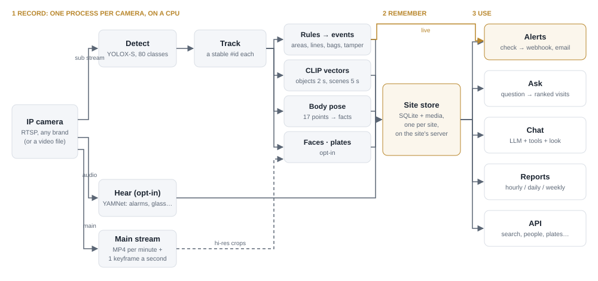

# Argus

*After Argus Panoptes, the hundred-eyed watchman of Greek myth (πανόπτης, "all-seeing"), who
never closed all his eyes at once.*

Argus keeps a searchable memory of everything your cameras see, so you can ask about it later in
plain language: *"was there a white van at the gate yesterday evening?"*, *"did anyone fall in the
warehouse last night?"*. It answers in sentences, with the frames as evidence. It also raises
alerts as things happen, and can have a local vision model check each alert before it goes out.
It runs on the site's own server, without a GPU; footage stays in the building.



**Full documentation: [DOCUMENTATION.md](DOCUMENTATION.md)** (product, how each part works with
figures, site installation, model research, roadmap).

## What it does

| | |
| --- | --- |
| **Record** | One process per camera detects and tracks all 80 COCO object types (YOLOX-S), stores each tracked object and each scene as a CLIP vector, and turns each person's body pose into facts (posture, hands up, facing, head down, still / walking / running, carried bags, clothing colours). Optional: face prints, number plates, sounds from the camera's microphone, main-stream recording. |
| **Ask** | A question is split into *what / when / which camera*; *what* is compared with the stored vectors. No LLM needed (`argus.ask`). |
| **Chat** | An LLM (local by default) answers with tools over the store: `objects`, `search`, `people`, `alerts`, `plates`, `face`, `look` (a local vision model reads the evidence images). The same tools are an **MCP server** for Claude Desktop, Claude Code or any MCP agent (`uv run --group mcp -m argus.mcp_server`). |
| **Alert** | Areas, lines, crowding, abandoned bags, camera tampering, person down, hands up, watchlist plates, sounds → stored with a snapshot and sent to webhook / email, each channel with its own filter. **Alert checking**: a local vision model looks at the snapshot first and can hold back false alarms. |
| **Report** | Hourly, daily or weekly: exact counts plus a written summary of what the owner asked to watch. |

## Quick start

```bash
uv sync
uv run -m argus.engine.download_model yolox_s         # the default detector (CPU sites)
uv run --group export -m argus.engine.export_clip     # CLIP -> models/clip_*.onnx (~600 MB), once
uv run -m argus.record --source data/vtest.avi --camera street --start-time 2026-09-25T14:00
uv run -m argus.ask "person with a bag on street"
uv run -m argus.chat "how many people walked past this afternoon?"    # needs Ollama, see below
```

Optional models: `download_model faces`, `plates`, `sounds`, `pose_rtmpose_t` (trials), and
`uv run --group export -m argus.engine.export_pose` (ViTPose-B, the shippable pose model).
The chat and the vision model need [Ollama](https://ollama.com): `ollama pull qwen3:4b` and
`ollama pull qwen3.5:4b`. Models run on a GPU when there is one (`device: auto`); on an NVIDIA
machine: `uv sync --no-group cpu --group gpu`.

## Try it on a laptop

```bash
uv run -m argus.engine.download_model yolox_nano
uv run -m argus.engine.download_model faces
uv run --group ui -m argus.ui        # configs/laptop.yaml, http://127.0.0.1:7860
```

*Camera* → *Start recording* (source `0` = webcam); *Find a person* by photo; *Ask* the chat;
*Reports*; and the engine's *Test bench* (models, thresholds, zones and lines, faces). The test
store is `data/store/laptop.db`, separate from a site's.

## Configuration at a glance

Everything is in `configs/default.yaml` (sites) or `configs/laptop.yaml` (demo); secrets go in
`.env` as `${VAR}`.

| Section | What it sets | Default |
| --- | --- | --- |
| `cameras` | IP cameras (vendor presets or a URL) and an `about:` per camera for the chat | — |
| `model`, `tracking` | detector (`yolox_s`), classes, thresholds; tracker | YOLOX-S |
| `search` | what is embedded with CLIP, how often | on |
| `zones` | areas and lines: enter, exit, dwell, cross, crowd | none |
| `alerts` | channels (webhook, email) with filters; `verify:` alert checking | no channels; check off |
| `tamper`, `abandoned` | camera covered / dark / blurred / turned / frozen; bags left behind | on / off |
| `pose` | body keypoints → facts; `down` and `hands_up` alerts | on |
| `faces` | face prints for search by photo (biometric: written approval first) | off |
| `plates` | number plates, watchlist alerts (personal data) | off |
| `sounds` | smoke alarms, glass, gunshots, screams, sirens (listening is regulated) | off |
| `recording` | main-stream MP4s + hi-res crops for search, faces, pose, plates | on |
| `chat`, `chat.vision` | chat model and the local vision model (`look`, alert checking) | Qwen3 4B / Qwen3.5 4B |
| `reports`, `store` | periodic reports; SQLite path and retention | none; 30 days |

## Layout

```text
configs/               default.yaml (site), laptop.yaml (demo), engine/ (engine-only examples)
src/argus/
  engine/              detector, tracker, zones, alerts + verify, store, CLIP / faces / pose /
                       plates / sounds, tamper and abandoned rules, search, API, test bench
  record.py ask.py     recorder; question -> ranked visits (no LLM)
  chat.py tools.py     chat CLI; the tools the LLM may call
  mcp_server.py        the same tools over MCP (stdio)
  llm.py vision.py     model backends; the local vision model (look, alert checking)
  report.py ui.py      periodic reports; test UI
docs/                  images/ (figures), Argus.pptx, Project Summary (.pdf + .html source),
                       Partner Program — Study.md
notebooks/             models_tour.ipynb: each model, step by step
models/                .onnx weights (git-ignored)
tests/                 uv run pytest (~310 tests; the ones that need a model run once it is downloaded)
```

## Status

Working: recording and indexing, plain-language search, chat with switchable models and `look`,
main-stream recording, alerts with channels, **alert checking** and the **MCP server**
(2026-10-10), body poses, face search, number plates (trial plate finder), sound events,
tampering / abandoned / crowding.

Next (details and order: [DOCUMENTATION.md, Roadmap](DOCUMENTATION.md#roadmap)):

- **Urgent:** train our own YOLOX plate finder (Open Images, CC BY 4.0); the current finder's
  weights are for trials only.
- Alert checking and person-down on a pilot site's real footage; fire and smoke model.
- Telegram, WhatsApp, SMS and siren channels; chat in the browser; API login.
- Later: MCP over HTTP with login, for agents that can't start a command (stdio over SSH works
  today).
