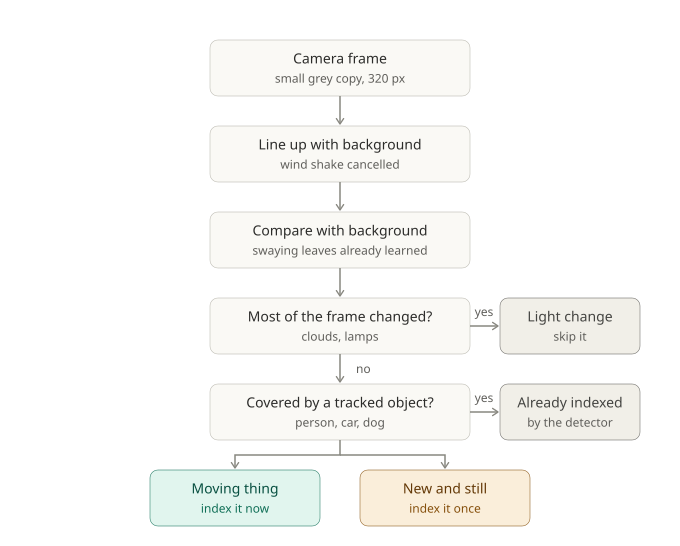
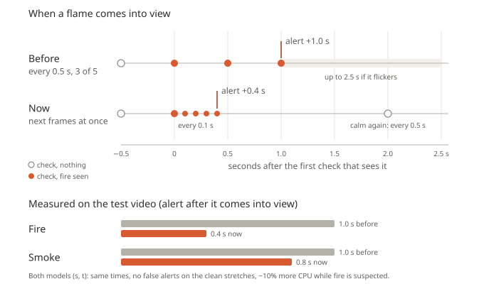
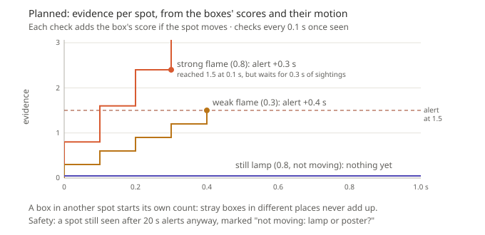
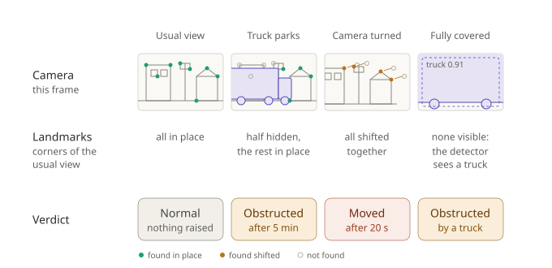

# Histor

*Histor is a Mobius Tensors product.*

*Greek ἵστωρ: "witness, one who knows by having seen". The root of "history".*

Histor records **everything** a camera sees as searchable embeddings, so you can ask about it
later: *"was there a white van at the gate yesterday evening?"*, *"when did someone leave a bag
by the bench?"*.

Histor is about **memory**: store all of it, ask any question later. It also **alerts**: the
same recorder runs the engine's area and line rules live and sends
what they catch to channels such as webhook, email and Telegram (see [Alerts](#alerts)).

## How it works

1. **Record** (one process per camera): detect and track every object (all 80 COCO classes),
   embed each tracked object with CLIP, and every few seconds embed the whole frame plus a 2x2
   grid of tiles, so things the detector has no class for are still searchable. Moving things no
   tracked object covers are embedded as soon as they appear, even if they cross the picture in a
   second (see [Things the detector misses](#things-the-detector-misses)). About once a
   second, each person's body pose (17 keypoints) becomes a few facts: posture, hands up, facing,
   head down, still / walking / running, a bag or suitcase on them, colour of top and trousers.
   Optionally, each vehicle's number plate is read and the camera's microphone listens for
   alarms and breaking glass. Everything goes into one SQLite store per site.
2. **Ask**: a question is split into *what / when / which camera*. The *what* is embedded with
   CLIP's text model and compared with the stored vectors. Matches of the same tracked object
   are merged into one visit.
3. **Chat**: an LLM gets the store as tools (objects, search, alerts, people, plates, face,
   look), runs as many lookups as the question needs, and answers in sentences, listing the
   thumbnails it looked at as evidence. `look` lets a local vision model read those images.
4. **Alert** (optional): rules raise events while recording (see [Alerts](#alerts)).
5. **Report** (optional): hourly, daily or weekly, a summary of what the chosen cameras saw,
   focused on what the owner asked to watch for, saved and sent (see [Reports](#reports)).

The detector, tracker, CLIP encoder, store and search are the engine in `src/histor/engine/`; the product modules sit on top in `src/histor/`. One uv environment,
models in `models/`.

### Things the detector misses

The detector knows 80 classes. Anything else (a cart, a drone, a ladder) is found by change
alone (`engine/motion.py`, `search.motion` in the config). Each frame is first cleaned of what
is not a new thing: camera shake, swaying leaves, light changes, and objects already tracked.



To tell a thing passing from a thing left behind, the frame is compared with two backgrounds:
one that learns in seconds and one that learns in minutes.



Moving things are indexed today. New still items (the amber case) are planned: see
[Next](#next).

## Models and licences

| Role                         | Model                                                                  | Licence                                   |
| ---------------------------- | ---------------------------------------------------------------------- | ----------------------------------------- |
| Objects                      | YOLOX (size per machine: [Installing a site](#installing-a-site))      | Apache-2.0                                |
| Search                       | CLIP ViT-B/32, OpenCLIP LAION-2B                                       | MIT                                       |
| Body pose                    | ViTPose-B, COCO only (RTMPose-t: trials only, research training data) | Apache-2.0                                |
| Fire and smoke               | our own YOLOv9 (`training/`)                                         | ours                                      |
| Faces (opt-in)               | YuNet + SFace                                                          | MIT / Apache-2.0                          |
| Plates (opt-in)              | finder open-image-models YOLOv9-t, reader fast-plate-ocr               | finder: trials only (see [Next](#next)); reader MIT |
| Sounds (opt-in)              | YAMNet                                                                 | Apache-2.0                                |

Chat and vision models: [Chat](#chat). A model ships only if code, weights **and** training data allow commercial use (no AGPL/GPL,
no research-only), it runs on a CPU through ONNX and ports to C++. No PyTorch at run time.

## Private by design

- Runs on the site's own server, cameras on an isolated network: footage never leaves the building.
- The chat model is local by default. A cloud model (Claude) is opt-in and receives text only
  (question, times, cameras, labels, file names), never images; `look` and alert checking always
  run locally.
- Faces are off until the client approves in writing (biometric data); face prints are deleted
  after 7 days. Plates and sounds are off by default; audio is classified in memory, never stored.
- Retention: sightings and events 30 days, recordings 7 days (purged by the API server).

## Quick start

```bash
uv sync
uv run -m histor.engine.download_model yolox_s      # the default detector (CPU sites)
uv run --group export -m histor.engine.export_clip      # CLIP -> models/clip_*.onnx (~600 MB), once
uv run -m histor.engine.download_model plates           # optional: number plates (plates: section)
uv run -m histor.engine.download_model sounds           # optional: sound events (sounds: section)
uv run -m histor.record --source data/vtest.avi --camera street --start-time 2026-09-25T14:00
uv run -m histor.ask "person with a bag on street"
uv run -m histor.ask                            # interactive, empty line quits
```

The models run on the GPU when there is one (`device: auto`).
NVIDIA machine: `uv sync --no-group cpu --group gpu`.

## Test on a laptop

A laptop's webcam is enough to try recording, face search and the chat. Models: YOLOX and the
face models (`uv run -m histor.engine.download_model yolox_nano` and `... faces`; the laptop config
uses nano to stay fluid);
CLIP is optional (without it, everything but search by description works), and so is the pose
model (`uv run --group export -m histor.engine.export_pose`): with it, the live view draws each person's
skeleton and the pose alerts fire (see [Alerts](#alerts)).

```bash
uv run --group ui -m histor.ui        # configs/laptop.yaml, opens http://127.0.0.1:7860
```

It opens on **Today**: the day so far in words, the alerts that need a look (*Mark as seen*),
each camera's activity (strips or a grid), the journal of events, and the chat beside it.
The other pages are in the top bar (*Test bench* appears with the *Developer* switch on):

1. **Cameras**: *Start* (source `0` = the built-in webcam). The live view shows the
   tracked objects, with the counts beside it (faces kept: best 5 per visit). Leave the
   frame and come back: that's a second visit.
2. **Find a person**: upload a photo, or *Use a frame from the live camera*, pick a time range
   (`today`, `last 10 minutes`) and *Search*: likely / possible visits with their best face.
   No LLM needed.
3. **Ask**: the chat, with *Attach photo* for face questions. Needs a chat model (see [Chat](#chat)).

The test store is `data/store/laptop.db` (delete `data/store/laptop*` to start over), separate
from a site's. Video files and camera URLs work as a source too.

## Chat

The model is a switch in `configs/default.yaml` (`chat.model`, entries under `chat.models`).

| Entry              | Runs on                                                                                       | Setup                                                         |
| ------------------ | --------------------------------------------------------------------------------------------- | ------------------------------------------------------------- |
| `local`          | Ollama, CPU (Qwen3 4B, Apache-2.0)                                                            | install[Ollama](https://ollama.com), `ollama pull qwen3:4b`  |
| `qwen3.5-4b`     | Ollama, CPU (Qwen3.5 4B, Apache-2.0, also reads images)                                       | `ollama pull qwen3.5:4b`                                    |
| `granite-3b`     | Ollama, CPU (IBM Granite 4.1 3B, Apache-2.0, smallest)                                        | `ollama pull granite4.1:3b`                                 |
| `gemma4-e4b`     | Ollama, CPU (Gemma 4 E4B, Apache-2.0, also reads images)                                      | `ollama pull gemma4:e4b`                                    |
| `local-large`    | Ollama, ~20 GB RAM or GPU (Qwen3 30B-A3B)                                                     | `ollama pull qwen3:30b-a3b`                                 |
| `qwen3.6-large`  | Ollama, ~32 GB RAM or GPU (Qwen3.6 35B-A3B, Apache-2.0)                                       | `ollama pull qwen3.6:35b`                                   |
| `nemotron-large` | Ollama, ~32 GB RAM or GPU (Nemotron 3.5 Lightning 30B-A3B, OpenMDW 1.1: read before shipping) | `ollama pull nemotron-3.5-lightning`                        |
| `claude`         | Anthropic API (Claude Opus 5.5)                                                               | `uv sync --group claude`, `ANTHROPIC_API_KEY` in `.env` |

The open models after `local` are there to compare on the same questions (see [Next](#next)). The UI's *Ask* tab shows whether
the selected model's server is up and the model downloaded. `note:` in an entry is shown there.

```bash
uv run -m histor.chat                                      # interactive
uv run -m histor.chat "how many cars came in yesterday?"
uv run -m histor.chat --model claude "was there a dog on the lawn this morning?"
```

What the model can look up (all tools take a time range in words or exact ISO `since`/`until`
and a camera; `objects` and `search` also take `with_labels` = "on the same camera at the same
time as"):

| Question                                                                 | Tool call                                                                                                                                   |
| ------------------------------------------------------------------------ | ------------------------------------------------------------------------------------------------------------------------------------------- |
| What happened yesterday 6pm to 9pm?                                      | `objects(when="yesterday 6pm to 9pm")`: everything tracked, in time order, with counts                                                    |
| How many cars came in today?                                             | `objects(labels=["car"], when="today")`: exact, one tracked object = one visit                                                            |
| Anyone with a dog this morning?                                          | `objects(labels=["person"], with_labels=["dog"], when="this morning")`                                                                    |
| A man in a red jacket near a car?                                        | `search(query="man in a red jacket", with_labels=["car"])`: CLIP                                                                          |
| Did any alert go off last night?                                         | `alerts(when="last night")`: what the alert rules fired, exact                                                                            |
| Who entered the yard?                                                    | `alerts(rules=["yard"], types=["enter"])`                                                                                                 |
| Did anyone fall in the warehouse last night?                             | `people(postures=["lying"], when="last night")`: seconds lying per person, exact; also `alerts(types=["down"])`                         |
| A man in a red top and blue jeans this morning?                          | `people(upper_colour="red", lower_colour="blue", when="this morning")`: colours from body keypoints, exact; `search` for anything finer |
| Anyone with their hands up near the till?                                | `people(arms="up", camera="till")`                                                                                                        |
| Was anyone running in the car park?                                      | `people(motion=["running"], camera="car park")`                                                                                           |
| Who came in with a suitcase?                                             | `people(carrying=["suitcase"], when="today")`                                                                                             |
| When did AB 123 CD come in?                                              | `plates(plate="AB 123 CD")`: look-alikes (0/O, 8/B...) and one wrong character forgiven                                                   |
| Which plates came to the gate today?                                     | `plates(when="today", camera="gate")`                                                                                                     |
| How many people were at the counter at 3pm?                              | `objects(...)` or `search(...)` to find the moment, then `look(images=[...], question="How many people?")`                            |
| Did a smoke alarm go off last night?                                     | `alerts(types=["sound"], rules=["smoke_alarm"], when="last night")`                                                                       |
| Was any camera covered or turned?                                        | `alerts(types=["tamper"])`                                                                                                                |
| *(photo attached)* Did this person come to the office between 1 and 4? | `face(photo="photo1", since="... 13:00", until="... 16:00", camera="office")`: likely / possible visits                                   |

"Together" means the same camera and overlapping in time (`within_seconds`, default 15), not
touching in the image.

In the interactive chat, `/model claude` switches model (and starts a new conversation),
`/models` lists them. Tool calls are printed as they happen (`--quiet` hides them).

### Looking for a person from a photo

Needs `faces.enabled: true` (see [Private by design](#private-by-design)), and only finds people on cameras that were recording faces at the time.

```text
you> /photo visitor.jpg
Attached as photo1
you> did this person come to the office between 1 and 4?
  -> face {'photo': 'photo1', 'since': '2026-10-07 13:00', 'until': '2026-10-07 16:00', 'camera': 'office'}
Likely yes: on the office camera from 13:40 to 13:45 (face clearly seen at 13:44, match 0.52).
```

- `/photo a.jpg b.jpg` attaches several photos of the same person (each stored face is
  compared with the best of them); `--face 2` picks a face in a group photo (1 = leftmost).
  One-shot: `uv run -m histor.chat --photo visitor.jpg "did this person come in today?"`.
- The photo never leaves the machine and is not saved: its face print is kept in memory for
  the session, and the model only learns its name (`photo1`), also with a cloud model.
- A photo with a face that is too small, blurred or turned away is refused with the reason.
- Answers are "likely" or "possible" (check the thumbnail). With no match, the model says how
  many faces the checked cameras recorded and whether they can see faces: no match is not proof
  the person was not there.

Ollama entries use `api: ollama`: Ollama's own API, which takes the context size per request
(`num_ctx`, 16384 by default). Through its OpenAI-compatible endpoint Ollama keeps its default
of 4096 tokens and silently cuts longer prompts, so the model loses its instructions and the tool
results. `think: false` turns a thinking model's reasoning off (the vision model behind `look`
and alert checking has it off by default: a yes/no answer in a second, not minutes). Any
OpenAI-compatible server works as `api: openai`: llama.cpp's `llama-server`
(`base_url: http://127.0.0.1:8080/v1`), LM Studio, vLLM, or a hosted one with
`api_key: ${SOME_KEY}`. Add an entry, no code change.

Small local models follow the tool instructions less reliably than large ones: if answers look
wrong, run with tool calls visible and check which lookups it made.

### Other agents (MCP)

`uv run --group mcp -m histor.mcp_server --config configs/default.yaml` serves the same tools over
MCP (stdio) for Claude, ChatGPT or a client's own agent, also from a laptop over SSH; `face` only
with `mcp.face_search` (`mcp:` section).

## Alerts

Off until rules are listed. In `configs/default.yaml`:

```yaml
zones:
  - name: yard                  # area: enter / exit, and dwell after 60 s
    points: [[0.10, 0.55], [0.60, 0.50], [0.65, 0.95], [0.05, 0.95]]
    classes: [person]
    dwell_seconds: 60
  - name: gate_line             # line: cross, with direction in / out
    type: line
    points: [[0.40, 0.30], [0.40, 0.80]]
    classes: [car, truck]
  - name: anywhere_dog          # no points: anywhere in the picture
    classes: [dog]

alerts:
  cooldown_seconds: 0           # store every event; hold messages back per channel instead
  channels:
    - type: webhook
      url: ${ALERT_WEBHOOK_URL}
      cooldown_seconds: 30
    - type: email               # host, sender, to, username, password...
      labels: [person]
      hours: "22:00-06:00"
```

Draw areas and lines in the test bench (**Zones & lines** tab) and paste the YAML. Each
channel filters by `rules`, `events`, `labels`, `hours` and `cooldown_seconds`. Every event goes
into the store with a snapshot, so the chat answers "did any alert go off last night?" from the
full list, whatever the channels sent. Webhook, email and Telegram work today; the same Telegram
bot can also answer questions from allowed chats (`telegram:` section;
only text leaves the site unless snapshots or clips are switched on). WhatsApp, SMS and on-site sirens
are planned.

More event types, each in its own config section and through the same channels:

| Event         | Rule                                                                                               | Section             | Default                      |
| ------------- | -------------------------------------------------------------------------------------------------- | ------------------- | ---------------------------- |
| `crowd`     | the area's name:`max_count` objects inside for `count_seconds` (queues, crowds)                | a zone in`zones:` | —                           |
| `abandoned` | `abandoned_object`: a backpack, handbag or suitcase still and unattended for 60 s                | `abandoned:`      | off                          |
| `tamper`    | `blocked` / `dark` / `blurred` / `moved` / `frozen`: the camera's own picture, for 20 s; `obstructed`: half the view hidden for 5 min (see [Camera tampering](#camera-tampering)) | `tamper:`         | on                           |
| `plate`     | the watchlist entry's name: a listed plate read twice on a vehicle                                 | `plates:`         | off                          |
| `sound`     | `smoke_alarm`, `glass_break`, `gunshot`, `explosion`, `scream`, `car_alarm`, `siren` | `sounds:`         | off                          |

A one-way line (`direction: in`) is a wrong-way alarm. Sounds need ffmpeg and a camera with a
microphone.

Object rules work on the detector's classes. Fire and smoke have their own model (see
[Fire and smoke](#fire-and-smoke)). Other new things to detect (objects a customer names) need a
model trained for them; the rules and channels then apply unchanged.

Body poses add two event types: `down` (rule `person_down`: a person lying for 10 s) and
`hands_up` (both hands above the head for 3 s). Enable them in the `pose:` section
(`alerts: [down]` by default); they reach the same channels and the same `alerts` tool.

### Fire and smoke

Our own YOLOv9 model (see [Models](#models-and-licences)), in its own section, `fire:`. A missed
fire is the costly mistake, so every choice favours catching it early. Install the model with
`uv run -m histor.engine.download_model fire_smoke`; the repo is private, so it needs `HF_TOKEN`.
It adds early warning to certified smoke and heat detectors; it does not replace them.

A box needs no more than a low score (0.25) to count as *seen*. One frame is never enough: a
lamp, a reflection or a headlight's glint can look like a flame for a moment. But nothing waits
either: the model checks a frame every 0.5 s, and **as soon as fire or smoke is seen once, the
next frames are checked at once** (every 0.1 s, about every frame on a CPU) until it is
confirmed or gone. The alert comes when it is seen at least 3 times over at least 0.4 s, on 60%
of the checks since the first sighting. A glint is gone sooner; real flames flicker and smoke
drifts, but both keep being seen.



The faster checks cost ~10% more CPU, and only while fire is suspected; the rest of the time
the model runs twice a second as before. One alert per episode and class (fire, smoke); a new
one once it has been gone for 60 s.

**Next: evidence per spot, from the score and the motion** (planned, to be tuned on real fire
videos first). Each sighting will add its *score* as evidence, so a confident box alerts sooner
than a doubtful one. Sightings will count per *spot* (boxes that overlap from one check to the
next, loosely, as flames change shape and smoke drifts), so stray boxes in different places
never add up. And a spot must *move*: flames flicker and smoke drifts, while a lamp, a poster or
a sunset stays still.



Stillness will delay an alert, never drop it: a fire far away, a slow stream or heavy
compression can make real flames look still, so a still spot that is still seen after 20 s
alerts anyway, marked as possibly a lamp or a poster.

### Camera tampering

The `tamper:` section watches each camera's own picture (no model, ~5 ms every 2 s): covered
(`blocked`), `dark`, `blurred`, `frozen`, turned (`moved`) or partly hidden (`obstructed`).

The hard case is a truck parking in front of the camera: half the picture changes, just as when
the camera is turned. Histor tells them apart by the **landmarks** of the usual view, corners
such as window frames, kerbs and signs (ORB features). If the ones still visible are exactly
where they were, the camera has not moved, whatever covers the rest. If they have all shifted
together, it was turned, even by a small pan. If none can be seen, the detector decides: a
truck filling the picture is an obstruction, not a turned camera.



- **`obstructed`**: something still hides at least half of the usual view for 5 minutes. The
  alert says what, when the detector saw it ("truck"). A crowd walking past changes all the
  time, so it never counts.
- **The usual view is never forgotten**: Histor keeps up to 4 references (day, night or
  infrared, the view before a move), so when the truck drives away the view is known again and
  nothing more is raised.
- **On-screen text** (a clock, the camera's name burnt into the picture) stays in place when
  the camera turns, so it is learned in the first minute and never counts as a landmark.
- **A plain truck side is not a blur**: it has little detail but crisp edges, unlike a lens out
  of focus.
- **Limit**: a sudden plain cover over the whole view, with nothing detected and no partial
  cover before it, looks the same as a turned camera. It raises one alert (`moved` or
  `blurred`), and nothing more when it goes away.

### Alert checking

Optional (`alerts.verify`): before an alert is sent, the local vision model (`qwen3.5:4b`) looks
at its snapshot and a close-up and answers YES, NO or UNSURE. Mode `veto` holds a NO back (still
stored, marked); `tag` sends everything with the verdict, to measure the model at a pilot. A model
that is down or slow never stops an alert, and fire alerts are never held back. Each check costs
seconds on a CPU: check rare, costly events (person down, abandoned bags), not every crossing.

## Reports

Set up at install time with the owner: how often, which cameras, what they care about. In
`configs/default.yaml`:

```yaml
reports:
  - name: morning
    every: daily                # hourly | daily | weekly (day: monday) | monthly (day: 1)
    at: "07:00"                 # the period ends then: yesterday 07:00 to today 07:00
    cameras: [gate, yard]       # names or aliases; empty = every camera
    interests:                  # in the owner's words; empty = what happened + anything unusual
      - vehicles at the gate after hours
      - anyone in the yard at night
    channels:                   # same settings as alerts.channels; none = saved only
      - type: email
        host: smtp.example.com
        sender: histor@example.com
        to: [owner@example.com]
```

```bash
uv run -m histor.report                   # runs the schedules: keep it running next to the recorders
uv run -m histor.report --now morning     # the last period's report now (--no-send: save only)
uv run -m histor.report --list            # saved reports
uv run -m histor.report --show morning    # the latest one
```

Each report has two parts:

- **Counts**, exact, from the store: tracked objects per camera, alerts with their times, and
  any camera that recorded nothing in the period (offline?).
- **Summary**, written by the chat model (`model:`, default `chat.model`): it checks each
  interest with the chat's tools, limited to the report's cameras and period, and says what it
  found or that it found nothing. If the model is down, the report goes out with the counts only
  and says why.

Reports are saved as JSON and Markdown under `data/store/reports/<name>/` (the UI's *Reports* tab
shows them, with the evidence thumbnails, and makes one on demand), then sent: email with up to 4
thumbnails attached, webhook as JSON (`kind: report`, summary, counts, thumbnail paths). A new
schedule starts with the next period; a period that ended while `report.py` was stopped is made
when it starts again (the latest one only).

## Cameras

Cameras are declared under `cameras:` in `configs/default.yaml`. The `recording:` section saves
each camera's main stream and crops from its full-resolution keyframes. For the HTTP API
(`/search`, `/search/face`, `/events`), run `uv run --group server -m histor.engine.server --config configs/default.yaml`.
It also serves the dashboard at `/` (cameras, live alerts with verdicts, search).

Give each camera an `about:` at install time, standing at the camera, so the chat knows what
it looks at (example in `configs/default.yaml`):

| Field                         | What it does                                                                                                                                        |
| ----------------------------- | --------------------------------------------------------------------------------------------------------------------------------------------------- |
| `description`, `location` | the model picks the right camera: "did they reach the office" means the office camera, not the corridor on the way                                  |
| `aliases`                   | other names in questions ("reception" →`lobby`), for the chat and for `ask.py`                                                                 |
| `covers`                    | entrance / exit / passage / room / outdoor / parking: "arrived" vs "passed by"                                                                      |
| `faces`                     | good / poor / none: face search explains a "no" ("the lobby camera can't see faces well"), and tells the installer where to enable`faces.cameras` |
| `hours`                     | normal activity, so "after hours" questions need no extra input                                                                                     |
| `notes`, `zones`          | what is normal ("cleaners at 19:00"), and what each alert area or line means                                                                        |

It goes into the model's instructions as one short line per camera (cut at ~300 characters,
for small local models). Use roles ("manager's office"), not people's names: with a cloud
model, this text is sent too.

## Installing a site

The essentials:

- Cameras on a PoE switch cabled to the server only. The server has two network ports (cameras
  on `10.50.0.0/24` with no gateway, the office LAN on the other) and does not route between them.
  Never port-forward RTSP or the camera pages.
- Cameras: ONVIF + RTSP, H.264; sub stream at 10–15 FPS for detection, main stream with a 1 s
  I-frame interval for recording; smart codec, UPnP and cloud off; time from the server (NTP).
- Ubuntu Server 24.04, CPU only is fine; a surveillance HDD for recordings (~43 GB per 1080p
  camera per day).
- One systemd service per camera (`histor-camera@<name>`), plus the API, reports and the optional
  Telegram bot.
- API and dashboard on `127.0.0.1:8000` with `server.token` set; reach them through an SSH tunnel,
  a VPN or an HTTPS proxy.

| Cameras | Server                                      | Detector                     | Disk (1080p, 7 days) |
| ------- | ------------------------------------------- | ---------------------------- | -------------------- |
| 1–4     | 8 cores, 16 GB RAM (32 with chat + vision) | `yolox_s`                  | 2 TB                 |
| 5–12    | 16 cores, 32 GB RAM                         | `yolox_s` or `yolox_tiny` | 4–6 TB               |
| 12+     | benchmark first; GPU server if needed       | `yolox_m`                  | ~0.3 TB per camera   |

Starting points: run the site's cameras for an hour and watch the CPU before signing off.

## Limits

- Visual search gives ranked guesses: check the evidence frames.
- A long occlusion can split one visit into two.
- Not yet checked on a real site (next: a pilot site): alert checking (a week in `tag` mode),
  person down (staged falls), face thresholds (CCTV), plate read rates, sound false alarms and
  fire on real videos. Validate before promising them.
- Weapons are not offered.

## Cost of "everything"

Everything is sampled: each object every 2 s, each scene every 5 s, nothing under 40 px.
Embedding every class costs more CPU and storage than the people-and-vehicles default of
`configs/engine/search_example.yaml`. A CLIP crop takes ~30 ms on a laptop CPU, and each embedding is one 512-float
row (2 KB). On live cameras the indexer drops jobs instead of slowing detection down, so a busy
scene gets sampled more sparsely rather than lagging. Tune `object_interval_seconds`,
`scene_interval_seconds` and `min_box_height` per site.

## Layout

```text
configs/default.yaml   all COCO classes embedded, store in data/store/histor.db
configs/laptop.yaml    test on a laptop: webcam = camera "laptop", faces on, own store
configs/engine/        engine-only examples (detection, zones, search)
src/histor/
  engine/              detector, tracker, zones, alerts, store, CLIP / faces / pose / plates / sounds,
                       tamper and abandoned rules, search, API
  record.py            recorder (engine/main.py with this config)
  ask.py               question -> ranked sightings (no LLM)
  report.py            hourly / daily / weekly / monthly reports: exact counts + LLM summary, saved and sent
  chat.py              chat CLI: question -> LLM + tools -> answer + evidence
  tools.py             tools the LLM can call: objects, search, alerts, people, plates, face, look
  llm.py               model backends: Ollama, OpenAI-compatible (local) and Claude
  vision.py            the local vision model behind `look` (chat.vision)
  ui.py                test UI (Gradio): record, find a person by photo, chat, reports
  mcp_server.py        the chat's tools over MCP, for other agents
  telegram_bot.py      the chat as a Telegram bot, for allowed chats
docs/images/           diagrams shown in this README
training/              fire and smoke model: runs, results, method
notebooks/             models_tour.ipynb: each model, step by step
models/                .onnx weights (git-ignored)
tests/                 uv run pytest (tests/engine/ for the engine)
tests/smoke/           uv run pytest -m smoke: every entry point with the real models (~1 min)
```

## Next

- [ ] **Urgent: train our own YOLOX plate finder** on Open Images' "Vehicle registration plate"
  boxes (CC BY 4.0) and set `plates.detector.type: yolox`. The current finder's weights were
  trained with a fork of the GPL-3.0 YOLOv9 repo (MIT code): trials only until then.
- [ ] Evals: a fixed set of questions on recorded footage to pick the default chat model
  (`qwen3:4b` today).
- [ ] More alert channels: WhatsApp, SMS, on-site siren / relay.
- [ ] Logins per person (today one shared token per site); the chat in the dashboard.
- [ ] Reports set up from the UI; "what did last night's report say" in the chat.
- [ ] Fire: evidence per spot from the box scores and their motion (see
  [Fire and smoke](#fire-and-smoke)), measured on real fire videos and look-alikes (sunsets,
  lamps, red clothes, headlights) before it ships.
- [ ] Fire: a CLIP score for fires that fill the frame.
- [ ] Tamper and alert checking: let the local vision model confirm a sudden full cover
  ("a truck's side fills the picture") instead of raising `moved`.
- [ ] A smaller COCO-only pose model.
- [ ] Detectors trained per customer (customer-specific objects).
- [ ] Captions per scene (small VLM) stored next to the vectors, for questions CLIP handles badly
  (counting, "what was he doing").
- [ ] Multi-camera timeline: follow one visit across cameras.
- [ ] Search index: new still items (fast + slow background), scenes indexed when they change
  instead of every 5 s, and results showing the matching tile next to the whole frame.

## Open questions

- **Before the first paid site:** how updates reach client servers (signed releases, undo,
  offline sites, what an unpaid site does), and how far to protect our code and models.
- **Pilot offer:** what it costs, how long it lasts, and what result turns it into a sale.
- **Contracts:** the face-search approval form; which countries allow plates and sound; what a
  cloud chat model receives; how to word fire alerts.
