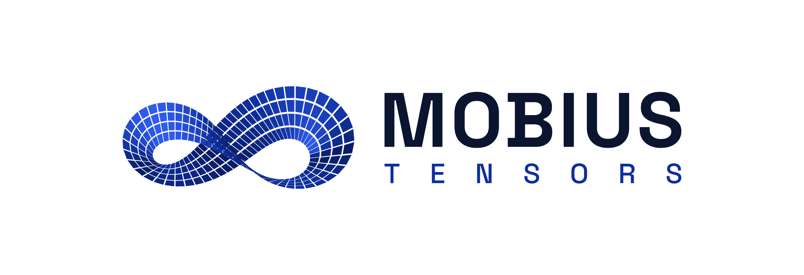

# Mobile App

*Histor is a Mobius Tensors product. Research draft v1, 2026-10-14: nothing here is decided.*

## Short answer

**Must have: live view of the cameras, chat with the system, and notifications and alerts**
(decided 2026-10-14). Live view and chat don't exist on the server today; alerts do, but not as
phone push. So all three are server work first, then screens.

Build it in two steps:

1. **First (about 4–6 weeks): server pieces + the dashboard as an installable web app (PWA).**
   - **Live view:** go2rtc next to the recorders, WebRTC to the phone (section 3).
   - **Chat:** a streaming chat endpoint on the API server, the same model and tools as `chat.py`
     and the Telegram bot (section 4).
   - **Notifications and alerts:** Web Push on new alerts, settings per phone, an alert screen
     (section 2).
   The dashboard already works at phone width (DOCUMENTATION section 27.1); add a manifest and a
   service worker and it installs on the home screen. Phones reach the site over a VPN (Tailscale /
   WireGuard), as section 37 already advises. Everything here is reused by the native app.
2. **Then (about 2–3 months for one developer): a native app** (Expo / React Native): reliable push
   on iPhones, per-person logins, several sites in one app, Face ID unlock, and an App Store / Play
   listing that sales can point to.

The hard parts are not the screens. They are **reaching a server that has no public address**,
**live video to a phone on 4G**, **a chat that is slow on a CPU**, and **sending push without the
alert leaving the site in clear**. Each is below.

## What the app would do

| Feature | Exists on the server today | Needs |
| --- | --- | --- |
| **Live view of every camera** (must have) | **no** | go2rtc + a camera grid (section 3) |
| **Chat with the system** (must have) | `chat.py`, Telegram bot; **no HTTP endpoint** | `POST /chat`, streamed (section 4) |
| **Push notifications on alerts** (must have) | channels in `alerts.py`; no phone push | a push channel + settings per phone (section 2) |
| **Alert feed**: snapshot, what happened, check verdict (must have) | `GET /events`, `/media` | nothing |
| Play the moment (recording, 3 s early) | `/recordings`, `video_url` | nothing: MP4 H.264 plays natively |
| Cameras online / offline, today's counts, tamper | `GET /status` | nothing |
| Search by description, plates | `/search`, `/plates` | nothing |
| Find a person by photo (opt-in) | `POST /search/face` | nothing; careful store privacy labels |
| Per-person login, revoke a lost phone | **no**: one shared token per site | logins per person / per device |
| Several sites in one app (owners, partners) | no | a site list in the app |
| Acknowledge / mark an alert handled | no | one field on `events` + an endpoint |

Telegram already covers "alerts and questions from a phone" (section 17.1). The app is worth it
where Telegram isn't: clients who won't put alerts on a third-party cloud, live view, video, and a
branded product.

## 1. Reaching the site

The Histor server sits on the client's LAN at `127.0.0.1:8000`, with no public address. A phone on
4G has to get there.

| Option | How | Privacy | Work | Verdict |
| --- | --- | --- | --- | --- |
| **VPN app on the phone** (Tailscale, WireGuard) | user installs the VPN app; Histor app uses the site's tailnet / VPN address | end-to-end encrypted; nothing on our side | none in the app | **Step 1.** Fine for B2B: a few phones per site |
| **VPN embedded in the app** | Tailscale's `tsnet` / `libtailscale` inside the app, no separate VPN app (community Flutter / Dart wrappers exist; on iOS it runs in userspace, no VPN entitlement) | same; turn off its log upload | medium; wrappers are young | Step 2 candidate |
| **Reverse proxy + domain + HTTPS** | Caddy on the site, a port forwarded on the client's router | TLS to the site | router access at each site | possible; the docs already allow it with the token set |
| **Cloudflare Tunnel** | outgoing tunnel, no port forward | **TLS ends at Cloudflare**; their terms are against serving video on free plans | small | no: breaks "private by design" |
| **Our own relay** (what Hik-Connect, Scrypted do) | each site keeps an outgoing connection to a Mobius Tensors relay; the app goes through it | only if we encrypt end to end | large; we run a service 24/7 | later, if sites grow |

Self-hosting the coordination server (Headscale, BSD-3) would let us run a Tailscale-compatible
network without depending on Tailscale's company. The app should also switch between the LAN
address (on the site's Wi-Fi) and the remote one, as the Frigate apps do.

## 2. Notifications and alerts (must have)

**What the user gets.** The alerts the site already raises (areas, lines, crowding, abandoned bags,
tampering, person down, watchlist plates, sounds, fire and smoke later), after alert checking
(DOCUMENTATION section 18), so held-back false alarms don't ring the phone.

- **Notification:** title and one line in the same words as email and Telegram (`alert_message`),
  the snapshot as a thumbnail where the client allowed images, and actions: **Watch live**, **Play
  clip**, **Mark handled**.
- **Alert screen:** full snapshot with the box, the check's verdict and reason, the clip from 3 s
  before, a button to the camera's live view, and **"Ask about this alert"**, which opens the chat
  with the alert attached ("where did this person go next?").
- **Settings per phone**, the same filters the channels already have (`rules`, `events`, `labels`,
  `hours`, `cooldown_seconds`): the night guard gets everything 22:00–06:00, the owner only person
  down, fire and tampering. Stored on the server per device, so one filter code serves all.
- **Three levels:** *quiet* (feed only, no sound), *normal*, *urgent* (fire, person down: critical
  alert on iPhone if Apple grants it, below). The site admin sets which event types are urgent.
- **Handled:** one person marks an alert handled (and optionally a note); the others see it, so two
  guards don't run to the same door. Badge count = unhandled alerts.
- **System alerts too:** a camera offline or tampered, disk full, the server not reporting. "The
  server stopped" can only come from outside the site: the push relay (below) notices a site that
  stopped sending its heartbeat.
- **Missed pushes:** push is best effort on both platforms. Opening the app always reloads the feed
  from `GET /events`, so nothing is lost, only late.

**PWA step.** Web Push (VAPID, as Frigate does): the server makes an outgoing HTTPS call to the
browser's push service, like the Telegram channel already does. Payloads are encrypted for the
device by the standard. Limits: on iPhone it works only when the app is **added to the home screen**
(iOS 16.4+), the user must tap a button to allow it, and developers still report subscriptions that
silently stop. Fine on Android.

**Native step.** Apple (APNs) and Google (FCM) accept pushes only from the app's publisher's keys,
so a site server can't send them without holding our Apple key. So we need a small **push relay**
run by Mobius Tensors, Histor's first cloud piece. To keep the alert on site:

- The site sends the relay only *"device X: new alert"* plus a blob encrypted with a key the phone
  got at pairing. The relay never sees the camera, the label or the image.
- On iPhone, a **Notification Service Extension** decrypts the blob before the alert is shown and
  can fetch the snapshot from the site over the VPN (Firefox iOS uses this pattern). It only runs
  for visible alerts, not silent pushes, so a failed decrypt must show a plain "New alert".
- On Android, an FCM data message, decrypted by the app.

**Alerts that must wake someone.** Apple's **Critical Alerts** (sound through silent mode / Focus)
are granted by hand to health, public-safety and home-security apps; apply early, approval can take
weeks or be refused, and each user must opt in. On Android 14+, full-screen alerts are kept for
calling and alarm apps; use a high-priority notification channel instead.

## 3. Live view and recordings

**Live view (must have).** Not in Histor today. Add **go2rtc** (MIT, one Go binary, no
dependencies) next to the recorders:

- It reads each camera's RTSP stream and serves it as **WebRTC** (under a second of delay) to the
  browser or app, **without re-encoding** when the camera sends H.264, so it costs almost no CPU and
  never slows the detectors.
- **Grid:** all cameras on their **sub stream** (low resolution, a few hundred kbit/s each), so a
  grid of 8 works on 4G. Tap a camera → full screen on the **main stream**.
- **Codecs:** H.264 plays everywhere. H.265 over WebRTC plays only in Safari; for H.265 cameras set
  the sub stream to H.264 (most cameras allow it), or go2rtc falls back to MSE / MP4, or transcodes
  (costs CPU: avoid).
- **Through the VPN:** WebRTC goes over the tailnet like any other traffic, no extra ports. go2rtc
  stays on `127.0.0.1`; the Histor API proxies its signalling behind the same login, so there is
  one address and one token.
- **Optional overlay:** boxes and zone lines drawn on top of the video from the tracker's results
  (a small WebSocket of boxes per camera), so the client sees what Histor sees.
- **Audio:** off by default (listening is regulated in many places, DOCUMENTATION section 24).
- **Two-way audio, PTZ:** go2rtc supports some cameras' talk-back; leave for later.

**Recordings.** Already MP4 from the main stream with a `video_url` that opens the moment, 3 s
early. Phones play H.264 natively; H.265 plays on iPhones and most Androids. A timeline per camera
(scroll back through the day) is the natural next screen after live view.

## 4. Chat (must have)

The chat (`chat.py`) already answers in plain language with evidence, and the Telegram bot already
does it from a phone (DOCUMENTATION section 17.1). The app needs the same thing over HTTP:

- **`POST /chat`** on the API server, behind the same login: question (+ optional photo for face
  search) → answer, evidence thumbnails, and links that open the recording at the right moment.
- **Streamed** (Server-Sent Events): on a CPU, Qwen3 4B takes tens of seconds, so the app shows
  each step as it happens (*"searching shop camera, last night… looking at 3 images…"*) and then
  the answer word by word. A silent wait of 30 s feels broken.
- **Conversations per device**, kept on the server, so follow-ups work ("and yesterday?"); *New
  chat* button, like the bot's `/new`. Same 30-minute reset.
- **One question at a time per site** (the CPU runs one model); others wait in line and see it.
- **Tap an answer's evidence** → the snapshot, then the recording; **tap a camera name** → live
  view. This is where the app beats Telegram.
- **Voice:** the phone's own speech-to-text in the keyboard is enough at first; nothing on the
  server.
- Same privacy as the chat today: with the local model nothing leaves the site; with Claude, the
  `about:` text, times and labels go to Anthropic (DOCUMENTATION section 25).

## 5. Logins and pairing

One shared token per site is not enough for an app: a lost phone means changing the token for
everyone. Proposed:

- The site admin opens the dashboard, *Add a phone* → a **QR code** (site address + one-time code,
  valid 10 minutes). The app scans it and gets **its own device token**, which the admin can revoke.
- Face ID / fingerprint to open the app; the token stays in the Keychain / Keystore.
- Roles later: *watch* (alerts, video) vs *admin* (zones, faces, plates).

This also answers the open question "logins per person" for the dashboard.

## 6. Framework (native step)

| | Expo / React Native | Flutter | Native (Swift + Kotlin) |
| --- | --- | --- | --- |
| Language | TypeScript (close to the dashboard's JS) | Dart | two codebases |
| Push, Keychain, biometrics, camera | Expo modules | plugins | built in |
| Notification Service Extension | via config plugin (expo-apple-targets) | Xcode target | built in |
| Embedded Tailscale | native module to write | community packages exist | official libtailscale |
| WebRTC live view | react-native-webrtc | flutter_webrtc | built in |
| Updates without store review | yes (OTA for JS) | no | no |

**Recommendation: Expo**, unless whoever builds it already knows Flutter. A Python team learns
TypeScript faster than Dart, and OTA updates matter when one app talks to many site versions.

## 7. Store requirements and costs

- **Accounts:** Apple Developer $99 a year, Google Play $25 once, under a Mobius Tensors company
  account (needs a D-U-N-S number for an organisation listing).
- **Review needs a working demo:** the app is useless without a site, so Apple's reviewers need a
  reachable demo site with demo footage and a login. Plan a public demo server.
- **Account deletion** (Apple 5.1.1(v)): applies to apps that create accounts. Ours are created by
  the site admin, but a *Remove this phone* button that deletes the device login is cheap insurance.
- **Privacy labels / Data safety:** declare what the app touches (photos for face search, camera
  for QR, notifications). Say that video stays between the phone and the client's server.
- **Licences:** same rule as the models: permissive only (MIT, Apache, BSD). Expo, React Native,
  go2rtc, Headscale, WireGuard, react-native-webrtc all fit.

## 8. What others do

- **Frigate** (open-source NVR): Web Push from the on-site server, HTTPS required, remote access left
  to the user (VPN or reverse proxy). Several unofficial apps (Viewu, CrowsEye, Freegate) add native
  push and switch between home and remote addresses. Proof that "on-site server + phone" works
  without a vendor cloud.
- **Hikvision Hik-Connect, Dahua DMSS:** vendor relay cloud, P2P through it. Easy for users, but the
  video passes through the vendor: the opposite of our pitch.
- **Verkada, Rhombus, Spot AI:** cloud-managed, app talks to their cloud. Same trade-off.

Our angle: *the app talks to your server, not to ours*; only an encrypted "you have an alert" goes
through Mobius Tensors.

## 9. Plan

| Step | What | Rough effort |
| --- | --- | --- |
| 1a | **Live view:** go2rtc as a service, config generated from the site YAML, signalling proxied behind the login, camera grid + full screen in the dashboard | 1–2 weeks |
| 1b | **Chat:** `POST /chat` streamed (SSE), conversations per device, chat screen in the dashboard with evidence and links to live / recordings | 1–2 weeks |
| 1c | PWA: manifest, icons (Histor eye), service worker, install prompt | 2–3 days |
| 1d | **Notifications and alerts:** Web Push channel in `alerts.py` (`WebPushSink`, VAPID keys in `.env`), settings per phone, alert screen with actions, *handled* on `events` | 1–1.5 weeks |
| 1e | Docs: Tailscale on the server and the phones; a walk test on 4G | 1–2 days |
| 2a | Device logins + QR pairing (server + dashboard) | 1 week |
| 2b | Push relay (small service) + encrypted payloads | 1–2 weeks |
| 2c | Expo app: sites, live grid (react-native-webrtc), chat, alert feed, playback, status, search, push, biometrics | 6–8 weeks |
| 2d | Store accounts, demo site, review, Critical Alerts request | 2–4 weeks, in parallel |

Estimates are for one developer and unverified.

## Open questions

- **Who builds it,** and do they know React or Flutter?
- **Is a push relay acceptable?** It is the first service Mobius Tensors runs for Histor in the
  cloud: who hosts it, and what does the contract say?
- **Price:** included in "all modules included" (internal price list), or not?
- **Partners:** should one app show all the sites a partner installs and supports?
- **Tailscale or our own Headscale** for client sites?

## Sources

- iOS Web Push limits: [MagicBell](https://www.magicbell.com/blog/pwa-ios-limitations-safari-support-complete-guide), [webscraft](https://webscraft.org/blog/pwa-pushspovischennya-na-ios-u-2026-scho-realno-pratsyuye)
- Frigate notifications: [Frigate docs](https://docs-dev.frigate.video/configuration/notifications), [Phylax](https://github.com/sfortis/phylax), [Viewu](https://apps.apple.com/ly/app/viewu/id6502717790)
- Critical Alerts: [Apple forums](https://developer.apple.com/forums/thread/792320), [Ajax](https://ajax.systems/critical-alerts), [newly.app](https://newly.app/articles/critical-alerts-entitlement)
- Android full-screen intents: [Google Play](https://support.google.com/googleplay/android-developer/answer/13392821), [AOSP](https://source.android.com/docs/core/permissions/fsi-limits)
- go2rtc: [pkg.go.dev](https://pkg.go.dev/github.com/AlexxIT/go2rtc)
- Embedded Tailscale: [libtailscale (Dart)](https://pub.dev/packages/libtailscale), [tailscale (Dart)](https://pub.dev/packages/tailscale)
- Cloudflare and video: [Cloudflare](https://developers.cloudflare.com/fundamentals/reference/policies-compliances/delivering-videos-with-cloudflare/index.md)
- Account deletion: [Apple 5.1.1(v)](https://developer.apple.com/help/app-review/guideline-reference/5-1-1-account-deletion)
- Notification Service Extension: [Apple](https://developer.apple.com/tutorials/data/documentation/usernotifications/modifying-content-in-newly-delivered-notifications.md), [Firefox iOS](https://github.com/mozilla-mobile/firefox-ios/wiki/Notification-Service-and-Push)
- Expo vs Flutter: [pkgpulse](https://www.pkgpulse.com/guides/react-native-vs-flutter-vs-expo-2026), [newly.app](https://newly.app/compare/expo-vs-flutter)
